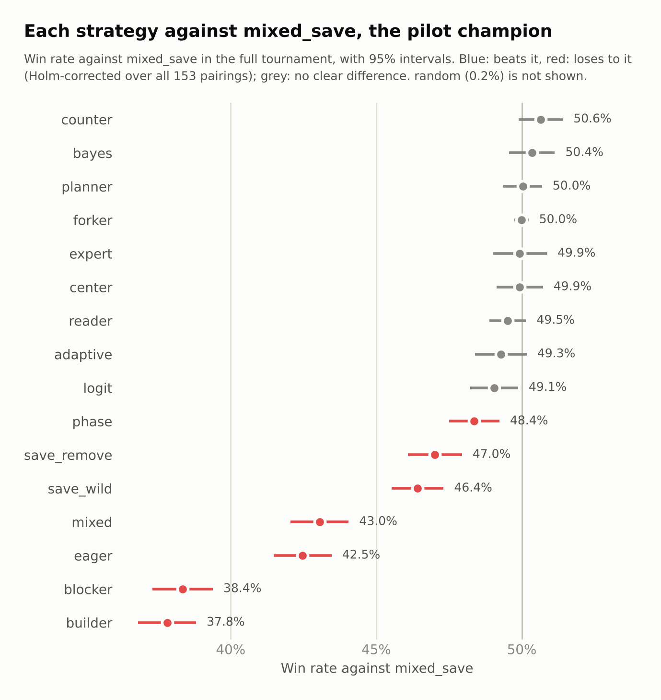
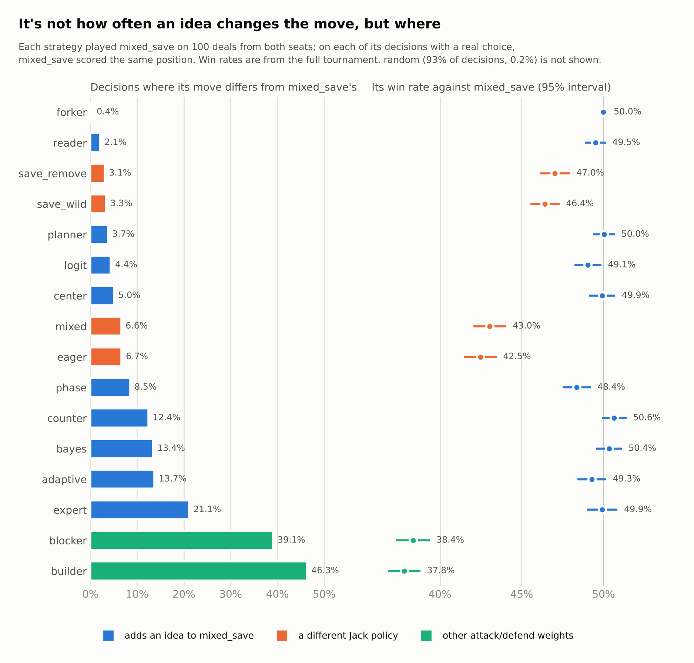
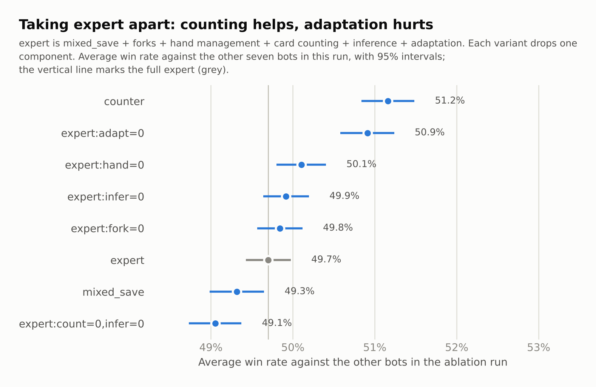
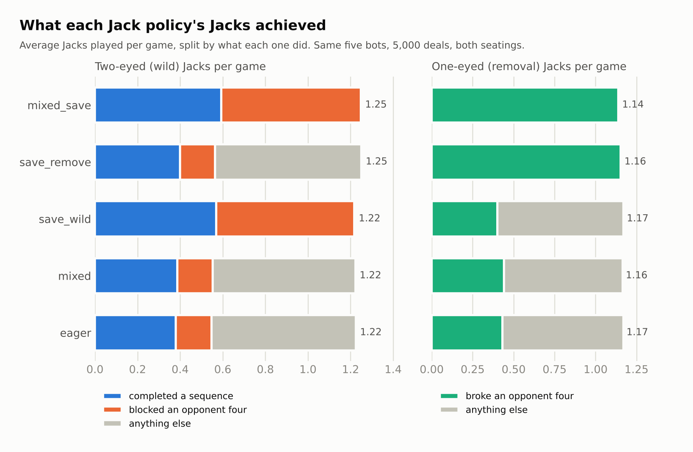
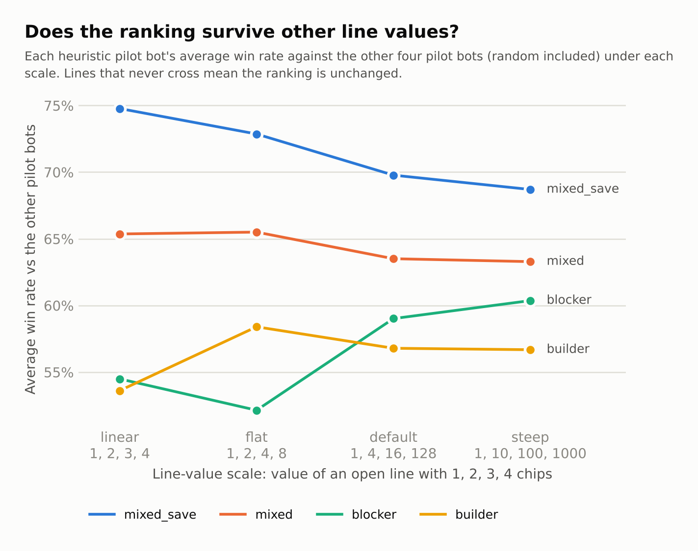

# Findings

This is the write-up of the whole study: 17 experiments and 3,382,200 simulated games of two-player
Sequence between bots with different strategies.

Every number here comes from a generated file in [`results/`](results/README.md):

- each run's `summary.md`, written by `analysis.py`
- the comparisons with the pilot (`comparison.md`)
- the cross-run tables in [`results/README.md`](results/README.md)
- the hunts' logs

`python study.py` regenerates all of them from the game logs in a few minutes, and
`bash run_study.sh` reruns every experiment from scratch.

## Summary

1. **Jack timing is the biggest lever in the game** (section 3).
   - Keeping both kinds of Jack for completing or stopping a sequence is worth about 6 points:
     `mixed_save` beats `mixed` 55.8%–57.0% in three independent runs, and 60.1% under the
     one-sequence rule.
   - The two kinds contribute about equally, and their effects add up.
   - Saved Jacks are nearly always decisive; Jacks played greedily are decisive less than half the time.
2. **Above Jack saving, the game is a plateau** (section 2.4). Ten further ideas built on `mixed_save`
   all land within about a point of it in the 18-strategy tournament. None beats it beyond chance, and
   one (`phase`, build early and defend late) is slightly worse.
3. **What matters is where an idea changes the move, not how often** (section 2.5).
   - The fork bonus changes 0.4% of moves; card counting 12.4%; the combined `expert` 21.1%. None gains
     more than 0.7 points.
   - Greedy Jack play changes only 6.6% of moves and costs 7 points.
4. **Card counting is the equilibrium, by about 0.7 points** (section 2.2).
   - It is the pure equilibrium of the 18-strategy meta-game.
   - It beats `mixed_save` 50.6%, 50.7% and 50.6% in three independent runs.
   - Adding inference about the opponent's hand makes it slightly worse.
5. **Combining ideas doesn't help** (section 2.6). Taking the combined `expert` apart:
   - Card counting is its only useful component.
   - Its adaptive weights cost about a point.
   - Forks, hand management and inference do nothing measurable.
   - Plain card counting beats every combination.
6. **Nothing found beats card counting** (section 7).
   - Two counter-strategy hunts screened 153 candidates.
   - The one improvement they reported (card counting with doubled defence, 51.0% on 4,000 deals) ties
     `counter` 50.0% ± 0.5 in a dedicated rerun.
   - The winner's curse appears at both stages of the hunt.
7. **Lookahead at a modest budget doesn't help** (section 6). Monte Carlo sampling over the hidden
   cards, with 32 playouts per move, wins 46.8% ± 3.4 against the heuristic it is built on.
8. **Sequence is a skill ladder, not rock-paper-scissors** (section 2.3). One rating per strategy explains
   99.4% of the 18 × 18 win-rate matrix, and there are no cycles.
9. **Defend about as much as you attack; noise is cheap until it isn't** (sections 4–5).
   - Defence weights from 0.75 to 2 are within a point of each other.
   - Noisy (logit) choice keeps 49% against greedy play down to λ = 0.3, then collapses to 27%.
10. **The conclusions are robust, with one exception** (section 8).
    - The ranking and the equilibrium survive two replications on fresh deals, four line-value
      scales and the one-sequence rule.
    - Whether pure defence beats pure offence does not survive: it flips with the line values.
11. **Moving first is worth 2 to 5 points** (section 9). The first player wins 52.3% of 918,000 games
    between different bots, and up to 55% when the bots are evenly matched.
12. **The centre wins games; the edges don't** (section 10). In two independent runs every edge square
    is used by strategic winners less than geometry alone predicts.

## The experiments

Every pairing is played in the duplicate format: each deal twice, once with each bot moving first.
Unless marked, each bot also plays mirror matches against itself on twice as many deals.

| run | question | strategies | deals per pairing | games | first seed |
|---|---|---|---|---|---|
| `pilot` | Which of five strategies wins? | 5 | 5,000 | 150,000 | 2026 |
| `full` | Ranking, equilibrium and cycles among all 18 strategies; what each idea adds | 18 | 3,000 | 1,026,000 | 200,000 |
| `jacks` | Which Jack policy is best, and what do the Jacks achieve? | 5 | 5,000 | 150,000 | 300,000 |
| `sweep_defend` | How much should a bot defend? | 9 | 3,000 | 270,000 | 400,000 |
| `sweep_lambda` | How much does noisy choice cost? | 7 | 3,000 | 168,000 | 500,000 |
| `counting` | Is card counting's small edge real? | 3 | 15,000, no mirrors | 90,000 | 700,000 |
| `ablation` | Why doesn't combining ideas help? | 8 | 3,000 | 216,000 | 800,000 |
| `sampler` | Does Monte Carlo lookahead beat the heuristics? | 3 | 300, no mirrors | 1,800 | 600,000 |
| `hunt` | Can anything beat the equilibrium? | searched | 400 to screen, 4,000 to confirm | 73,600 | 900,000 |
| `hunt_wide` | The same, from a wider starting pool | searched | 400 to screen, 4,000 to confirm | 216,800 | 1,500,000 |
| `defence_counting` | Is the wide hunt's find real? | 4 | 10,000, no mirrors | 120,000 | 1,800,000 |
| `replication` | Does the pilot replicate on fresh deals? | 5 | 5,000 | 150,000 | 100,000 |
| `replication2` | And on a second set of fresh deals? | 5 | 5,000 | 150,000 | 5,000,000 |
| `values_linear`, `values_flat`, `values_steep` | Does the ranking survive other line values? | 5 | 5,000 | 450,000 | 2026 |
| `one_sequence` | Does it survive the one-sequence rule? | 5 | 5,000 | 150,000 | 2026 |

The line-value and one-sequence runs reuse the pilot's deals on purpose, so they differ from it only in
the setting being tested. Every other run uses its own block of fresh deals.

## 1. The pilot: five strategies

The pilot played five strategies against each other on 5,000 deals: 150,000 games
([summary](results/pilot/summary.md)).

- **`mixed_save` beats every other bot.** It wins 56.2% against `mixed`, 61.3% against `blocker`,
  62.0% against `builder` and 99.6% against `random` (all ±0.8 or better).
- **The equilibrium is pure `mixed_save`,** in all 500 bootstrap resamples.
- **The game is a skill ladder.** A single rating per bot explains 99.3% of the win-rate matrix, the
  ranking `mixed_save > mixed > blocker > builder > random` is strict, and all 10 pairings differ from
  50% after the Holm correction.


Everything below asks the same questions of a much bigger field, and checks whether the pilot's
answers survive.

## 2. The full tournament: 18 strategies

All 18 fast strategies played each other on 3,000 deals: 6,000 games per pairing, 1,026,000 games in
all ([summary](results/full/summary.md)).


### 2.1 Three tiers


The 18 strategies fall into three tiers.

- **The plateau.** These are the eleven strategies that keep Jacks for completing or stopping a
  sequence: `mixed_save` and the ten ideas built on it. They average 54.6% to 56.5% against the
  field. Only 6 of the 55 pairings among them differ from 50% after the Holm correction. Five of those
  six are `phase` losing narrowly; the sixth is `counter` beating `logit` 51.8%.
- **Partial Jack saving.** `save_remove` (52.7%) and `save_wild` (51.9%) keep only one kind of Jack.
- **No Jack saving.** `mixed` (48.9%) and `eager` (48.3%) don't save Jacks; below them are the
  single-minded `blocker` (44.1%) and `builder` (43.0%), then `random` (0.4%).

The single biggest step in the ranking is Jack saving, not any of the ideas built on top of it.

### 2.2 The equilibrium: card counting, by a hair

The equilibrium of the 18-strategy meta-game is pure `counter` (card counting). It is the best
response to 17 of the 18 bots, itself included; the exception is `adaptive`, whose best response is
`bayes` at 51.5%. But its lead is thin:

- **Edge over `mixed_save`.** `counter` beats `mixed_save` only 50.6% ± 0.8, not significant on its
  own.
- **Bootstrap.** `counter` is in the equilibrium mix in 97% of resamples, but its weight ranges from
  1.9% to 100%. `bayes` (15% of resamples), `forker` (9%), `mixed_save` (6%) and `expert` (6%) sometimes
  share it.
- **Nash averaging.** Every plateau bot scores at least 48.0% against the equilibrium (`counter`):
  `bayes` 49.7%, `forker` 49.5%, `mixed_save` 49.4%.
- **Replicator dynamics.** Starting from an even population, after t = 300 the population is still
  mixed: `counter` 52.0%, `bayes` 19.8%, `forker` 7.7%, `mixed_save` 6.5%, `center` 4.6%, `expert`
  4.0%. Selection between near-equal strategies is slow.

**Is card counting's edge real?** A dedicated run played the top three head to head on 15,000 deals,
90,000 games ([summary](results/counting/summary.md)):

| pairing | win rate | Holm-corrected |
|---|---|---|
| `counter` vs `mixed_save` | 50.7% ± 0.3 | yes |
| `counter` vs `bayes` | 50.3% ± 0.2 | yes |
| `bayes` vs `mixed_save` | 50.2% ± 0.4 | no |

- **Card counting genuinely helps,** by about 0.7 points.
- **The inference on top of it doesn't.** `bayes` assumes an opponent that leaves a four unfinished
  lacked the card, and it is slightly worse than plain counting.

So the equilibrium is right, but the margin is a fraction of a point.

### 2.3 Still a skill ladder

With 18 strategies the meta-game is still almost purely transitive. A rating per bot explains 99.4%
of the win-rate matrix, there are no rock-paper-scissors cycles among the significant results, and
102 of the 153 pairings differ from 50% after the Holm correction. A better strategy beats a weaker
one regardless of who else is in the field.

### 2.4 What each idea adds to `mixed_save`



| idea | strategy | win rate vs `mixed_save` | verdict |
|---|---|---|---|
| card counting | `counter` | 50.6% ± 0.8 | no clear difference |
| counting + inference | `bayes` | 50.4% ± 0.8 | no clear difference |
| hand management | `planner` | 50.0% ± 0.7 | no clear difference |
| fork bonus | `forker` | 50.0% ± 0.2 | no clear difference |
| everything combined | `expert` | 49.9% ± 0.9 | no clear difference |
| centre weight | `center` | 49.9% ± 0.8 | no clear difference |
| reading the opponent | `reader` | 49.5% ± 0.6 | no clear difference |
| defend when behind | `adaptive` | 49.3% ± 0.9 | no clear difference |
| noisy choice (λ = 1) | `logit` | 49.1% ± 0.8 | no clear difference |
| build early, defend late | `phase` | 48.4% ± 0.9 | worse (Holm-corrected) |

None of the ten ideas beats `mixed_save` beyond chance; one (`phase`) is measurably worse. Combining
five of them (`expert`) doesn't help either.

### 2.5 Why the plateau: most ideas rarely change the move

To see why, each strategy played `mixed_save` on 100 deals from both seats. At each of its decisions
with a real choice, `mixed_save` scored the same position; this counts how often the strategy's move
differs from `mixed_save`'s best ([table](results/README.md#how-often-does-each-idea-change-the-move)).



- **Ideas that rarely fire.** The fork bonus changes the move in 0.4% of decisions, so `forker` plays
  almost exactly like `mixed_save`. That is why their pairing has the tightest margin in the matrix
  (±0.2): the two seats of a deal usually play out identically. `reader` changes 2.1% of moves,
  `planner` 3.7% and `center` 5.0%.
- **Ideas that fire often but barely matter.**
  - `counter` changes 12.4% of moves and gains 0.6 points.
  - `adaptive` changes 13.7% and loses 0.7.
  - `expert` changes 21.1% and comes out level.
- **Decisions that matter a lot.** `mixed` differs from `mixed_save` on only 6.6% of decisions: its
  Jack plays. Those decisions cost it 7.0 points (43.0%). Partial saving (`save_wild`, `save_remove`)
  changes about 3% of moves and costs 3–4 points.

**What matters is not how often a strategy deviates but where.** A Jack decision is worth roughly a
point of win rate per percent of decisions changed; the strategic refinements are worth almost
nothing per decision.

### 2.6 Why combining ideas doesn't help

`expert` adds five ideas to `mixed_save`: forks, hand management, card counting, inference and
adaptive weights. A dedicated run removed one component at a time: eight bots on 3,000 deals, 216,000
games ([summary](results/ablation/summary.md)).



| bot | what it is | avg vs the other seven |
|---|---|---|
| `counter` | `mixed_save` + card counting only | 51.2% ± 0.3 |
| `expert:adapt=0` | `expert` without adaptive weights | 50.9% ± 0.3 |
| `expert:hand=0` | without hand management | 50.1% ± 0.3 |
| `expert:infer=0` | without inference | 49.9% ± 0.3 |
| `expert:fork=0` | without forks | 49.8% ± 0.3 |
| `expert` | all five | 49.7% ± 0.3 |
| `mixed_save` | none of them | 49.3% ± 0.3 |
| `expert:count=0,infer=0` | without card counting (and therefore inference) | 49.1% ± 0.3 |

- **Card counting is the one component that pays.** Without it `expert` drops to the bottom (49.1%),
  and that version loses to `counter` 47.7% ± 0.9 (Holm-corrected).
- **Adaptive weights hurt.** Attacking more when ahead and defending more when behind costs about a
  point. Without it `expert` rises from 49.7% to 50.9% and beats `mixed_save` 51.4% ± 0.8
  (Holm-corrected). This points the same way as `adaptive` on its own in the full tournament (49.3%
  against `mixed_save`).
- **Forks, hand management and inference do nothing measurable.** Removing any one of them moves
  `expert` by 0.4 points at most.
- **Plain card counting beats every combination.** `counter` tops this run, and it beats the full
  `expert` 51.2% ± 0.9 head to head.

The extra machinery in `expert` is at best dead weight and, in the case of adaptation, harmful.

## 3. Jack timing

The five Jack policies played each other on 5,000 deals (150,000 games, [summary](results/jacks/summary.md)).
These games also record what every Jack achieved.

| policy | what it does with Jacks | vs `mixed` | avg vs the other policies |
|---|---|---|---|
| `mixed_save` | keeps both kinds for completing or stopping a sequence | 55.8% ± 0.8 | 54.9% ± 0.4 |
| `save_remove` | keeps only one-eyed (removal) Jacks | 53.3% ± 0.7 | 51.2% ± 0.4 |
| `save_wild` | keeps only two-eyed (wild) Jacks | 52.6% ± 0.7 | 50.6% ± 0.4 |
| `mixed` | plays a Jack whenever it scores best | – | 47.3% ± 0.3 |
| `eager` | plays Jacks as soon as it can | 49.2% ± 0.5 | 46.0% ± 0.3 |



- **Saving both kinds is worth about 6 points.** The estimates are consistent across three independent
  runs: `mixed_save` beats `mixed` 56.2% (pilot), 57.0% (full tournament) and 55.8% (here).
- **The two kinds add up.** Saving wild Jacks alone is worth 2.6 points and saving removal Jacks
  alone 3.3. Together that is 5.9 points, close to the 5.8 measured for saving both. Neither kind is
  clearly worth more: `save_remove` vs `save_wild` is 50.4% ± 0.8.
- **Saved Jacks are decisive Jacks.**
  - Of `mixed_save`'s two-eyed Jacks, 47.5% complete a sequence and 52.5% block an opponent four.
    Of `mixed`'s, 31.6% complete one, 13.6% block, and the rest go on ordinary moves.
  - 99.7% of `mixed_save`'s one-eyed Jacks break an opponent four, against 37.9% of `mixed`'s.
- **Playing Jacks early is slightly worse than playing them greedily.** `eager` vs `mixed` is
  49.2% ± 0.5. That clears the Holm correction, but it is under a point.

## 4. How much to defend

`mixed_save` was played with its defence weight varied from 0 to 4; attack stays 1. That is nine
versions on 3,000 deals: 270,000 games ([summary](results/sweep_defend/summary.md)).


| defence weight | avg vs the other weights | vs defence 1 (`mixed_save`) |
|---|---|---|
| 0 | 45.0% ± 0.3 | 44.2% ± 1.0 |
| 0.25 | 50.2% ± 0.3 | 48.9% ± 0.9 |
| 0.5 | 50.8% ± 0.3 | 49.4% ± 0.9 |
| 0.75 | 51.6% ± 0.3 | 50.0% ± 0.8 |
| 1 | 51.6% ± 0.3 | – |
| 1.5 | 51.3% ± 0.3 | 49.1% ± 0.8 |
| 2 | 51.0% ± 0.3 | 49.7% ± 0.9 |
| 3 | 49.8% ± 0.3 | 48.7% ± 1.0 |
| 4 | 48.7% ± 0.3 | 47.2% ± 1.0 |

- **Ignoring the opponent is costly.** With defence 0, the bot loses 44.2% against the default and
  averages 45.0%.
- **The optimum is broad.** Weights from 0.75 to 2 are all within a point of each other. The
  equilibrium of this sweep is 86% defence 0.75, 9% defence 1 and 5% defence 0.5.
- **Over-defending costs slowly.** At defence 4 the bot still wins 47.2% against the default.
- **Defence lengthens games.** The median mirror match grows from 39 plies at defence 0 to 58 at
  defence 4.

The default weight of 1 is already at the optimum.

## 5. Bounded rationality: how much does noise cost?

`logit` picks each move with probability proportional to exp(λ × score): a small λ is nearly random, a
large one nearly greedy. Six values of λ played each other and the greedy `mixed_save` on 3,000 deals:
168,000 games ([summary](results/sweep_lambda/summary.md)).


| λ | vs `mixed_save` (greedy) | avg vs field |
|---|---|---|
| 0.03 | 26.5% ± 1.0 | 29.0% |
| 0.1 | 38.5% ± 1.1 | 43.9% |
| 0.3 | 49.1% ± 1.0 | 54.2% |
| 1 | 49.5% ± 0.8 | 55.5% |
| 3 | 49.8% ± 0.7 | 55.6% |
| 10 | 49.6% ± 0.6 | 55.6% |

- **Down to λ = 0.3, noise is almost free.** The noisy bot still scores 49–50% against the greedy one.
  The scores separate good moves from bad ones by large margins, so modest noise rarely picks a bad
  move.
- **Below λ = 0.3 it collapses quickly:** 38.5% at λ = 0.1, 26.5% at λ = 0.03.
- **The ranking is a perfect ladder:** a rating explains 99.9% of this sweep's matrix.

## 6. Lookahead: does search beat the heuristics?

`sampler` imagines the hidden cards, the way the bridge program GIB does (Ginsberg 2001):

- It takes the top k = 4 moves of its guide, `mixed_save`.
- For each, it deals the unseen cards at random n = 8 times and plays each game out with `mixed_save`
  on both sides.
- It picks the move that won most often.

That is 32 playouts per decision and about a second per game. It played `mixed_save` and `counter` on
300 deals from both seats: 1,800 games, without mirror matches
([summary](results/sampler/summary.md)).

| | vs `mixed_save` | vs `counter` |
|---|---|---|
| `sampler` | 46.8% ± 3.4 | 48.3% ± 3.3 |
| `counter` | 51.7% ± 2.2 | – |

- **At this budget, lookahead doesn't beat its own guide.** `sampler` is 3.2 points below
  `mixed_save`. That isn't beyond chance, but the interval rules out any gain larger than 0.2 points.
- **The estimates are noisy.** With 8 playouts per candidate, each move's estimated win rate has a
  standard error of about 18 points, far larger than the real differences between the guide's top
  moves. So the sampler often swaps the guide's best move for a luckier-looking one.
- **The method also has a known blind spot.** It samples the hidden cards and then plays each sample
  as if all cards were visible ("perfect-information Monte Carlo"), so it can't value information
  (Long et al. 2010). In Sequence the hidden information is the opponent's hand and the deck.
- **More search remains open.** Larger k and n, or a counting rollout policy, is the obvious next step.
  At several seconds per game it needs more computing time than this study used.

## 7. Can anything beat the equilibrium?

The counter-strategy hunt (the double oracle method; McMahan, Gordon & Blum 2003) searches the heuristic
bots' settings for a strategy that beats the current equilibrium. Each iteration:

1. It solves the pool's equilibrium.
2. It screens candidates against it on 400 deals: every one-setting change of the equilibrium's bots,
   plus 24 random settings.
3. It confirms the four best on 4,000 fresh deals.
4. It adds the best to the pool if its 95% interval lies above 50%. Otherwise it stops.

Two hunts were run ([log](results/hunt/hunt_log.md), [wide log](results/hunt_wide/hunt_log.md)):

| hunt | start pool | iterations | candidates screened | games | result |
|---|---|---|---|---|---|
| `hunt` | `counter` | 1 | 52 | 73,600 | nothing beats `counter`: the best finalist confirms at 50.0% |
| `hunt_wide` | `counter`, `bayes`, `forker`, `mixed_save` | 2 | 50 + 51 | 216,800 | adds card counting with doubled defence, confirmed at 51.0% (50.2%–51.8%) against `counter`; nothing beats that |


- **The winner's curse is real.** Screening on 400 deals is noisy (a median 95% margin of ±2.7
  points), and the best-looking candidates shrink on fresh deals.
  - In the first hunt the top screening estimate (counting with centre weight 20) was 52.5%; it
    confirmed at 49.7%.
  - In the wide hunt's second iteration a candidate screened at 52.0% confirmed at 48.9%.
  - Without the confirmation stage, both hunts would have "found" improvements that don't exist.
- **Screening ranks candidates differently on different deals.** The wide hunt's find was a candidate
  in the first hunt too. Its 400 screening deals there put it at 49.6% (in `hunt_log.json`), below the
  four finalists. A hunt is only as sensitive as its screening.
- **The find has an exact twin.** Attack 0.5 with defence 1 ranks every move the same way as attack 1
  with defence 2. Both versions were finalists in the wide hunt and confirmed at exactly the same
  51.0%, because they play the same games.

### 7.1 Testing the hunt's find

The wide hunt's addition was then tested in a dedicated 2 × 2 run. It crossed card counting (no / yes)
with the defence weight (1 / doubled) on 10,000 fresh deals: 120,000 games
([summary](results/defence_counting/summary.md)).

| row vs column | `mixed_save` | `mixed_save:defend=2` | `counter` | counting + doubled defence |
|---|---|---|---|---|
| `mixed_save` | – | 50.5% ± 0.5 | 49.4% ± 0.4 | 49.5% ± 0.5 |
| `mixed_save:defend=2` | 49.5% ± 0.5 | – | 48.9% ± 0.5 | 48.3% ± 0.4 |
| `counter` | 50.6% ± 0.4 | 51.1% ± 0.5 | – | 50.0% ± 0.5 |
| counting + doubled defence | 50.5% ± 0.5 | 51.7% ± 0.4 | 50.0% ± 0.5 | – |

- **The find ties `counter`: 50.0% ± 0.5, not the 51.0% the hunt measured.**
  - The hunt confirmed four finalists, each against an uncorrected 95% interval, and kept the best.
    That best confirmed estimate is still the maximum of four noisy numbers, so it is biased upward:
    the winner's curse at the second stage.
  - The independent rerun removes the bias.
- **Doubling the defence weight doesn't help, with or without counting.** `mixed_save:defend=2` is
  49.5% against `mixed_save`, and doubled defence adds nothing to `counter`. This matches the defence
  sweep (section 4).
- **Card counting's edge shows up a third time:** `counter` beats `mixed_save` 50.6% ± 0.4, after
  50.6% in the full tournament and 50.7% on 15,000 deals.

The search did not find anything better than plain card counting. It did show twice that a hunt's
answer needs an independent replication before it is believed. A stricter confirmation rule would not
have been enough on its own: with a Bonferroni-corrected interval across the four finalists, the
find's lower bound is still 50.02%. Only the rerun on fresh deals showed the tie.

## 8. Robustness

### 8.1 Replications

The pilot was rerun twice on fresh deals: `replication` (seeds from 100,000) and `replication2` (seeds
from 5,000,000), 150,000 games each. Together with the same pairings inside the full tournament, every
pilot pairing has four independent estimates
([table](results/README.md#every-estimate-of-the-pilot-pairings)).

| pairing | pilot | replication | replication2 | full | pooled |
|---|---|---|---|---|---|
| builder vs blocker | 47.3% ±0.8 | **49.3% ±0.8** | 47.8% ±0.8 | 47.4% ±1.1 | 48.0% |
| builder vs mixed | 43.2% ±0.8 | 43.2% ±0.8 | 43.0% ±0.8 | 42.6% ±1.0 | 43.0% |
| builder vs mixed_save | 38.0% ±0.8 | 38.7% ±0.8 | 38.2% ±0.8 | 37.8% ±1.0 | 38.2% |
| blocker vs mixed | 45.6% ±0.8 | **44.2% ±0.8** | 45.8% ±0.8 | 45.8% ±1.0 | 45.3% |
| blocker vs mixed_save | 38.7% ±0.8 | 38.6% ±0.8 | 39.1% ±0.8 | 38.4% ±1.0 | 38.7% |
| mixed vs mixed_save | 43.8% ±0.8 | 44.5% ±0.8 | 44.0% ±0.8 | 43.0% ±1.0 | 43.9% |

- **The conclusions replicate exactly.** All four runs give the same ranking
  (`mixed_save > mixed > blocker > builder > random`) and the same pure `mixed_save` equilibrium.
- **The second replication matches the pilot closely:** its largest difference is 0.5 points.
- **The first replication has two outlying pairings** (bold): `builder` vs `blocker` 2.0 points above
  the pilot (z = 3.3) and `blocker` vs `mixed` 1.4 below. The other three estimates agree with each
  other, so these are a chance fluctuation of that block of deals, not a change in the code.
  - Every one of the 20,000 pilot games in those two pairings was replayed with the current code, and
    all were identical.
  - Inside each run the deals are independent (section 11).

Single estimates of close pairings can be off by up to 2 points, so the study relies on pooled or
dedicated runs for small effects (section 2.2).

### 8.2 Line values

The heuristic bots value an open line by how many chips it has. The pilot used 1, 4, 16, 128 for a
line with 1–4 chips. The same five bots were rerun on the pilot's 5,000 deals with three other
scales ([table](results/README.md#line-values-does-the-ranking-survive)).



| scale | values | ranking | equilibrium | `mixed_save` vs `mixed` | `blocker` vs `builder` |
|---|---|---|---|---|---|
| linear | 1, 2, 3, 4 | mixed_save > mixed > blocker > builder > random | mixed_save | 59.0% ± 0.8 | 50.8% ± 0.9 |
| flat | 1, 2, 4, 8 | mixed_save > mixed > **builder > blocker** > random | mixed_save | 57.4% ± 0.8 | **45.1% ± 0.9** |
| default | 1, 4, 16, 128 | mixed_save > mixed > blocker > builder > random | mixed_save | 56.2% ± 0.8 | 52.7% ± 0.8 |
| steep | 1, 10, 100, 1000 | mixed_save > mixed > blocker > builder > random | mixed_save | 55.2% ± 0.8 | 53.3% ± 0.8 |

- **The main results survive every scale.**
  - `mixed_save` is on top, and the equilibrium is pure `mixed_save`.
  - Saving Jacks is worth 5–9 points: `mixed_save` beats `mixed` 55.2%–59.0%.
  - Balance beats both single-minded bots.
- **Defence vs offence does not survive.** `blocker` beats `builder` under the default (52.7%) and
  steep (53.3%) scales, ties under linear (50.8%), and loses under flat (45.1%). Whether pure defence
  beats pure offence depends on how lines are valued; balance beats both regardless.
- **Flatter scales make games longer:** a median of 58 plies under linear and 53 under flat, against 49
  under default and steep.

### 8.3 The one-sequence rule

Under a common house rule the first sequence wins. The pilot's bots were rerun under it on the same
5,000 deals ([summary](results/one_sequence/summary.md), [comparison](results/one_sequence/comparison.md)).

- **Games are a third shorter:** a median of 31 plies against 49.
- **Jack saving matters even more.** `mixed_save` beats `mixed` 60.1% ± 0.7 (56.2% under two
  sequences), and its average against the field rises from 69.8% to 72.2%.
- **Defence and offence tie:** `blocker` vs `builder` is 50.3% ± 0.8.
- **The equilibrium is still pure `mixed_save`.**

## 9. First-move advantage

Moving first helps in every experiment.

- **Mirror matches.** In the full tournament the first player wins 52.6% (random play) to 55.2%
  (`blocker`) of mirror matches.
- **Pooled.** Across all 918,000 games between different bots it wins 52.3% (52.2%–52.4%).
- **Even matches show it more.** In the sweeps, where every bot is a close variant of `mixed_save`, the
  first player wins 54.2% (defence sweep) and 53.7% (λ sweep). In a lopsided pairing the stronger bot
  usually wins from either seat.
- **Scale.** The edge, 2–5 points, is about the size of the Jack-saving effect. The duplicate format
  cancels it out of every pairing's win rate.


## 10. Which squares win games

In the full tournament the four central squares (2♥ 5♥ 4♥ 3♥, rows 4–5, columns 4–5) are each part
of the winner's sequences in 23.8%–25.3% of decided games, against 5.7% for a corner. They lie on 20
of the 192 lines, the most of any square, so part of this is geometry.


Dividing by each square's share in random-vs-random games separates strategy from geometry:

- **Strategic winners use every edge square less than geometry predicts.** All 32 non-corner edge
  squares have lift below ×1, in the pilot (×0.30 to ×0.69) and again, independently, in the full
  tournament (up to ×0.82). The least-used are edge squares near a corner: 5♦ (8, 9) at ×0.31 and
  6♣ (1, 0) at ×0.36 in the full tournament.
- **The central block is used more.** In both runs, 41 of the 42 squares in rows 2–7, columns 1–7
  have lift of ×1 or more (the exception sits at ×0.99 in the full tournament). The most-lifted square
  is 8♥ (6, 3) in both: ×1.49 in the pilot, ×1.39 in the full tournament.
- **One reading:** under random play, lines through a corner need only four chips and get completed
  by accident. Against a blocking opponent those short edge lines are easy to shut, so strategic wins
  come from the open centre.


## 11. How reliable are these numbers?

- **Margins.** Every margin is a 95% interval computed over paired deals. Inside each run the deals
  are independent: grouping consecutive deals into blocks of 100 gives block-to-block variance 0.95–0.99
  times what independence predicts.
- **Multiple comparisons.** Claims that one bot beats another use the Holm correction over all of a
  run's pairings (153 in the full tournament).
- **Replication.** The rankings and equilibria replicate exactly in two fresh runs. The second
  replication matches the pilot within 0.5 points on every pairing. The first has two pairings off by
  1.4 and 2.0 points, which is unusual but explained by chance (section 8.1). Treat a single estimate
  of a difference under about 2 points with caution unless a dedicated run confirms it (section 2.2).
- **Determinism.** The test suite replays a sample of games from every published log and requires
  identical outcomes. All 20,000 pilot games of the two pairings that moved most in the first
  replication were also replayed in full: none differed.
- **Convergence.** The convergence charts in each run's summary show the headline estimate settling
  as deals accumulate.

## 12. Limitations

- **The strategies, not perfect play.** All the heuristic bots look one move ahead with hand-built
  scores. The results describe this population of strategies (empirical game theory, Wellman 2006),
  not optimal play. The lookahead experiments (section 6) are the only step beyond one ply.
- **One board, two players.** The standard board and the two-player rules; team play with three or
  more players isn't modelled.
- **Rule simplifications.**
  - A dead card is always traded in, one per turn.
  - When the draw pile runs out, the discards are reshuffled (0.2%–4.5% of games, depending on the
    run).
  - A player with no legal move passes (under 1.5% of games).
  - A game is a draw after 500 plies: 26 of the 3,382,200 games, 17 of them `random` against `random`.
- **The equilibria are of these meta-games.** Adding strategies can change the equilibrium, as it did
  between the pilot and the full tournament. The hunts (section 7) search for such strategies but can
  only explore the settings the heuristic bots expose.
- **Square lift is noisier at the edges.** The random-play baseline has 6,000–10,000 decided games per
  run, so lifts for rarely used squares are noisier than the shares.

## 13. Open questions

- **Deeper search.** Does lookahead with a stronger rollout policy, or more of it, open a gap over the
  heuristics (section 6)? `sampler:policy=counter` and larger `k` and `n` are one command away.
- **Opponent modelling that pays.** `reader` and `bayes` model the opponent but barely change play.
  A bot that exploits a specific weak opponent (for example `builder`, which never blocks) could show
  how much exploitation is available.
- **Team play.** Three- and four-player Sequence, with teams, changes blocking incentives entirely.

## Reproducing

```bash
bash run_study.sh    # every experiment (about 3 hours on 2 cores), then python study.py
python study.py      # rebuild every report and figure from the logs in results/ (minutes)
```

[`run_study.sh`](run_study.sh) lists each experiment's exact command; each run's settings are also
saved in its `games_run.json`.

## References

- Balduzzi, D., Tuyls, K., Pérolat, J. & Graepel, T. (2018). Re-evaluating evaluation. *NeurIPS*.
- Ginsberg, M. L. (2001). GIB: Imperfect information in a computationally challenging game.
  *Journal of Artificial Intelligence Research*, 14, 303–358.
- Holm, S. (1979). A simple sequentially rejective multiple test procedure. *Scandinavian Journal of
  Statistics*, 6(2), 65–70.
- Knight, V. & Campbell, J. (2018). Nashpy: A Python library for the computation of Nash equilibria.
  *Journal of Open Source Software*, 3(30), 904.
- Lanctot, M. et al. (2017). A unified game-theoretic approach to multiagent reinforcement learning.
  *NeurIPS*.
- Long, J. R., Sturtevant, N. R., Buro, M. & Furtak, T. (2010). Understanding the success of perfect
  information Monte Carlo sampling in game tree search. *AAAI*.
- McKelvey, R. D. & Palfrey, T. R. (1995). Quantal response equilibria for normal form games.
  *Games and Economic Behavior*, 10(1), 6–38.
- McMahan, H. B., Gordon, G. J. & Blum, A. (2003). Planning in the presence of cost functions
  controlled by an adversary. *ICML*.
- Taylor, P. D. & Jonker, L. B. (1978). Evolutionary stable strategies and game dynamics.
  *Mathematical Biosciences*, 40, 145–156.
- Wellman, M. P. (2006). Methods for empirical game-theoretic analysis. *AAAI*.
