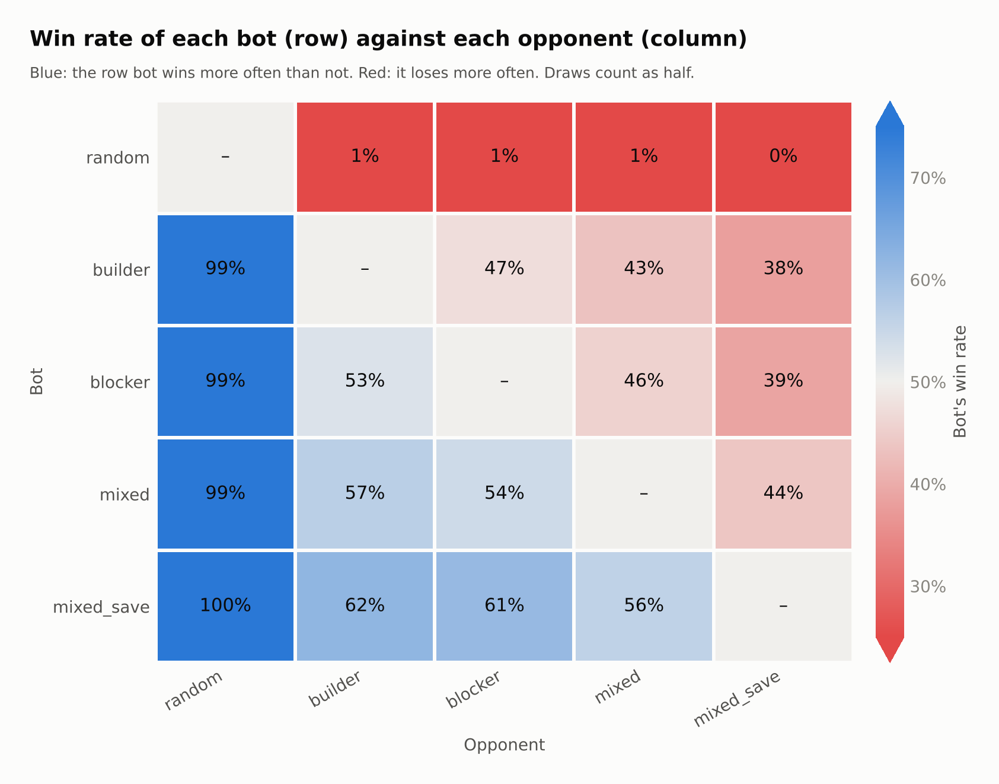
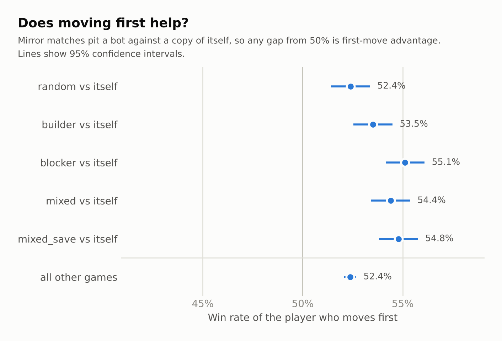
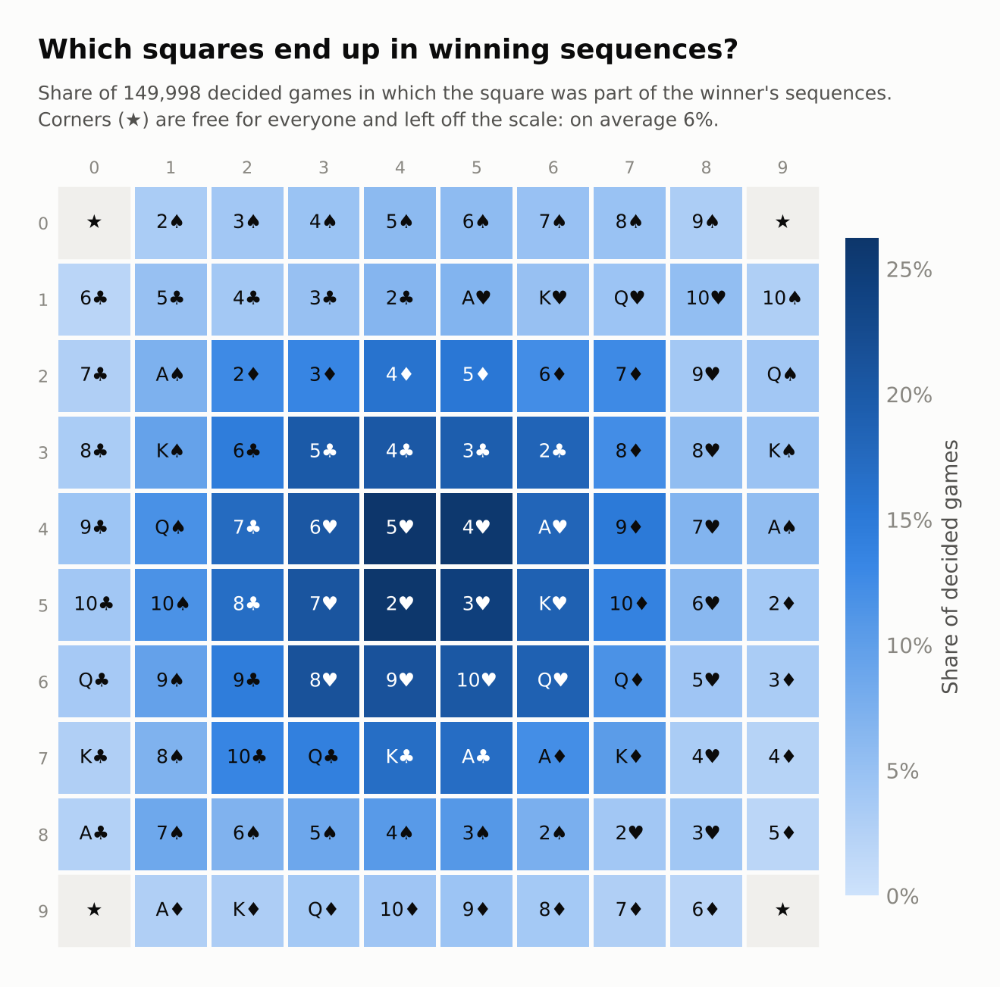
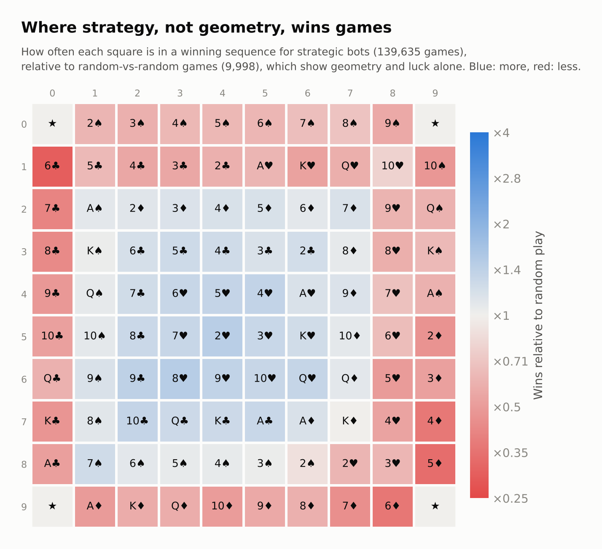
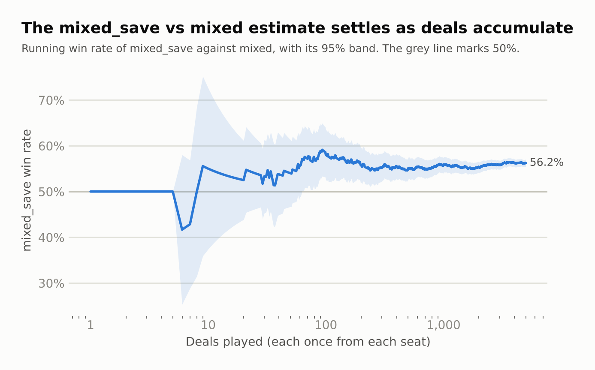

# Findings

These are the results of the **pilot tournament**: five strategies, 150,000 games, stored in
[`results/full_run/`](results/full_run/). Every number comes from the generated report
[`results/full_run/summary.md`](results/full_run/summary.md) or directly from the game log
[`results/full_run/games.csv`](results/full_run/games.csv), and can be regenerated in a few seconds:

```bash
python analysis.py results/full_run/games.csv
```

The other experiments described in the [README](README.md#experiments) (all 18 strategies, the
lookahead bot, the counter-strategy hunt, the sensitivity checks) are implemented and tested but
have not been run at scale yet; [section 10](#10-open-questions-and-next-experiments) lists them.

## Summary

1. **One strategy dominates.** `mixed_save` beats every other bot by a margin well beyond chance: 56.2% against
   `mixed`, 61.3% against `blocker`, 62.0% against `builder` and 99.6% against `random`.
2. **The meta-game has a pure equilibrium.** The Nash equilibrium is 100% `mixed_save`, in every one of
   500 bootstrap resamples. It is the best response to every bot, itself included, and it takes over
   the whole population under replicator dynamics.
3. **Sequence plays like a skill ladder, not rock-paper-scissors.** A single rating per bot explains
   99.3% of the win-rate matrix. The ranking is strict, and there are no cycles:
   `mixed_save > mixed > blocker > builder > random`.
4. **Jack timing matters as much as defence does.** Keeping Jacks for completing or stopping a
   sequence is the only difference between `mixed_save` and `mixed`, and it is worth 6.2 points
   (56.2% ± 0.8). That is about what adding blocking to a pure builder is worth (`mixed` beats
   `builder` 56.8%).
5. **Balance beats specialising.** Pure defence narrowly beats pure offence (`blocker` beats `builder`
   52.7% ± 0.8), but the balanced bot beats both.
6. **Moving first is worth 2 to 5 points.** In mirror matches the first player wins 52.4% (random
   play) to 55.1% (`blocker`) of games.
7. **The centre wins games; the edges don't.** The four central squares appear in about a quarter of all
   winning sequences. Against a random-play baseline, strategic winners use all 32 edge squares less
   than geometry alone predicts.

## 1. What was played

| Strategy | What it does |
|---|---|
| `random` | Plays a random card on a random open space |
| `builder` | Only extends its own lines (attack 1, defend 0) |
| `blocker` | Mostly blocks (attack 0.2, defend 1) |
| `mixed` | Balances building and blocking (attack 1, defend 1), plays Jacks whenever they score best |
| `mixed_save` | `mixed`, but keeps both kinds of Jack for completing or stopping a sequence |

- **Duplicate format.** Each pairing was played on 5,000 deals (seeds 2026–7025), and each deal was
  played twice with the seats swapped, so neither bot benefits from a lucky deal: 10,000 games per
  pairing and 100,000 in all.
- **Mirror matches.** Each bot also played 10,000 games against a copy of itself (seeds 2026–12025),
  which measures the first-move advantage: 50,000 games.
- **Outcome.** 150,000 games, with a median length of 49 plies. There were 2 draws, both `random`
  against `random` hitting the 500-ply cap.
- **Command.** `python tournament.py --roster pilot --deals 5000 --seed 2026 --out results/full_run/games.csv`
  reproduces the schedule exactly. The test suite replays every 500th pilot game and checks that every
  outcome is identical.

## 2. Win rates

Row bot's win rate against the column bot, with the 95% margin computed over paired deals.

| bot \ opponent | random | builder | blocker | mixed | mixed_save | avg vs field |
|---|---|---|---|---|---|---|
| **random** | – | 1.3% ±0.2 | 1.0% ±0.2 | 0.9% ±0.2 | 0.4% ±0.1 | 0.9% |
| **builder** | 98.7% ±0.2 | – | 47.3% ±0.8 | 43.2% ±0.8 | 38.0% ±0.8 | 56.8% |
| **blocker** | 99.0% ±0.2 | 52.7% ±0.8 | – | 45.6% ±0.8 | 38.7% ±0.8 | 59.0% |
| **mixed** | 99.1% ±0.2 | 56.8% ±0.8 | 54.4% ±0.8 | – | 43.8% ±0.8 | 63.5% |
| **mixed_save** | 99.6% ±0.1 | 62.0% ±0.8 | 61.3% ±0.8 | 56.2% ±0.8 | – | 69.8% |



- Any line-based heuristic all but eliminates random play: 98.7% to 99.6%.
- Among the heuristic bots, every bot higher in the table beats every bot below it. All 10 pairings
  differ from 50% after a Holm correction for multiple comparisons.

## 3. The meta-game: equilibrium, best responses, population dynamics

Treat the tournament as a game in which each player secretly picks a bot. The win-rate matrix minus
50% is then a symmetric zero-sum game, solved as a linear program.

| bot | equilibrium weight | bootstrap 95% range | in the mix (share of 500 resamples) |
|---|---|---|---|
| random | 0.0% | 0.0% – 0.0% | 0% |
| builder | 0.0% | 0.0% – 0.0% | 0% |
| blocker | 0.0% | 0.0% – 0.0% | 0% |
| mixed | 0.0% | 0.0% – 0.0% | 0% |
| mixed_save | 100.0% | 100.0% – 100.0% | 100% |

- **Equilibrium.** Pure `mixed_save`, with game value 0.0000 as theory requires. nashpy's solver
  finds the same mix independently.
- **Best responses.** `mixed_save` is the best response to every bot, itself included (50.0%), and it
  beats every other bot after the Holm correction.
- **Replicator dynamics.** Starting from a population split evenly between the five bots,
  `mixed_save` reaches a 100% share by t = 300.

In this field no mixing is needed: one strategy is simply better. Whether that survives richer
strategies is the main open question ([section 10](#10-open-questions-and-next-experiments)).

## 4. A skill ladder, not rock-paper-scissors

The matrix splits into a transitive part (one rating per bot) and a purely cyclic part (Hodge
decomposition, Balduzzi et al. 2018). The rating is the bot's average edge over 50% across all bots,
itself included.

| bot | rating |
|---|---|
| mixed_save | +15.8 points |
| mixed | +10.8 points |
| blocker | +7.2 points |
| builder | +5.4 points |
| random | −39.3 points |

- The ladder explains **99.3%** of the variation in the matrix; only **0.7%** is cyclic.
- There are no rock-paper-scissors triples among the significant results.

## 5. Jack timing

Two-eyed Jacks (J♦, J♣) are wild; one-eyed Jacks (J♠, J♥) remove an opponent chip. `mixed` plays a
Jack whenever it scores best; `mixed_save` holds both kinds until they can complete a sequence or stop
one.

- **Effect.** `mixed_save` beats `mixed` **56.2% ± 0.8**. That is the pilot's clearest single
  improvement, and about as large as the gain from adding blocking to a pure builder.
- **What changes.** Both bots play the same number of two-eyed Jacks per game (1.22), so the gain on the
  wild Jacks comes from *when* they are played. `mixed_save` also spends fewer one-eyed Jacks
  (1.02 against 1.15 per game).

Average per game played:

| bot | two-eyed Jacks | one-eyed Jacks | dead cards traded |
|---|---|---|---|
| random | 1.15 | 1.10 | 0.77 |
| builder | 1.13 | 0.99 | 0.13 |
| blocker | 1.30 | 1.23 | 0.36 |
| mixed | 1.22 | 1.15 | 0.20 |
| mixed_save | 1.22 | 1.02 | 0.25 |

The pilot log predates the columns that record what each Jack achieved (finished a sequence, blocked
a four, broke a four). Rerunning the Jack roster records them (`--roster jacks`, section 10).

## 6. Offence, defence and game length

- **Defence edges out offence.** `blocker` beats `builder` 52.7% ± 0.8.
- **Balance beats both.** `mixed` beats `builder` 56.8% and `blocker` 54.4%.
- **Blocking makes games longer.** Median length of mirror matches, in plies:

| mirror match | median length |
|---|---|
| builder vs itself | 41 |
| mixed vs itself | 49 |
| mixed_save vs itself | 52 |
| blocker vs itself | 55 |
| random vs itself | 80 |

Between different bots, median lengths range from 44 plies (`builder` vs `mixed`, `mixed_save` vs
`random`) to 53 (`blocker` vs `mixed_save`).

## 7. First-move advantage

In a mirror match both seats run the same bot, so any edge for the first player is pure first-move
advantage.

| games | first player wins | 95% range | games played |
|---|---|---|---|
| random vs itself | 52.4% | 51.4% – 53.4% | 10,000 |
| builder vs itself | 53.5% | 52.5% – 54.5% | 10,000 |
| blocker vs itself | 55.1% | 54.1% – 56.1% | 10,000 |
| mixed vs itself | 54.4% | 53.4% – 55.4% | 10,000 |
| mixed_save vs itself | 54.8% | 53.8% – 55.8% | 10,000 |
| all other games | 52.4% | 52.1% – 52.7% | 100,000 |



- Moving first helps in every case.
- Strategic play gains more from it than random play does: the intervals for `blocker`, `mixed` and
  `mixed_save` lie entirely above random's.
- The edge is comparable in size to the gaps between strategies: 4.8 points in the `mixed_save`
  mirror, against the 6.2 points that Jack saving is worth. The duplicate format cancels it out of every
  pairing's win rate.

## 8. Which squares win games

### Where winning sequences lie

Share of the 149,998 decided games in which a square was part of the winner's sequences. The four
corners (free spaces) average 5.8%.

| rank | square | row, col | lines through it | share |
|---|---|---|---|---|
| 1 | 5♥ | 4, 4 | 20 | 26.2% |
| 2 | 2♥ | 5, 4 | 20 | 26.1% |
| 3 | 4♥ | 4, 5 | 20 | 25.8% |
| 4 | 3♥ | 5, 5 | 20 | 24.6% |
| 5 | 8♥ | 6, 3 | 15 | 21.4% |
| 6 | 9♥ | 6, 4 | 17 | 21.2% |
| 7 | 7♥ | 5, 3 | 17 | 20.8% |
| 8 | 6♥ | 4, 3 | 17 | 20.5% |
| 9 | 10♥ | 6, 5 | 17 | 20.3% |
| 10 | 4♣ | 3, 4 | 17 | 20.3% |



The four central squares lie on 20 of the 192 five-in-a-row lines, the most of any square. Part of
their share is therefore geometry.

### Beyond geometry

To separate strategy from geometry, each square's share among strategic bots' wins (139,635 games) is
divided by its share in random-vs-random games (9,998). That baseline shows what geometry and luck
produce on their own. Lift above ×1 means strategy uses the square more than geometry predicts.

|  | square | row, col | lift |
|---|---|---|---|
| most | 8♥ | 6, 3 | ×1.49 |
| most | 2♥ | 5, 4 | ×1.47 |
| most | 9♣ | 6, 2 | ×1.42 |
| most | 9♥ | 6, 4 | ×1.40 |
| most | 4♥ | 4, 5 | ×1.37 |
| least | 7♣ | 2, 0 | ×0.41 |
| least | 4♦ | 7, 9 | ×0.37 |
| least | 6♦ | 9, 8 | ×0.37 |
| least | 5♦ | 8, 9 | ×0.34 |
| least | 6♣ | 1, 0 | ×0.30 |



- **Every one of the 32 non-corner edge squares has lift below ×1** (×0.30 to ×0.69). The five
  least-used squares all sit on the edge within two squares of a corner.
- **The central block (rows 2–7, columns 1–7) is the reverse.** 41 of its 42 squares have lift of ×1
  or more.
- **One reading:** under random play, lines through a corner need only four chips and get completed
  by accident. Against an opponent who blocks, those short edge lines are easy to shut down, so
  strategic wins come from the open centre.

The random baseline has about 10,000 decided games, so lifts for rarely used squares are noisier
than the shares above.

## 9. How reliable are these numbers?

- **Margins.** Margins are computed over paired deals. They are ±0.8 points for pairings between
  heuristic bots, and ±0.1 to ±0.2 points against `random`.
- **Multiple comparisons.** All 10 pairings remain significant after the Holm correction.
- **Equilibrium stability.** The bootstrap redraws every win rate within its margin 500 times and
  re-solves. The equilibrium never changes.
- **Convergence.** The headline estimate (`mixed_save` against `mixed`) is within one point of its
  final value after about 1,000 deals and settles at 56.2% by 5,000.

  

- **Reproducibility.** Every game is determined by its seed. The test suite replays a sample of
  pilot games exactly, and the analysis gives identical output on Python 3.10 and 3.13.

## 10. Open questions and next experiments

Everything below is implemented and covered by the tests; the commands write a CSV that
`python analysis.py <csv>` then analyses. Running times are rough and depend on the machine.

| Question | Command |
|---|---|
| What does each idea (centre, forks, hand management, card counting, inference, adaptation, noisy choice) add on top of `mixed_save`? | `python tournament.py --roster ideas --deals 2000 --out results/ideas/games.csv` |
| Which Jack policy is best, and what do the Jacks achieve? | `python tournament.py --roster jacks --deals 3000 --out results/jacks/games.csv` |
| Does the full field of 18 strategies still have a pure equilibrium? | `python tournament.py --deals 1000 --out results/full/games.csv` |
| Does Monte Carlo lookahead beat the best heuristics? | `python tournament.py --bots mixed_save expert sampler --deals 100 --out results/sampler/games.csv` |
| Can any strategy beat the equilibrium? | `python hunt.py --out results/hunt` |
| How defensive should a bot be? | defence sweep in the README |
| How much does noisy (bounded-rational) choice cost? | λ sweep in the README |
| Does the pilot replicate on fresh deals? | `python tournament.py --roster pilot --deals 5000 --seed 100000 --out results/replication/games.csv`, then `compare_runs.py` |
| Does the ranking depend on the line-value scale? | `--values linear`, `flat` or `steep` with `--roster pilot`, then `compare_runs.py` |
| Does the "first to one sequence" variant change anything? | `python tournament.py --roster pilot --sequences-to-win 1 --deals 2000 --out results/one_sequence/games.csv` |

## 11. Limitations

- **The strategies, not perfect play.** All five bots look one move ahead with hand-built
  heuristics. The results describe this field of strategies (empirical game theory, Wellman 2006),
  not optimal play.
- **One configuration.** The pilot uses one line-value scale (1, 4, 16, 128 for a line with 1–4 chips)
  and the official two-sequence rule. The sensitivity runs are set up but not yet run.
- **Five of 18 strategies.** The other 13 heuristic strategies and the lookahead bot have not been
  run at scale.
- **Rule simplifications.**
  - A dead card is always traded in, one per turn.
  - When the draw pile runs out, the discards are reshuffled (2.2% of pilot games).
  - A player with no legal move passes (0.29% of games, mostly long ones: median 125 plies).
  - A game is a draw after 500 plies (2 games).
- **Two players only.** Team play (three or more players) is not modelled.
- **Noisy baseline.** The square-lift baseline rests on about 10,000 random-vs-random games.

## References

- Balduzzi, D., Tuyls, K., Pérolat, J. & Graepel, T. (2018). Re-evaluating evaluation. *NeurIPS*.
- Ginsberg, M. L. (2001). GIB: Imperfect information in a computationally challenging game.
  *Journal of Artificial Intelligence Research*, 14, 303–358.
- Holm, S. (1979). A simple sequentially rejective multiple test procedure. *Scandinavian Journal of
  Statistics*, 6(2), 65–70.
- Knight, V. & Campbell, J. (2018). Nashpy: A Python library for the computation of Nash equilibria.
  *Journal of Open Source Software*, 3(30), 904.
- Lanctot, M. et al. (2017). A unified game-theoretic approach to multiagent reinforcement learning.
  *NeurIPS*.
- Long, J. R., Sturtevant, N. R., Buro, M. & Furtak, T. (2010). Understanding the success of perfect
  information Monte Carlo sampling in game tree search. *AAAI*.
- McKelvey, R. D. & Palfrey, T. R. (1995). Quantal response equilibria for normal form games.
  *Games and Economic Behavior*, 10(1), 6–38.
- McMahan, H. B., Gordon, G. J. & Blum, A. (2003). Planning in the presence of cost functions
  controlled by an adversary. *ICML*.
- Taylor, P. D. & Jonker, L. B. (1978). Evolutionary stable strategies and game dynamics.
  *Mathematical Biosciences*, 40, 145–156.
- Wellman, M. P. (2006). Methods for empirical game-theoretic analysis. *AAAI*.
