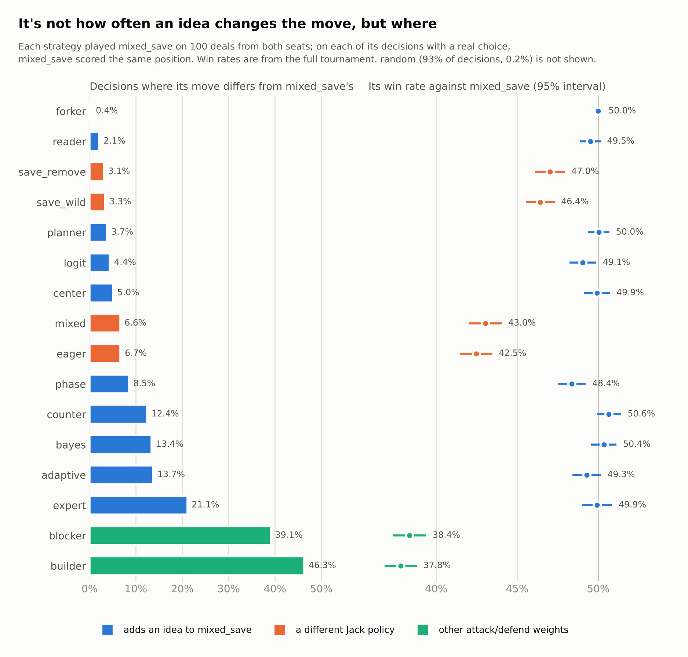

# Sequence: a game-theory tournament

Which strategies win at the board game *Sequence*, and is there a single best one?

Bots with different strategies play millions of simulated two-player games against each other.
Their win rates form the payoff matrix of a "meta-game", which is analysed with game theory:

- Nash equilibria, best responses, dominance and cycles
- skill ladders and replicator dynamics
- the first-move advantage and Jack timing
- which squares win games

Counter-strategy hunts (the double oracle method) test whether the equilibrium survives new
strategies. A Monte Carlo lookahead bot tests whether search beats heuristics.



## Key findings

The study: 17 experiments, 3.4 million simulated games. The full write-up is in
**[FINDINGS.md](FINDINGS.md)**; every table behind it is in [results/README.md](results/README.md).

| Finding | Evidence |
|---|---|
| **Jack timing is the biggest lever.** Keeping Jacks for completing or stopping a sequence beats playing them whenever they score best by about 6 points. | `mixed_save` beats `mixed` 56.2%, 57.0% and 55.8% in three independent runs. Nearly all of its Jacks are decisive, against about 45% of `mixed`'s. |
| **Beyond that, a plateau.** Ten further ideas built on `mixed_save` add at most a point: forks, centre weight, hand management, card counting, inference, three kinds of adaptation, noisy choice, and all combined. | None beats `mixed_save` beyond chance among 18 strategies. Card counting's +0.7 points took a dedicated 90,000-game run to confirm. |
| **Where a strategy deviates matters, not how often.** | Card counting changes 12% of moves for +0.7 points. `mixed`'s 6.6% of different moves, all Jack plays, cost 7 points. |
| **Combining ideas doesn't help.** Taking the combined `expert` apart shows card counting is its only useful part. | Without adaptive weights `expert` gains 1.2 points; without card counting it falls to the bottom; forks, hand management and inference change nothing measurable. |
| **The equilibrium is card counting, and two counter-strategy hunts didn't beat it.** | `counter` is 100% of the 18-strategy equilibrium, and it beats `mixed_save` 50.6%–50.7% in three independent runs. The hunts screened 153 candidates; the one improvement they reported ties `counter` 50.0% ± 0.5 in a dedicated rerun. |
| **The winner's curse is everywhere.** | Hunt candidates screened at 52%–52.5% confirm at 48.9%–49.7%. Even the best of four confirmed finalists (51.0%) shrank to 50.0% on fresh deals. |
| **Search doesn't help at a modest budget.** | Monte Carlo lookahead wins 46.8% ± 3.4 against `mixed_save`. |
| **Sequence is a skill ladder, not rock-paper-scissors.** | One rating per bot explains 99.4% of the 18 × 18 win-rate matrix; there are no cycles. |
| **Defend about as much as you attack, and noise is cheap until it isn't.** | Defence weights 0.75–2 are within a point of each other. Noisy (logit) choice holds 49% against greedy down to λ = 0.3, then collapses to 27%. |
| **Robust, with one exception.** The ranking and the equilibrium survive four line-value scales and the one-sequence rule; whether pure defence beats pure offence does not. | `blocker` vs `builder` swings from 53.3% to 45.1% with the line values. |
| **Moving first is worth 2–5 points.** | The first player wins 52.3% of 918,000 games between different bots, and 52.6%–55.2% of mirror matches. |
| **The centre wins games; the edges don't.** | In two independent runs, all 32 edge squares are used less by strategic winners than geometry predicts. |

## The study at a glance

| Experiment | Question | Games |
|---|---|---|
| [`pilot`](results/pilot/summary.md) | Five strategies: which wins? | 150,000 |
| [`full`](results/full/summary.md) | All 18 strategies: ranking, equilibrium, cycles, what each idea adds | 1,026,000 |
| [`jacks`](results/jacks/summary.md) | Five Jack policies, and what their Jacks achieve | 150,000 |
| [`sweep_defend`](results/sweep_defend/summary.md) | How much should a bot defend? | 270,000 |
| [`sweep_lambda`](results/sweep_lambda/summary.md) | How much does noisy (bounded-rational) choice cost? | 168,000 |
| [`counting`](results/counting/summary.md) | Is card counting's small edge real? | 90,000 |
| [`ablation`](results/ablation/summary.md) | Why doesn't combining ideas help? | 216,000 |
| [`sampler`](results/sampler/summary.md) | Does Monte Carlo lookahead beat the heuristics? | 1,800 |
| [`hunt`](results/hunt/hunt_log.md), [`hunt_wide`](results/hunt_wide/hunt_log.md) | Can any strategy beat the equilibrium? | 290,400 |
| [`defence_counting`](results/defence_counting/summary.md) | Is the hunt's apparent improvement real? | 120,000 |
| [`replication`](results/replication/comparison.md), [`replication2`](results/replication2/comparison.md) | Does the pilot replicate on fresh deals? | 300,000 |
| [`values_*`](results/values_steep/comparison.md) | Does the ranking survive other line values? | 450,000 |
| [`one_sequence`](results/one_sequence/comparison.md) | Does it survive the one-sequence rule? | 150,000 |

## Quick start

You need Python 3.10 or newer. The simulation itself uses only the standard library; the analysis
needs numpy, pandas, matplotlib, scipy and nashpy.

```bash
python -m venv .venv
source .venv/bin/activate              # Windows: .venv\Scripts\activate
pip install -r requirements.txt
```

```bash
python -m unittest -v tests            # 1. run the tests (under a minute)
python board.py                        # 2. print the layout; check it against your real board
python play.py mixed counter --seed 3  # 3. watch one game move by move
python play.py human mixed_save        # 4. play against a bot yourself
python tournament.py --deals 50        # 5. a small tournament of all 18 strategies, to time your machine
python analysis.py results/games.csv   # 6. results/summary.md plus the charts
```

The tests include `test_published_games_reproduce`. It replays a sample of games from every log in
`results/` and checks that every outcome is identical, so you know the published numbers hold for
this version of the code.

## The strategies

Every strategy except `random` and `sampler` looks one move ahead. It scores each legal move on the
192 five-in-a-row lines through its space, as `attack × gain + defend × block` plus optional features,
and plays the best one (details in `scoring.py`). Each new idea is added on top of `mixed_save`, the
pilot's champion, so comparing a strategy with `mixed_save` shows what its idea adds.

| Strategy | Group | What it does |
|---|---|---|
| `random` | Baseline | Plays a random card on a random open space |
| `builder` | Baseline | Only extends its own lines (attack 1, defend 0) |
| `blocker` | Baseline | Mostly blocks (attack 0.2, defend 1) |
| `mixed` | Baseline | Balances both (attack 1, defend 1) |
| `mixed_save` | Jack timing | `mixed`, keeping both kinds of Jack for completing or stopping a sequence |
| `save_wild` | Jack timing | Keeps only two-eyed Jacks that way |
| `save_remove` | Jack timing | Keeps only one-eyed Jacks that way |
| `eager` | Jack timing | Plays Jacks as soon as it can, unless something urgent is on |
| `center` | Position | Extra weight on central spaces |
| `forker` | Tactics | Bonus for moves that leave two or more threats at once; the opponent can block only one |
| `planner` | Hand management | Plays cards whose other space is taken first; avoids spending a card it may need to block with |
| `counter` | Information | Counts unseen cards: blocks only threats the opponent can actually fill, and values lines by whether their spaces can still be filled |
| `bayes` | Information | `counter`, plus inference: if the opponent left a four unfinished, it lacked the card, so the gap is less urgent |
| `adaptive` | Adaptation | Defends more when behind, attacks more when ahead (who is closer to two sequences) |
| `phase` | Adaptation | Builds early, defends late, as the board fills |
| `reader` | Adaptation | Tracks how often the opponent blocks its threats, and defends more against opponents that rarely block |
| `logit` | Bounded rationality | Picks moves at random with probability proportional to exp(λ × score), λ = 1 |
| `expert` | Combined | `mixed_save` + forks + card counting + inference + hand management + adaptive weights |
| `sampler` | Lookahead | Deals the hidden cards at random many times, plays each top move out to the end, picks the most wins |
| `human` | You | `play.py` only |

### Variants without writing code

A strategy name can take settings after a colon; anything not set keeps the preset's value.

| Setting | Values | Meaning |
|---|---|---|
| `attack`, `defend` | numbers | weights on building and blocking |
| `jacks` | `greedy`, `save`, `save_wild`, `save_remove`, `eager` | Jack policy |
| `values` | `linear` (1,2,3,4), `flat` (1,2,4,8), `default` (1,4,16,128), `steep` (1,10,100,1000) | value of a line with 1–4 chips |
| `center` | number | weight on central spaces |
| `fork` | number | bonus per extra threat, in fours' worth |
| `hand` | 0 or 1 | hand management |
| `count`, `infer` | 0 or 1 | card counting; inference (needs count) |
| `adapt`, `phase`, `read` | 0 or 1 | ways of moving the weights (at most one) |
| `lam` | number > 0 | logit choice; small = nearly random, large = nearly greedy |
| sampler: `k`, `n`, `policy`, `plies` | | candidates, deals per candidate, rollout strategy, playout cap |

Examples: `mixed_save:defend=0.5`, `counter:fork=1`, `logit:lam=0.3`,
`mixed:jacks=save,values=steep`, `expert:adapt=0`, `sampler:k=8,n=16,policy=counter`.

## Reproducing the study

Every experiment is one command, and every game is determined by its seed, so the same command
produces the same games on any machine with any number of workers.

```bash
bash run_study.sh       # every experiment in results/ (about 3 hours on 2 cores), then the reports
python study.py         # only rebuild the reports and figures from the logs in results/ (minutes)
```

`run_study.sh` lists each experiment's exact command. To run your own:

```bash
python tournament.py --roster jacks --deals 3000 --out results/my_run/games.csv.gz
python analysis.py results/my_run/games.csv.gz           # summary.md and charts next to the log
python compare_runs.py results/pilot/games.csv.gz results/my_run/games.csv.gz
python hunt.py --pool counter --out results/my_hunt      # counter-strategy hunt
```

- **Rosters.** `--roster pilot | jacks | ideas | full` picks a named group of bots; `--bots` takes any
  list of specs.
- **Run variants.**
  - `--values` changes every heuristic bot's line values.
  - `--sequences-to-win 1` plays the one-sequence rule.
  - `--no-mirror` skips the mirror matches (useful for the slow `sampler`).
- **Compressed logs.** An `--out` path ending in `.gz` writes a compressed log (about 6× smaller). Every
  script reads both kinds.

## Methods

- **Duplicate format.** Each deal is played twice for every pair of bots, once with each bot moving
  first. Margins are computed over deals, which accounts for that pairing.
- **Mirror matches.** Each bot plays a copy of itself; any edge for the first player is the
  first-move advantage.
- **Equilibrium.** The win-rate matrix minus 50% is a symmetric zero-sum game. It is solved as a linear
  program with scipy and cross-checked with nashpy. A bootstrap re-solves it 500 times, and each
  bot's win rate against the equilibrium mix is reported (Nash averaging).
- **Multiple comparisons.** Claims that one bot beats another use a Holm correction over all pairings.
- **Skill ladder vs cycles.** The matrix splits into a rating part (each bot's average edge) and a
  purely cyclic part (Balduzzi et al. 2018); the summary reports each share.
- **Counter-strategy hunt.** The hunt screens many candidates on a few deals, then confirms the best on
  fresh deals. That avoids the winner's curse: the best of many noisy estimates is biased upward.
- **Decision agreement.** To see how often an idea actually changes play, each strategy plays
  `mixed_save`. At each of its decisions, `mixed_save` scores the same position, which counts how
  often the chosen move differs.
- **Empirical game theory.** The strategies are whole bots, and their payoffs are estimated by
  simulation (Wellman 2006). The results describe these strategies, not perfect play.
- **Reproducibility.** Every game is determined by its seed, and the logs are identical however many
  workers you use. `python play.py A B --seed S` replays any game.

References are listed at the end of [FINDINGS.md](FINDINGS.md#references).

## Rules implemented

The official two-player rules:

- Two decks (104 cards), seven cards each.
- Play a card and put a chip on one of its two spaces, then draw.
- Two-eyed Jacks (J♦, J♣) are wild.
- One-eyed Jacks (J♠, J♥) remove an opponent chip that isn't in a completed sequence.
- Corners are free for both players.
- Five in a row is a sequence, and the second may share one space with the first.
- First to two sequences wins.

Simplifications:

- A dead card is always traded in, one per turn. Trading is almost always right, since a dead card
  only becomes playable again if a one-eyed Jack clears one of its spaces.
- When the draw pile runs out, the discards are reshuffled (0.2%–4.5% of games, depending on the
  run).
- A player with no legal move passes. After 500 plies the game is a draw: 26 of the study's
  3.4 million games, most of them random against random.
- Bots see a `PlayerView`: the board, their own hand, the face-up discards and the move history. They
  never see the opponent's hand or the deck.

## Writing your own bot

A bot is any object with a `name` and `choose(view, player, moves, rng)` returning one of `moves`.

- Use `rng` for randomness, so games replay exactly.
- Keep per-game memory in `view.notes`, because one bot object plays many games.
- `view` offers `board`, `real`, `live`, `sequences`, `hand`, `opponent_hand_size`, `discards`,
  `history`, `unseen_counts()`, `threat_gaps(p)`, `open_four(p, line)`, `determinize(rng)` and more
  (see `PlayerView` in `game.py`).
- Register the bot in `make_bot()` in `bots.py` to use it by name.

## Repository layout

```
.
├── board.py            Board layout, cards, and the 192 five-in-a-row lines
├── game.py             Rules engine, the player view bots see, cloning and re-dealing for lookahead
├── scoring.py          How heuristic bots value moves: line values, counting, inference, forks, adaptation
├── bots.py             The strategies, presets, rosters, and make_bot()
├── sampler.py          The Monte Carlo lookahead bot
├── tournament.py       Round-robin tournament, in parallel, one CSV row per game
├── analysis.py         Game-theory analysis of one run: summary.md and charts
├── compare_runs.py     Two runs side by side (replication, sensitivity)
├── hunt.py             Counter-strategy search (double oracle)
├── study.py            Rebuilds every report, comparison and cross-run figure from results/
├── play.py             Watch a game, replay one by its seed, or play yourself
├── tests.py            Rules, views, every strategy, the scripts, and replays of the published games
├── run_study.sh        The exact command for every experiment in results/
├── FINDINGS.md         The write-up: every result and what it means
├── figures/            Cross-run figures used in FINDINGS.md (made by study.py)
└── results/            One folder per experiment; results/README.md indexes them
    └── <run>/
        ├── games.csv.gz        one row per game (compressed CSV)
        ├── games_run.json      the run's settings and command
        ├── summary.md          the report analysis.py writes
        ├── comparison.md       comparison with the pilot (replications and variants)
        └── *.png               the run's charts
```

## CSV columns

| Column | Meaning |
|---|---|
| `game_id`, `seed` | game number and the deal's seed |
| `seat0`, `seat1` | the two bots; seat 0 moves first |
| `mirror` | 1 if a bot plays a copy of itself |
| `winner_seat`, `winner` | 0, 1 or −1 for a draw, and the winning bot |
| `turns` | game length in plies |
| `seqs0`, `seqs1` | completed sequences as cell numbers, e.g. `41-42-43-44-45;...`, where cell = row × 10 + column |
| `two_eyed0/1`, `one_eyed0/1` | Jacks played per seat |
| `dead_swaps0/1`, `passes0/1` | dead cards traded and passes per seat |
| `reshuffles` | times the discards were reshuffled into a new draw pile |
| `jack_finish0/1` | two-eyed Jacks that completed a sequence |
| `jack_block0/1` | two-eyed Jacks placed in the gap of an opponent four |
| `jack_break0/1` | one-eyed Jacks that broke an opponent four |

The pilot log predates the last six columns.

## License

[MIT](LICENSE).

*Sequence* is a trademark of its respective owner. This is an independent research project, not
affiliated with or endorsed by the game's publisher.
