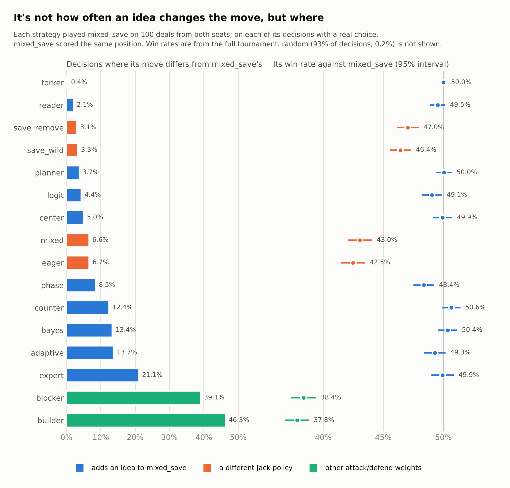
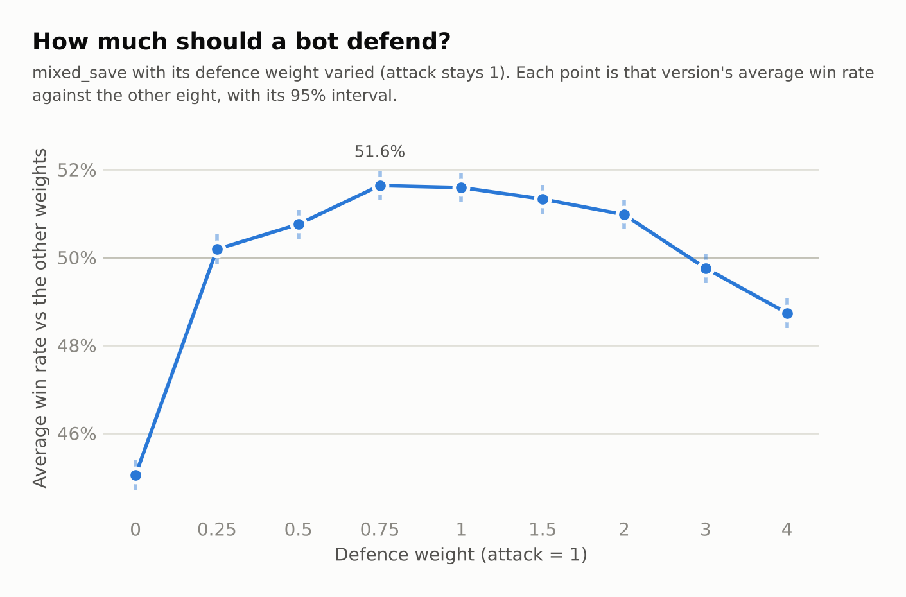
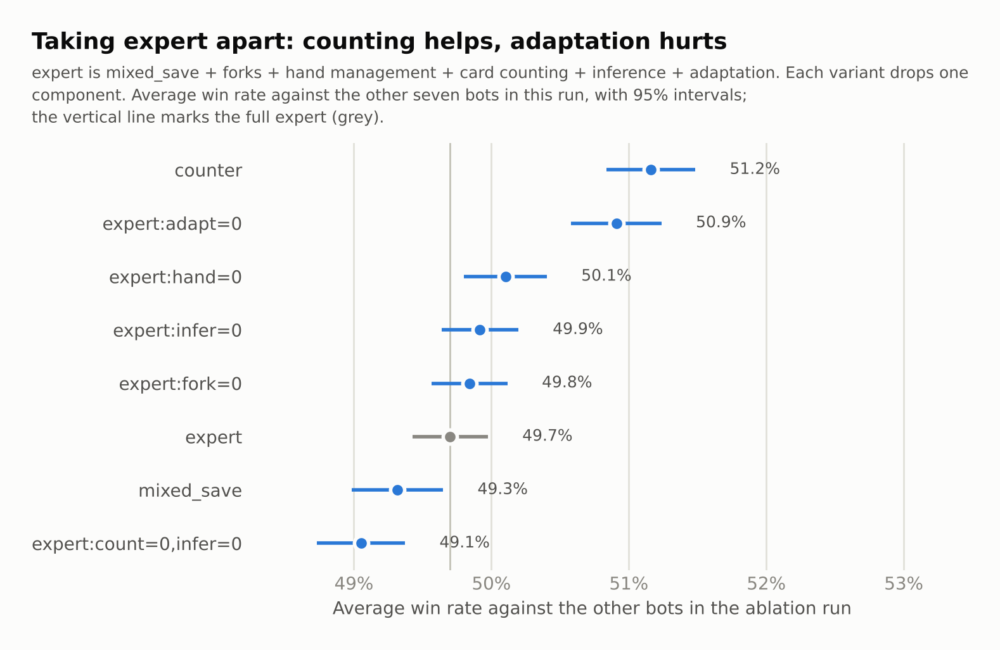
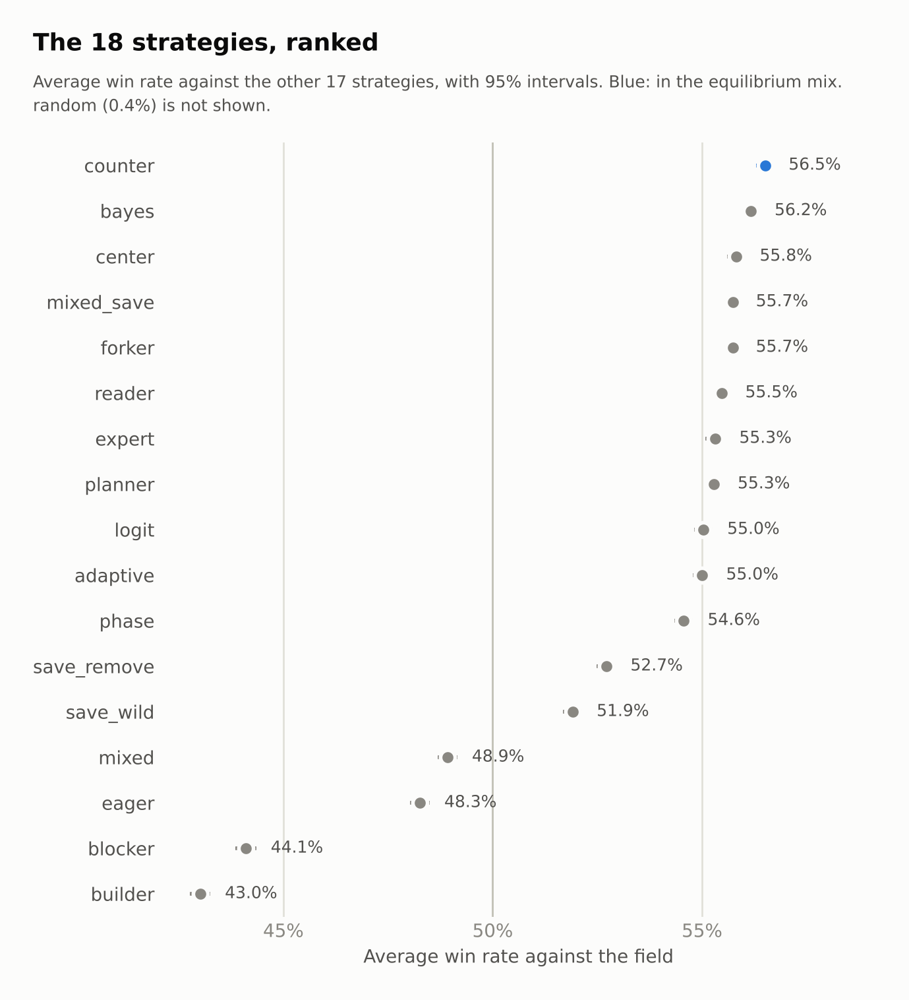
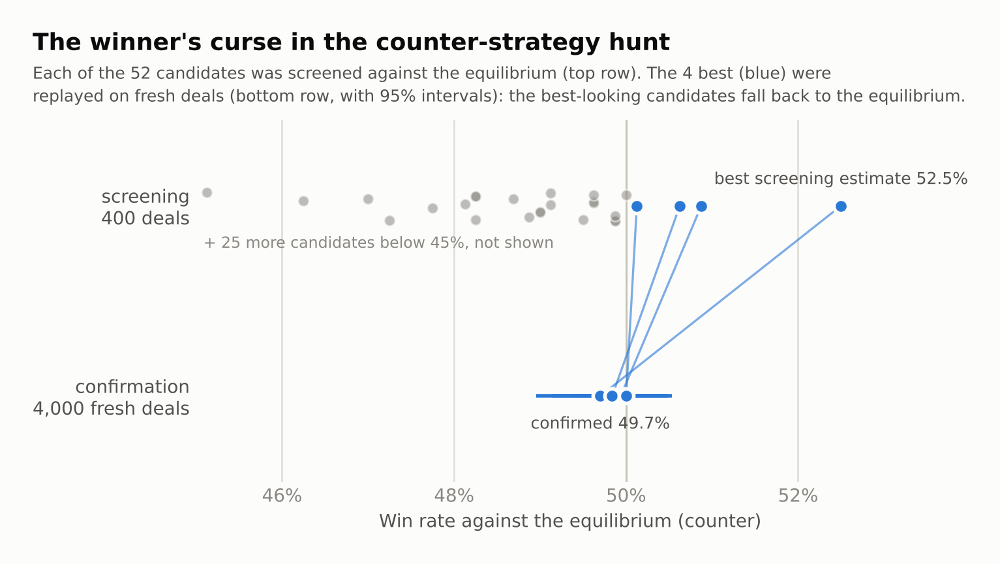
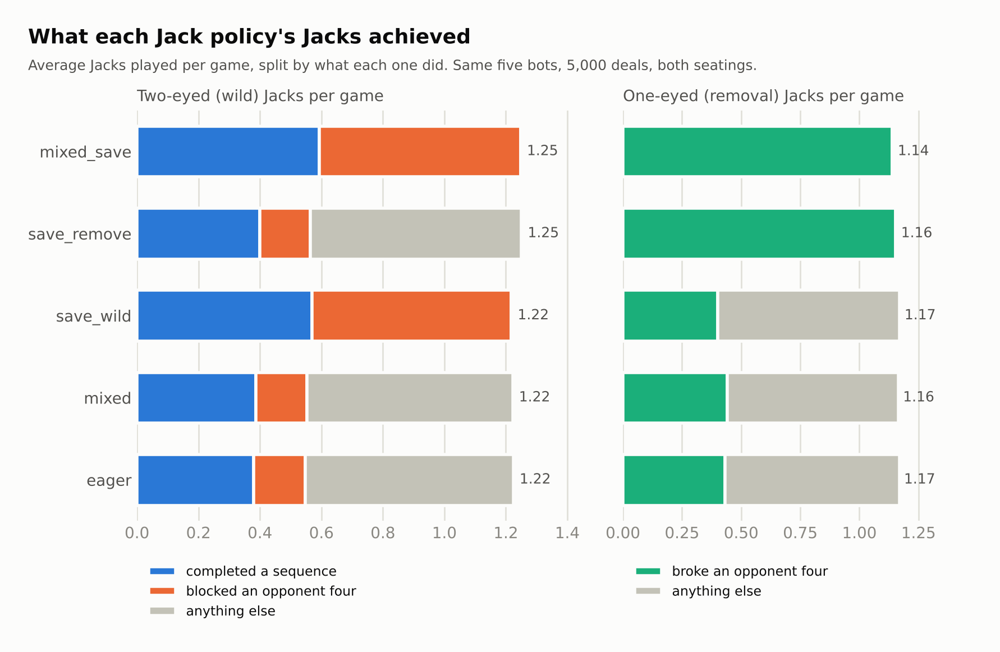
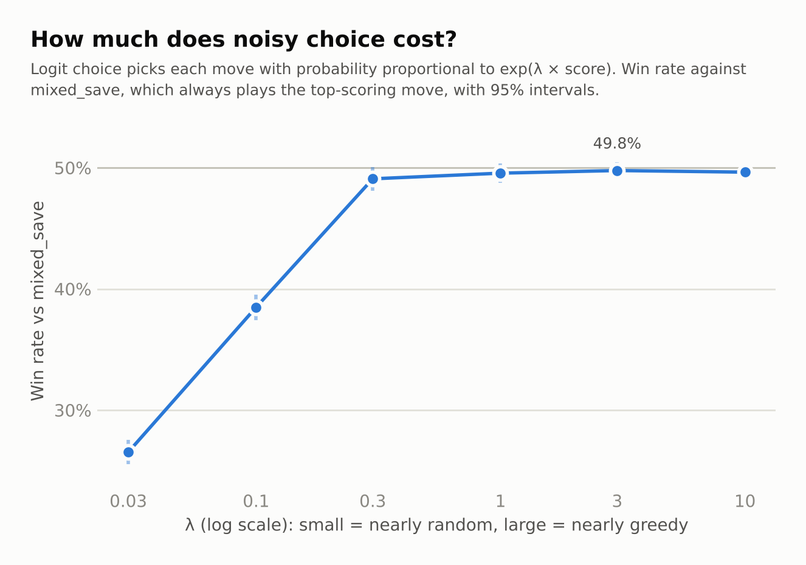
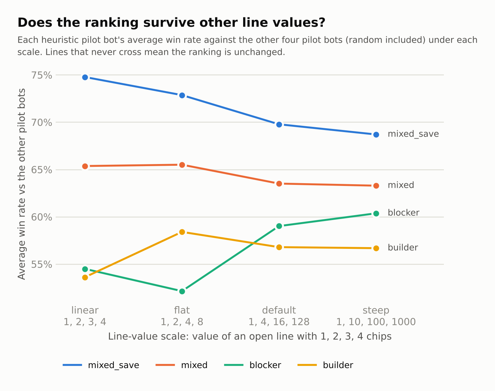
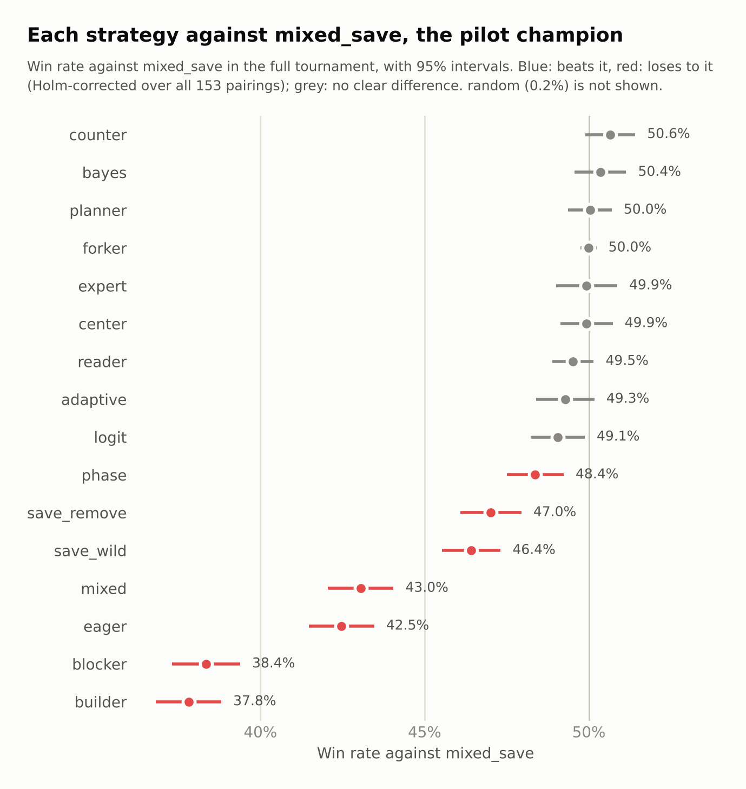

# Results

Every folder holds one experiment: its game log (`games.csv.gz`, one row per game), its settings (`games_run.json`), the report `analysis.py` writes (`summary.md`) and its charts. This page and the figures in `figures/` are generated by `python study.py`; the interpretation is in [FINDINGS.md](../FINDINGS.md).

| run | what it tests | games | deals | first seed | line values | sequences to win | reports |
|---|---|---|---|---|---|---|---|
| `pilot` | The five pilot strategies, 5,000 deals | 150,000 | 5000 | 2026 | default | 2 | [summary](pilot/summary.md) |
| `full` | All 18 fast strategies | 1,026,000 | 3000 | 200000 | default | 2 | [summary](full/summary.md) |
| `replication` | The pilot again, on 5,000 fresh deals | 150,000 | 5000 | 100000 | default | 2 | [summary](replication/summary.md), [vs pilot](replication/comparison.md) |
| `replication2` | The pilot a third time, on another 5,000 fresh deals | 150,000 | 5000 | 5000000 | default | 2 | [summary](replication2/summary.md), [vs pilot](replication2/comparison.md) |
| `values_linear` | The pilot with linear line values (1, 2, 3, 4) | 150,000 | 5000 | 2026 | linear | 2 | [summary](values_linear/summary.md), [vs pilot](values_linear/comparison.md) |
| `values_flat` | The pilot with flat line values (1, 2, 4, 8) | 150,000 | 5000 | 2026 | flat | 2 | [summary](values_flat/summary.md), [vs pilot](values_flat/comparison.md) |
| `values_steep` | The pilot with steep line values (1, 10, 100, 1000) | 150,000 | 5000 | 2026 | steep | 2 | [summary](values_steep/summary.md), [vs pilot](values_steep/comparison.md) |
| `one_sequence` | The pilot under the rule variant: first to one sequence wins | 150,000 | 5000 | 2026 | default | 1 | [summary](one_sequence/summary.md), [vs pilot](one_sequence/comparison.md) |
| `jacks` | The five Jack-timing policies | 150,000 | 5000 | 300000 | default | 2 | [summary](jacks/summary.md) |
| `sweep_defend` | mixed_save with defence weights from 0 to 4 | 270,000 | 3000 | 400000 | default | 2 | [summary](sweep_defend/summary.md) |
| `sweep_lambda` | Logit (noisy) choice with lambda from 0.03 to 10, and mixed_save | 168,000 | 3000 | 500000 | default | 2 | [summary](sweep_lambda/summary.md) |
| `counting` | Head to head at 15,000 deals: is card counting's edge real? | 90,000 | 15000 | 700000 | default | 2 | [summary](counting/summary.md) |
| `defence_counting` | Card counting x doubled defence, head to head at 10,000 deals | 120,000 | 10000 | 1800000 | default | 2 | [summary](defence_counting/summary.md) |
| `ablation` | expert with one component removed at a time | 216,000 | 3000 | 800000 | default | 2 | [summary](ablation/summary.md) |
| `sampler` | Monte Carlo lookahead against the strongest heuristic bots | 1,800 | 300 | 600000 | default | 2 | [summary](sampler/summary.md) |
| `hunt` | Counter-strategy hunt (double oracle) from the full tournament's equilibrium | 73,600 | – | – | – | – | [log](hunt/hunt_log.md) |
| `hunt_wide` | Counter-strategy hunt from a wider starting pool | 216,800 | – | – | – | – | [log](hunt_wide/hunt_log.md) |

## Full tournament: all 18 strategies

Ranking by average win rate against the other 17 bots. The equilibrium of the meta-game is counter 100%. A rating per bot explains 99.4% of the matrix. 102 of 153 pairings differ from 50% after the Holm correction.

| bot | avg vs field (95%) | vs mixed_save | rating (points) | equilibrium weight | vs the equilibrium mix |
|---|---|---|---|---|---|
| counter | 56.5% ±0.2 | 50.6% ±0.8 | +6.1 | 100.0% | 50.0% |
| bayes | 56.2% ±0.2 | 50.4% ±0.8 | +5.8 | 0.0% | 49.7% |
| center | 55.8% ±0.2 | 49.9% ±0.8 | +5.5 | 0.0% | 49.1% |
| mixed_save | 55.7% ±0.2 | – | +5.4 | 0.0% | 49.4% |
| forker | 55.7% ±0.2 | 50.0% ±0.2 | +5.4 | 0.0% | 49.5% |
| reader | 55.5% ±0.2 | 49.5% ±0.6 | +5.2 | 0.0% | 49.1% |
| expert | 55.3% ±0.2 | 49.9% ±0.9 | +5.0 | 0.0% | 49.2% |
| planner | 55.3% ±0.2 | 50.0% ±0.7 | +5.0 | 0.0% | 48.9% |
| logit | 55.0% ±0.2 | 49.1% ±0.8 | +4.8 | 0.0% | 48.2% |
| adaptive | 55.0% ±0.2 | 49.3% ±0.9 | +4.7 | 0.0% | 48.5% |
| phase | 54.6% ±0.2 | 48.4% ±0.9 (significant) | +4.3 | 0.0% | 48.0% |
| save_remove | 52.7% ±0.2 | 47.0% ±0.9 (significant) | +2.6 | 0.0% | 46.4% |
| save_wild | 51.9% ±0.2 | 46.4% ±0.9 (significant) | +1.8 | 0.0% | 45.1% |
| mixed | 48.9% ±0.2 | 43.0% ±1.0 (significant) | -1.0 | 0.0% | 42.5% |
| eager | 48.3% ±0.2 | 42.5% ±1.0 (significant) | -1.6 | 0.0% | 41.9% |
| blocker | 44.1% ±0.2 | 38.4% ±1.0 (significant) | -5.6 | 0.0% | 36.4% |
| builder | 43.0% ±0.2 | 37.8% ±1.0 (significant) | -6.6 | 0.0% | 37.6% |
| random | 0.4% ±0.0 | 0.2% ±0.1 (significant) | -46.8 | 0.0% | 0.2% |

## How often does each idea change the move?

Each strategy played mixed_save on 100 deals from both seats. On each of its decisions with two or more legal moves, mixed_save scored the same position; the decision differs if the chosen move is not among mixed_save's top-scoring moves.

| bot | decisions that differ | decisions | win rate vs mixed_save (full tournament) |
|---|---|---|---|
| forker | 0.4% | 4,993 | 50.0% ±0.2 |
| reader | 2.1% | 4,976 | 49.5% ±0.6 |
| save_remove | 3.1% | 4,911 | 47.0% ±0.9 |
| save_wild | 3.3% | 4,862 | 46.4% ±0.9 |
| planner | 3.7% | 4,935 | 50.0% ±0.7 |
| logit | 4.4% | 4,947 | 49.1% ±0.8 |
| center | 5.0% | 4,953 | 49.9% ±0.8 |
| mixed | 6.6% | 4,738 | 43.0% ±1.0 |
| eager | 6.7% | 4,720 | 42.5% ±1.0 |
| phase | 8.5% | 4,927 | 48.4% ±0.9 |
| counter | 12.4% | 4,938 | 50.6% ±0.8 |
| bayes | 13.4% | 4,885 | 50.4% ±0.8 |
| adaptive | 13.7% | 4,944 | 49.3% ±0.9 |
| expert | 21.1% | 4,976 | 49.9% ±0.9 |
| blocker | 39.1% | 4,943 | 38.4% ±1.0 |
| builder | 46.3% | 4,242 | 37.8% ±1.0 |
| random | 93.1% | 4,459 | 0.2% ±0.1 |

## Replication

The pilot's five bots on 5,000 fresh deals. Every difference should look like chance.

| pairing | pilot | replication | difference (points) | z |
|---|---|---|---|---|
| random vs builder | 1.3% ±0.2 | 1.7% ±0.3 | +0.4 | +2.21 |
| random vs blocker | 1.0% ±0.2 | 1.0% ±0.2 | +0.0 | +0.00 |
| random vs mixed | 0.9% ±0.2 | 0.9% ±0.2 | +0.0 | +0.00 |
| random vs mixed_save | 0.4% ±0.1 | 0.3% ±0.1 | -0.1 | -1.03 |
| builder vs blocker | 47.3% ±0.8 | 49.3% ±0.8 | +2.0 | +3.33 |
| builder vs mixed | 43.2% ±0.8 | 43.2% ±0.8 | -0.0 | -0.02 |
| builder vs mixed_save | 38.0% ±0.8 | 38.7% ±0.8 | +0.7 | +1.32 |
| blocker vs mixed | 45.6% ±0.8 | 44.2% ±0.8 | -1.4 | -2.46 |
| blocker vs mixed_save | 38.7% ±0.8 | 38.6% ±0.8 | -0.1 | -0.22 |
| mixed vs mixed_save | 43.8% ±0.8 | 44.5% ±0.8 | +0.8 | +1.41 |

3 of 10 differences are beyond chance (|z| ≥ 1.96); about 0.5 would be expected by luck alone if nothing had changed. Largest difference: 2.0 points.

Ranking, pilot: mixed_save > mixed > blocker > builder > random.

Ranking, replication: mixed_save > mixed > blocker > builder > random.

## Second replication

The pilot's five bots on another 5,000 fresh deals.

| pairing | pilot | replication2 | difference (points) | z |
|---|---|---|---|---|
| random vs builder | 1.3% ±0.2 | 1.7% ±0.3 | +0.4 | +2.15 |
| random vs blocker | 1.0% ±0.2 | 1.0% ±0.2 | -0.0 | -0.29 |
| random vs mixed | 0.9% ±0.2 | 0.8% ±0.2 | -0.1 | -0.94 |
| random vs mixed_save | 0.4% ±0.1 | 0.3% ±0.1 | -0.1 | -1.15 |
| builder vs blocker | 47.3% ±0.8 | 47.8% ±0.8 | +0.5 | +0.87 |
| builder vs mixed | 43.2% ±0.8 | 43.0% ±0.8 | -0.2 | -0.32 |
| builder vs mixed_save | 38.0% ±0.8 | 38.2% ±0.8 | +0.2 | +0.33 |
| blocker vs mixed | 45.6% ±0.8 | 45.8% ±0.8 | +0.1 | +0.17 |
| blocker vs mixed_save | 38.7% ±0.8 | 39.1% ±0.8 | +0.3 | +0.56 |
| mixed vs mixed_save | 43.8% ±0.8 | 44.0% ±0.8 | +0.2 | +0.34 |

1 of 10 differences are beyond chance (|z| ≥ 1.96); about 0.5 would be expected by luck alone if nothing had changed. Largest difference: 0.5 points.

Ranking, pilot: mixed_save > mixed > blocker > builder > random.

Ranking, replication2: mixed_save > mixed > blocker > builder > random.

## Every estimate of the pilot pairings

Each pilot pairing measured on independent deals: the pilot (seeds from 2026), the two replications, and the same pairing inside the full tournament (seeds from 200000). Pooled = inverse-variance weighted mean. χ² measures disagreement between the estimates; with 4 estimates it has 3 degrees of freedom (95% of the time below 7.81) if they differ only by chance.

| pairing | pilot | replication | replication2 | full | pooled | χ² |
|---|---|---|---|---|---|---|
| random vs builder | 1.3% ±0.2 | 1.7% ±0.3 | 1.7% ±0.3 | 1.3% ±0.3 | 1.5% | 10.2 |
| random vs blocker | 1.0% ±0.2 | 1.0% ±0.2 | 1.0% ±0.2 | 1.1% ±0.3 | 1.0% | 0.7 |
| random vs mixed | 0.9% ±0.2 | 0.9% ±0.2 | 0.8% ±0.2 | 0.7% ±0.2 | 0.8% | 2.9 |
| random vs mixed_save | 0.4% ±0.1 | 0.3% ±0.1 | 0.3% ±0.1 | 0.2% ±0.1 | 0.3% | 4.8 |
| builder vs blocker | 47.3% ±0.8 | 49.3% ±0.8 | 47.8% ±0.8 | 47.4% ±1.1 | 48.0% | 13.4 |
| builder vs mixed | 43.2% ±0.8 | 43.2% ±0.8 | 43.0% ±0.8 | 42.6% ±1.0 | 43.0% | 1.1 |
| builder vs mixed_save | 38.0% ±0.8 | 38.7% ±0.8 | 38.2% ±0.8 | 37.8% ±1.0 | 38.2% | 2.6 |
| blocker vs mixed | 45.6% ±0.8 | 44.2% ±0.8 | 45.8% ±0.8 | 45.8% ±1.0 | 45.3% | 9.8 |
| blocker vs mixed_save | 38.7% ±0.8 | 38.6% ±0.8 | 39.1% ±0.8 | 38.4% ±1.0 | 38.7% | 1.2 |
| mixed vs mixed_save | 43.8% ±0.8 | 44.5% ±0.8 | 44.0% ±0.8 | 43.0% ±1.0 | 43.9% | 5.6 |

## Line values: does the ranking survive?

Average win rate against the other pilot bots under each line-value scale (the pilot is the default scale). All four runs use the same 5,000 deals.

| bot | linear | flat | default | steep |
|---|---|---|---|---|
| random | 1.8% | 1.1% | 0.9% | 1.0% |
| builder | 53.6% | 58.4% | 56.8% | 56.7% |
| blocker | 54.5% | 52.1% | 59.0% | 60.4% |
| mixed | 65.4% | 65.5% | 63.5% | 63.3% |
| mixed_save | 74.8% | 72.9% | 69.8% | 68.7% |

| scale | ranking | equilibrium | mixed_save vs mixed | blocker vs builder | mixed vs builder |
|---|---|---|---|---|---|
| linear | mixed_save > mixed > blocker > builder > random | mixed_save 100% | 59.0% ±0.8 | 50.8% ±0.9 | 62.4% ±0.8 |
| flat | mixed_save > mixed > builder > blocker > random | mixed_save 100% | 57.4% ±0.8 | 45.1% ±0.9 | 57.0% ±0.8 |
| default | mixed_save > mixed > blocker > builder > random | mixed_save 100% | 56.2% ±0.8 | 52.7% ±0.8 | 56.8% ±0.8 |
| steep | mixed_save > mixed > blocker > builder > random | mixed_save 100% | 55.2% ±0.8 | 53.3% ±0.8 | 57.1% ±0.8 |

## Rule variant: first to one sequence

The same five bots and the same 5,000 deals, but the first sequence wins.

| pairing | pilot | one_sequence | difference (points) | z |
|---|---|---|---|---|
| random vs builder | 1.3% ±0.2 | 3.7% ±0.4 | +2.4 | +10.72 |
| random vs blocker | 1.0% ±0.2 | 2.6% ±0.3 | +1.6 | +8.74 |
| random vs mixed | 0.9% ±0.2 | 2.4% ±0.3 | +1.5 | +8.26 |
| random vs mixed_save | 0.4% ±0.1 | 0.9% ±0.2 | +0.4 | +3.68 |
| builder vs blocker | 47.3% ±0.8 | 49.7% ±0.8 | +2.4 | +4.13 |
| builder vs mixed | 43.2% ±0.8 | 44.8% ±0.7 | +1.6 | +2.87 |
| builder vs mixed_save | 38.0% ±0.8 | 36.5% ±0.7 | -1.4 | -2.61 |
| blocker vs mixed | 45.6% ±0.8 | 44.8% ±0.7 | -0.9 | -1.60 |
| blocker vs mixed_save | 38.7% ±0.8 | 33.8% ±0.8 | -4.9 | -8.61 |
| mixed vs mixed_save | 43.8% ±0.8 | 39.9% ±0.7 | -3.9 | -7.18 |

9 of 10 differences are beyond chance (|z| ≥ 1.96); about 0.5 would be expected by luck alone if nothing had changed. Largest difference: 4.9 points.

Ranking, pilot: mixed_save > mixed > blocker > builder > random.

Ranking, one_sequence: mixed_save > mixed > builder > blocker > random.

First-move advantage and length of mirror matches under each rule:

| bot | first player wins, 2 sequences | first player wins, 1 sequence | median plies, 2 sequences | median plies, 1 sequence |
|---|---|---|---|---|
| random | 52.4% | 52.3% | 80 | 63 |
| builder | 53.5% | 52.9% | 41 | 25 |
| blocker | 55.1% | 54.5% | 55 | 34 |
| mixed | 54.4% | 52.7% | 49 | 30 |
| mixed_save | 54.8% | 54.6% | 52 | 33 |

## Jack timing

The five Jack policies, all otherwise identical to mixed. Equilibrium: mixed_save 100%.

| policy | vs mixed | avg vs field (95%) | two-eyed per game | finished a sequence | blocked a four | one-eyed per game | broke a four |
|---|---|---|---|---|---|---|---|
| mixed_save | 55.8% ±0.8 | 54.9% ±0.4 | 1.25 | 47.5% | 52.5% | 1.14 | 99.7% |
| save_remove | 53.3% ±0.7 | 51.2% ±0.4 | 1.25 | 32.0% | 13.1% | 1.16 | 99.7% |
| save_wild | 52.6% ±0.7 | 50.6% ±0.4 | 1.22 | 46.7% | 53.2% | 1.17 | 34.3% |
| mixed | – | 47.3% ±0.3 | 1.22 | 31.6% | 13.6% | 1.16 | 37.9% |
| eager | 49.2% ±0.5 | 46.0% ±0.3 | 1.22 | 31.0% | 13.7% | 1.17 | 37.0% |

## Defence weight sweep

mixed_save with the defence weight varied; attack stays 1. Equilibrium: mixed_save:defend=0.75 86%, mixed_save 9%, mixed_save:defend=0.5 5%.

| defence weight | bot | avg vs the other weights (95%) | vs defence 1 |
|---|---|---|---|
| 0 | mixed_save:defend=0 | 45.0% ±0.3 | 44.2% ±1.0 |
| 0.25 | mixed_save:defend=0.25 | 50.2% ±0.3 | 48.9% ±0.9 |
| 0.5 | mixed_save:defend=0.5 | 50.8% ±0.3 | 49.4% ±0.9 |
| 0.75 | mixed_save:defend=0.75 | 51.6% ±0.3 | 50.0% ±0.8 |
| 1 | mixed_save | 51.6% ±0.3 | – |
| 1.5 | mixed_save:defend=1.5 | 51.3% ±0.3 | 49.1% ±0.8 |
| 2 | mixed_save:defend=2 | 51.0% ±0.3 | 49.7% ±0.9 |
| 3 | mixed_save:defend=3 | 49.8% ±0.3 | 48.7% ±1.0 |
| 4 | mixed_save:defend=4 | 48.7% ±0.3 | 47.2% ±1.0 |

## Bounded rationality: the λ sweep

Logit choice with probability proportional to exp(λ × score), against greedy mixed_save.

| λ | bot | vs mixed_save | avg vs field |
|---|---|---|---|
| 0.03 | logit:lam=0.03 | 26.5% ±1.0 | 29.0% |
| 0.1 | logit:lam=0.1 | 38.5% ±1.1 | 43.9% |
| 0.3 | logit:lam=0.3 | 49.1% ±1.0 | 54.2% |
| 1 | logit | 49.5% ±0.8 | 55.5% |
| 3 | logit:lam=3 | 49.8% ±0.7 | 55.6% |
| 10 | logit:lam=10 | 49.6% ±0.6 | 55.6% |
| greedy | mixed_save | – | 56.2% |

## Is card counting's edge real?

The top three strategies of the full tournament, head to head on 15,000 deals. Row bot's win rate against the column bot, with the 95% margin; 30,000 games per pairing.

| bot \ opponent | counter | bayes | mixed_save |
|---|---|---|---|
| **counter** | – | 50.3% ±0.2 | 50.7% ±0.3 |
| **bayes** | 49.7% ±0.2 | – | 50.2% ±0.4 |
| **mixed_save** | 49.3% ±0.3 | 49.8% ±0.4 | – |

## Card counting and defence

A 2 x 2 design: card counting (no / yes) x defence weight (1 / 2), head to head on 10,000 deals. `mixed:attack=0.5,jacks=save,count=1` is card counting with the defence weight doubled relative to attack (the counter-strategy hunt's find). Row bot's win rate against the column bot, with the 95% margin; 20,000 games per pairing.

| bot \ opponent | mixed_save | mixed_save:defend=2 | counter | mixed:attack=0.5,jacks=save,count=1 |
|---|---|---|---|---|
| **mixed_save** | – | 50.5% ±0.5 | 49.4% ±0.4 | 49.5% ±0.5 |
| **mixed_save:defend=2** | 49.5% ±0.5 | – | 48.9% ±0.5 | 48.3% ±0.4 |
| **counter** | 50.6% ±0.4 | 51.1% ±0.5 | – | 50.0% ±0.5 |
| **mixed:attack=0.5,jacks=save,count=1** | 50.5% ±0.5 | 51.7% ±0.4 | 50.0% ±0.5 | – |

## Taking expert apart

expert with one component removed at a time, against the full expert and the rest of this field.

| bot | vs expert | avg vs this field (95%) |
|---|---|---|
| counter | 51.2% ±0.9 | 51.2% ±0.3 |
| expert:adapt=0 | 51.3% ±0.9 | 50.9% ±0.3 |
| expert:hand=0 | 50.1% ±0.6 | 50.1% ±0.3 |
| expert:infer=0 | 50.2% ±0.4 | 49.9% ±0.3 |
| expert:fork=0 | 50.1% ±0.2 | 49.8% ±0.3 |
| mixed_save | 49.7% ±0.9 | 49.3% ±0.3 |
| expert:count=0,infer=0 | 49.5% ±0.8 | 49.1% ±0.3 |
| expert | – | 49.7% ±0.3 |

## Lookahead

Monte Carlo lookahead (`sampler`, k = 4 candidates, n = 8 deals each) against the strongest heuristic bots. Row bot's win rate against the column bot, with the 95% margin; 600 games per pairing.

| bot \ opponent | mixed_save | counter | sampler |
|---|---|---|---|
| **mixed_save** | – | 48.3% ±2.2 | 53.2% ±3.4 |
| **counter** | 51.7% ±2.2 | – | 51.7% ±3.3 |
| **sampler** | 46.8% ±3.4 | 48.3% ±3.3 | – |

## Counter-strategy hunt: `hunt`

Start pool: counter. Screening on 400 deals, confirming on 4000 fresh deals, 24 random candidates per iteration. Games played: 73,600.

| iteration | pool size | equilibrium | candidates screened | best candidate | its win rate vs the mix (95%) | lower bound, Bonferroni over the finalists | result |
|---|---|---|---|---|---|---|---|
| 1 | 1 | counter 100% | 52 | `mixed:jacks=save,fork=0.5,count=1` | 50.0% (49.9% – 50.1%) | 49.85% | stop |

Final pool: counter. Final equilibrium: counter 100%.

## Counter-strategy hunt: `hunt_wide`

Start pool: counter, bayes, forker, mixed_save. Screening on 400 deals, confirming on 4000 fresh deals, 24 random candidates per iteration. Games played: 216,800.

| iteration | pool size | equilibrium | candidates screened | best candidate | its win rate vs the mix (95%) | lower bound, Bonferroni over the finalists | result |
|---|---|---|---|---|---|---|---|
| 1 | 4 | counter 100% | 50 | `mixed:attack=0.5,jacks=save,count=1` | 51.0% (50.2% – 51.8%) | 50.02% | added |
| 2 | 5 | mixed:attack=0.5,jacks=save,count=1 100% | 51 | `mixed:attack=0.5,jacks=save,center=10,count=1` | 50.3% (49.6% – 51.1%) | 49.39% | stop |

Final pool: counter, bayes, forker, mixed_save, mixed:attack=0.5,jacks=save,count=1. Final equilibrium: mixed:attack=0.5,jacks=save,count=1 100%.

## Figures

