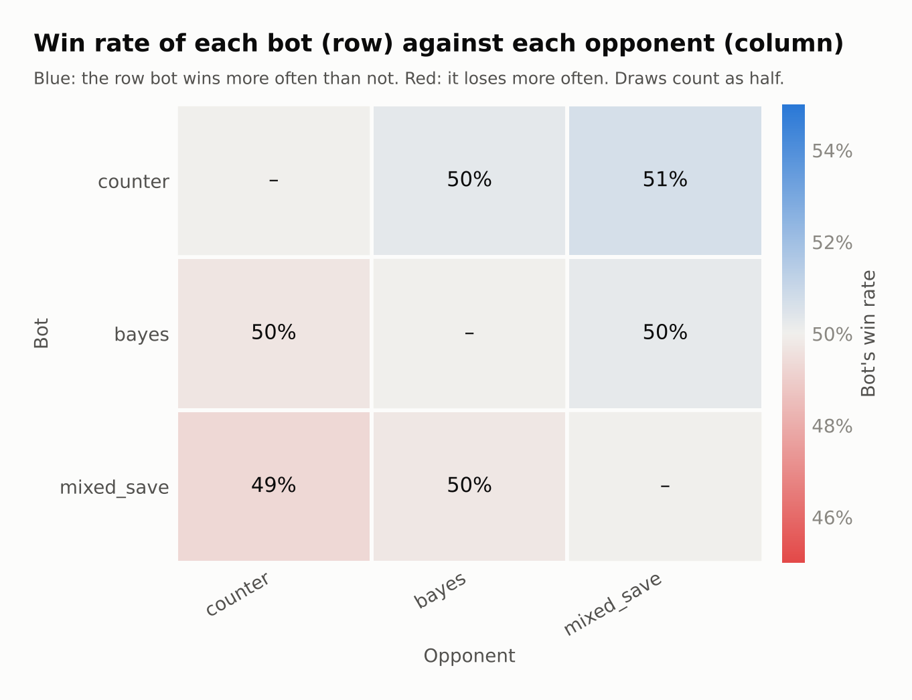
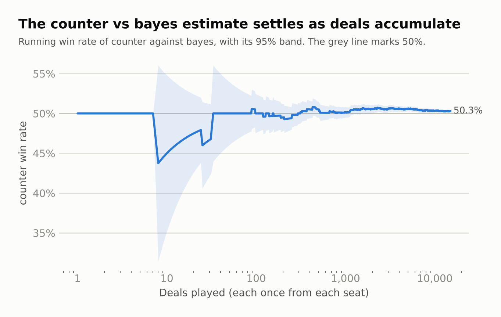
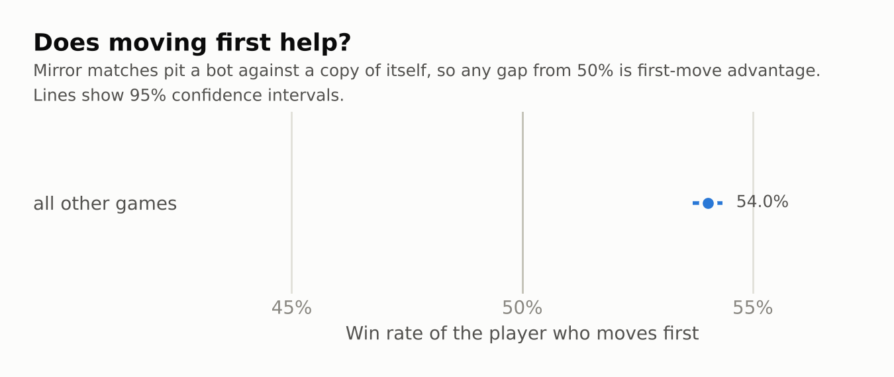
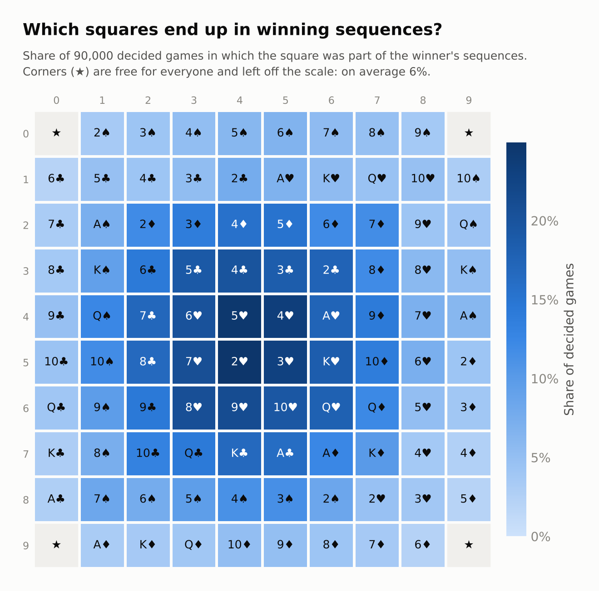

# Tournament summary

90,000 games between 3 bots (90,000 between different bots, 0 mirror matches). Draws: 0. Median game length: 51 turns (plies).

Settings: line values per bot (default), 2 sequences to win, first seed 700000, 15000 deals per pairing. Command: `python tournament.py --bots counter bayes mixed_save --deals 15000 --seed 700000 --no-mirror --out results/counting/games.csv.gz`

## Win-rate matrix

Row bot's win rate against the column bot, with the 95% margin. Margins come from paired deals (each deal is played once from each seat).

| bot \ opponent | counter | bayes | mixed_save | avg vs field |
|---|---|---|---|---|
| **counter** | – | 50.3% ±0.2 | 50.7% ±0.3 | 50.5% |
| **bayes** | 49.7% ±0.2 | – | 50.2% ±0.4 | 50.0% |
| **mixed_save** | 49.3% ±0.3 | 49.8% ±0.4 | – | 49.5% |

Games per pairing: 30,000.

## Equilibrium of the meta-game

If each player secretly picks a bot, this mix of bots can't be exploited: no single bot wins more than 50% against it. The bootstrap redraws every win rate within its margin 500 times and re-solves, to show how stable the answer is. The last column is each bot's win rate against the equilibrium mix (Nash averaging, Balduzzi et al. 2018): unlike the average against the field, it can't be inflated by adding weak bots.

| bot | equilibrium weight | bootstrap 95% range | in the mix (share of resamples) | win rate vs the mix |
|---|---|---|---|---|
| counter | 100.0% | 100.0% – 100.0% | 100% | 50.0% |
| bayes | 0.0% | 0.0% – 0.0% | 1% | 49.7% |
| mixed_save | 0.0% | 0.0% – 0.0% | 0% | 49.3% |

Game value: -0.0000 (a symmetric zero-sum game is worth 0).
Cross-check with nashpy's linear program: same mix, worst-case payoff +0.0000.

## Best responses

| against | best response | its win rate |
|---|---|---|
| counter | counter | 50.0% |
| bayes | counter | 50.3% |
| mixed_save | counter | 50.7% |

2 of 3 pairings differ from 50% after a Holm correction for multiple comparisons.

Beats every other bot (Holm-corrected): counter.
Rock-paper-scissors cycles (all three wins Holm-corrected): none.

## Skill ladder or cycles?

A rating per bot explains 99.0% of the variation in the win-rate matrix; the remaining 1.0% is cyclic (rock-paper-scissors). Rating = the bot's average edge over 50% across all bots, itself included.

| bot | rating |
|---|---|
| counter | +0.3 points |
| bayes | -0.0 points |
| mixed_save | -0.3 points |

## Replicator dynamics

A population starts evenly split between the bots; each bot's share grows in proportion to how much better than average it does. Shares at t = 300:

| bot | start | end |
|---|---|---|
| counter | 33.3% | 65.7% |
| bayes | 33.3% | 24.6% |
| mixed_save | 33.3% | 9.7% |

## Each strategy against mixed_save

mixed_save won the pilot, and each new idea is built on it, so this is what each idea adds (or costs). Significant = differs from 50% after the Holm correction.

| bot | win rate vs mixed_save | 95% margin | significant |
|---|---|---|---|
| counter | 50.7% | ±0.3 | yes |
| bayes | 50.2% | ±0.4 | no |

## First-move advantage

Win rate of the player who moves first. 50% means no advantage.

| games | first player wins | 95% range | games played |
|---|---|---|---|
| all other games | 54.0% | 53.7% – 54.3% | 90,000 |

## Game length

Median length in plies (one ply = one player's turn).

| bot | against other bots | mirror matches |
|---|---|---|
| counter | 51 | n/a |
| bayes | 50 | n/a |
| mixed_save | 51 | n/a |

## Jack use

Average per game played.

What the Jacks achieved: the share of two-eyed Jacks that completed a sequence or blocked an opponent's four, and of one-eyed Jacks that broke an opponent's four.

| bot | two-eyed Jacks | finished a sequence | blocked a four | one-eyed Jacks | broke a four | dead cards traded |
|---|---|---|---|---|---|---|
| counter | 1.24 | 48.1% | 51.8% | 1.12 | 99.5% | 0.28 |
| bayes | 1.24 | 48.1% | 51.8% | 1.11 | 99.5% | 0.27 |
| mixed_save | 1.25 | 46.6% | 53.3% | 1.14 | 99.6% | 0.28 |

## Squares that win games

Share of 90,000 decided games in which the square was part of the winner's sequences. The four corners (free spaces) average 5.7%. Central squares lie on more of the 192 lines (up to 20, against 3 for a corner), so part of this is geometry; the next section separates the two.

| rank | square | row, col | lines through it | share |
|---|---|---|---|---|
| 1 | 2♥ | 5, 4 | 20 | 24.9% |
| 2 | 5♥ | 4, 4 | 20 | 24.6% |
| 3 | 4♥ | 4, 5 | 20 | 23.4% |
| 4 | 3♥ | 5, 5 | 20 | 22.9% |
| 5 | 9♥ | 6, 4 | 17 | 21.2% |
| 6 | 7♥ | 5, 3 | 17 | 20.8% |
| 7 | 8♥ | 6, 3 | 15 | 20.7% |
| 8 | 6♥ | 4, 3 | 17 | 20.2% |
| 9 | 4♣ | 3, 4 | 17 | 20.0% |
| 10 | 10♥ | 6, 5 | 17 | 19.5% |

## Squares beyond geometry

Needs random-vs-random games (include `random` in the tournament) to separate strategy from geometry.

## Charts

