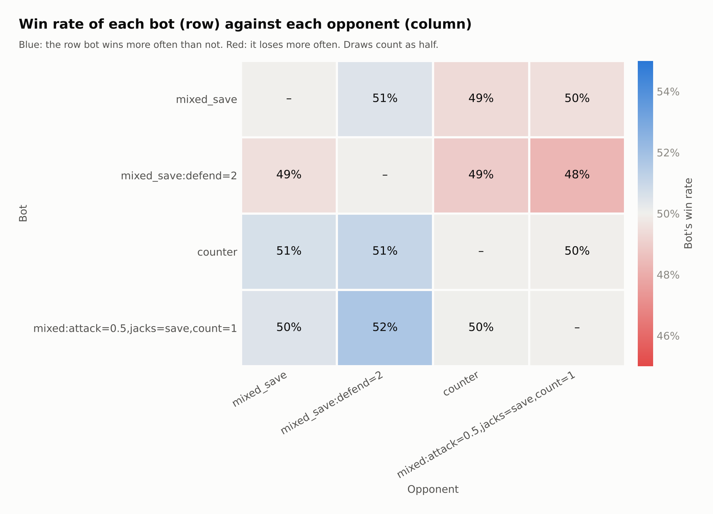
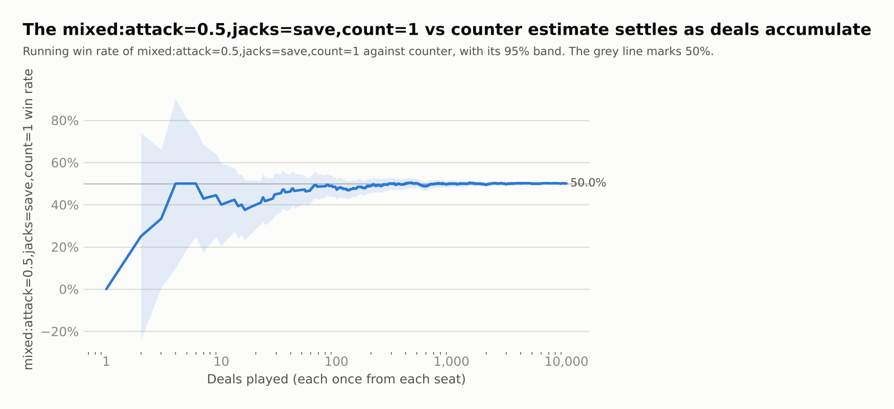
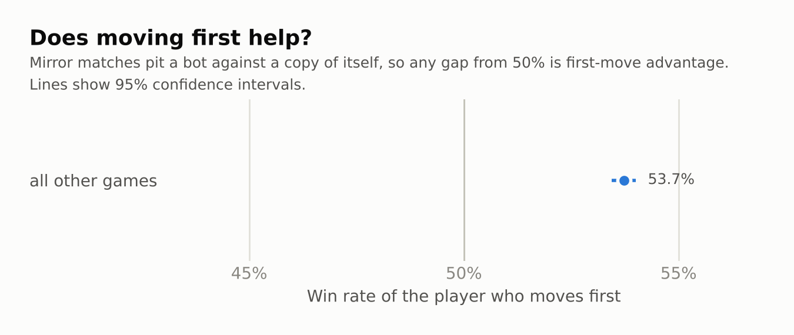
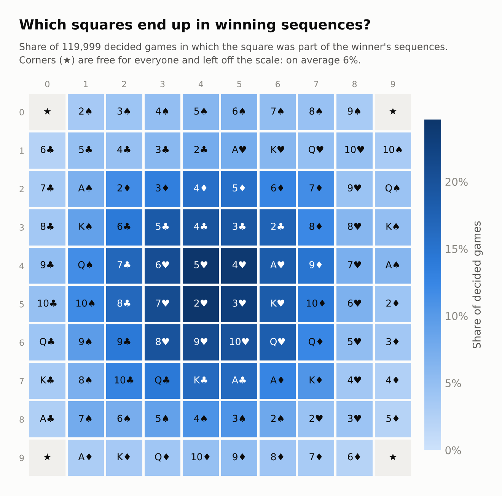

# Tournament summary

120,000 games between 4 bots (120,000 between different bots, 0 mirror matches). Draws: 1. Median game length: 52 turns (plies).

Settings: line values per bot (default), 2 sequences to win, first seed 1800000, 10000 deals per pairing. Command: `python tournament.py --bots mixed_save mixed_save:defend=2 counter mixed:attack=0.5,jacks=save,count=1 --deals 10000 --seed 1800000 --no-mirror --out results/defence_counting/games.csv.gz`

## Win-rate matrix

Row bot's win rate against the column bot, with the 95% margin. Margins come from paired deals (each deal is played once from each seat).

| bot \ opponent | mixed_save | mixed_save:defend=2 | counter | mixed:attack=0.5,jacks=save,count=1 | avg vs field |
|---|---|---|---|---|---|
| **mixed_save** | – | 50.5% ±0.5 | 49.4% ±0.4 | 49.5% ±0.5 | 49.8% |
| **mixed_save:defend=2** | 49.5% ±0.5 | – | 48.9% ±0.5 | 48.3% ±0.4 | 48.9% |
| **counter** | 50.6% ±0.4 | 51.1% ±0.5 | – | 50.0% ±0.5 | 50.6% |
| **mixed:attack=0.5,jacks=save,count=1** | 50.5% ±0.5 | 51.7% ±0.4 | 50.0% ±0.5 | – | 50.7% |

Games per pairing: 20,000.

## Equilibrium of the meta-game

If each player secretly picks a bot, this mix of bots can't be exploited: no single bot wins more than 50% against it. The bootstrap redraws every win rate within its margin 500 times and re-solves, to show how stable the answer is. The last column is each bot's win rate against the equilibrium mix (Nash averaging, Balduzzi et al. 2018): unlike the average against the field, it can't be inflated by adding weak bots.

| bot | equilibrium weight | bootstrap 95% range | in the mix (share of resamples) | win rate vs the mix |
|---|---|---|---|---|
| mixed_save | 0.0% | 0.0% – 0.0% | 2% | 49.5% |
| mixed_save:defend=2 | 0.0% | 0.0% – 0.0% | 0% | 48.3% |
| counter | 0.0% | 0.0% – 100.0% | 44% | 50.0% |
| mixed:attack=0.5,jacks=save,count=1 | 100.0% | 0.0% – 100.0% | 58% | 50.0% |

Game value: -0.0000 (a symmetric zero-sum game is worth 0).
Cross-check with nashpy's linear program: same mix, worst-case payoff +0.0000.

## Best responses

| against | best response | its win rate |
|---|---|---|
| mixed_save | counter | 50.6% |
| mixed_save:defend=2 | mixed:attack=0.5,jacks=save,count=1 | 51.7% |
| counter | mixed:attack=0.5,jacks=save,count=1 | 50.0% |
| mixed:attack=0.5,jacks=save,count=1 | mixed:attack=0.5,jacks=save,count=1 | 50.0% |

3 of 6 pairings differ from 50% after a Holm correction for multiple comparisons.

Beats every other bot (Holm-corrected): none.
Rock-paper-scissors cycles (all three wins Holm-corrected): none.

## Skill ladder or cycles?

A rating per bot explains 95.5% of the variation in the win-rate matrix; the remaining 4.5% is cyclic (rock-paper-scissors). Rating = the bot's average edge over 50% across all bots, itself included.

| bot | rating |
|---|---|
| mixed:attack=0.5,jacks=save,count=1 | +0.6 points |
| counter | +0.4 points |
| mixed_save | -0.2 points |
| mixed_save:defend=2 | -0.8 points |

## Replicator dynamics

A population starts evenly split between the bots; each bot's share grows in proportion to how much better than average it does. Shares at t = 300:

| bot | start | end |
|---|---|---|
| mixed_save | 25.0% | 8.0% |
| mixed_save:defend=2 | 25.0% | 0.8% |
| counter | 25.0% | 42.2% |
| mixed:attack=0.5,jacks=save,count=1 | 25.0% | 49.1% |

## Each strategy against mixed_save

mixed_save won the pilot, and each new idea is built on it, so this is what each idea adds (or costs). Significant = differs from 50% after the Holm correction.

| bot | win rate vs mixed_save | 95% margin | significant |
|---|---|---|---|
| counter | 50.6% | ±0.4 | yes |
| mixed:attack=0.5,jacks=save,count=1 | 50.5% | ±0.5 | no |
| mixed_save:defend=2 | 49.5% | ±0.5 | no |

## First-move advantage

Win rate of the player who moves first. 50% means no advantage.

| games | first player wins | 95% range | games played |
|---|---|---|---|
| all other games | 53.7% | 53.4% – 54.0% | 120,000 |

## Game length

Median length in plies (one ply = one player's turn).

| bot | against other bots | mirror matches |
|---|---|---|
| mixed_save | 52 | n/a |
| mixed_save:defend=2 | 53 | n/a |
| counter | 52 | n/a |
| mixed:attack=0.5,jacks=save,count=1 | 53 | n/a |

## Jack use

Average per game played.

What the Jacks achieved: the share of two-eyed Jacks that completed a sequence or blocked an opponent's four, and of one-eyed Jacks that broke an opponent's four.

| bot | two-eyed Jacks | finished a sequence | blocked a four | one-eyed Jacks | broke a four | dead cards traded |
|---|---|---|---|---|---|---|
| mixed_save | 1.28 | 45.6% | 54.3% | 1.16 | 99.3% | 0.36 |
| mixed_save:defend=2 | 1.30 | 42.8% | 57.1% | 1.18 | 99.0% | 0.43 |
| counter | 1.27 | 47.2% | 52.7% | 1.13 | 99.4% | 0.33 |
| mixed:attack=0.5,jacks=save,count=1 | 1.29 | 44.8% | 55.1% | 1.16 | 99.2% | 0.39 |

## Squares that win games

Share of 119,999 decided games in which the square was part of the winner's sequences. The four corners (free spaces) average 5.5%. Central squares lie on more of the 192 lines (up to 20, against 3 for a corner), so part of this is geometry; the next section separates the two.

| rank | square | row, col | lines through it | share |
|---|---|---|---|---|
| 1 | 5♥ | 4, 4 | 20 | 24.6% |
| 2 | 2♥ | 5, 4 | 20 | 24.6% |
| 3 | 4♥ | 4, 5 | 20 | 24.0% |
| 4 | 3♥ | 5, 5 | 20 | 23.1% |
| 5 | 9♥ | 6, 4 | 17 | 21.1% |
| 6 | 7♥ | 5, 3 | 17 | 21.0% |
| 7 | 6♥ | 4, 3 | 17 | 20.7% |
| 8 | 10♥ | 6, 5 | 17 | 19.9% |
| 9 | 8♥ | 6, 3 | 15 | 19.9% |
| 10 | 4♣ | 3, 4 | 17 | 19.8% |

## Squares beyond geometry

Needs random-vs-random games (include `random` in the tournament) to separate strategy from geometry.

## Charts

