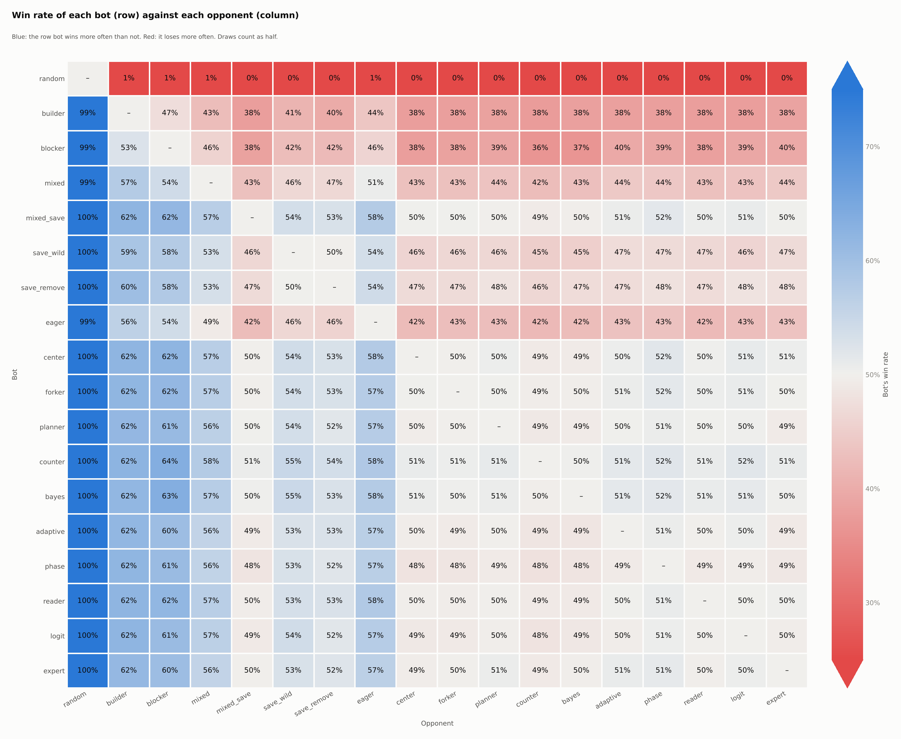
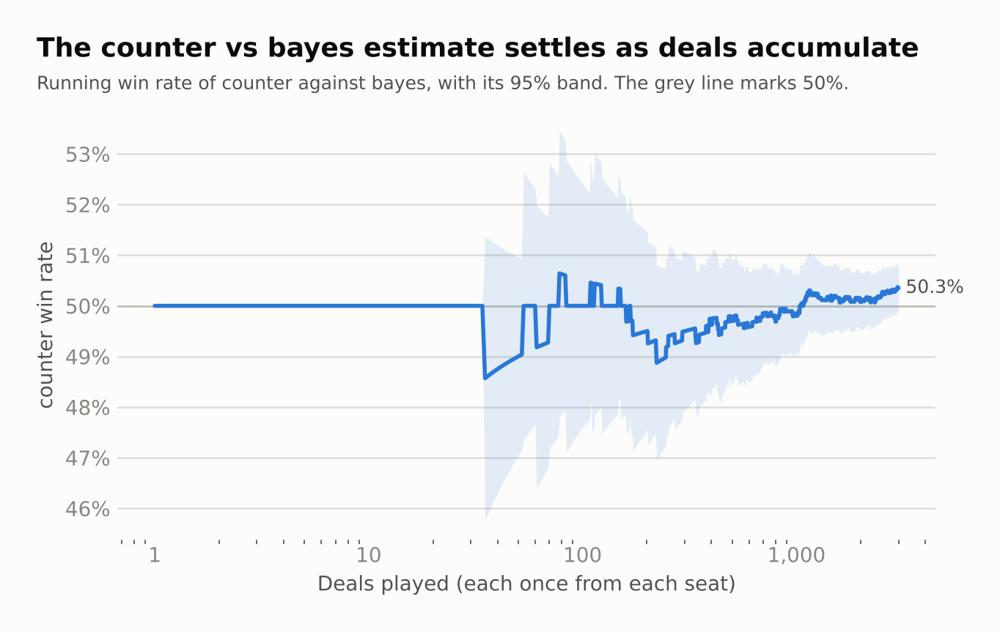
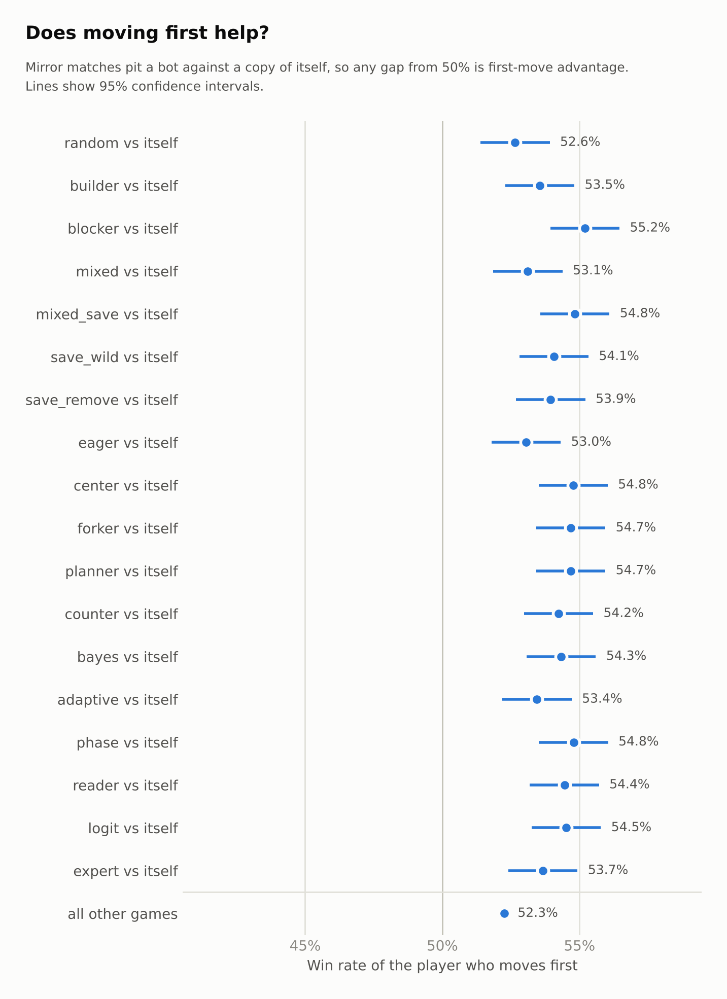
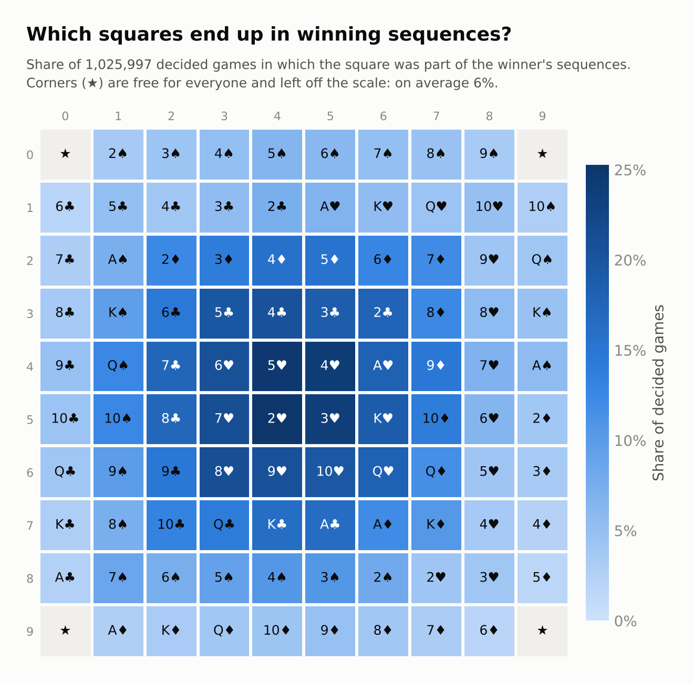
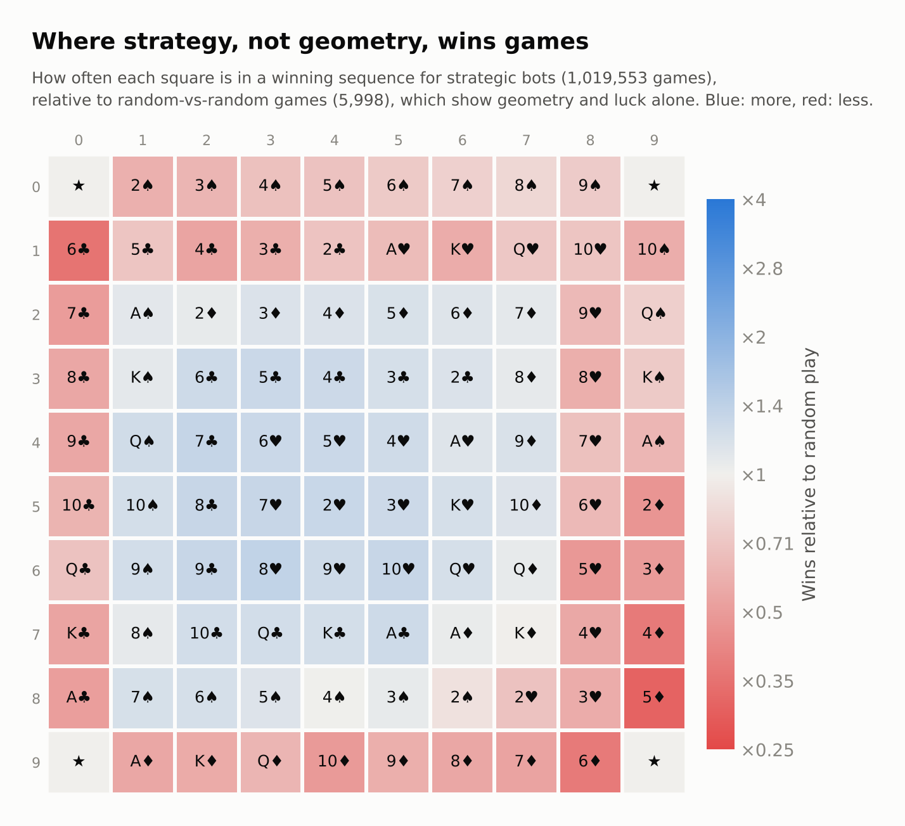

# Tournament summary

1,026,000 games between 18 bots (918,000 between different bots, 108,000 mirror matches). Draws: 3. Median game length: 50 turns (plies).

Settings: line values per bot (default), 2 sequences to win, first seed 200000, 3000 deals per pairing. Command: `python tournament.py --deals 3000 --seed 200000 --out results/full/games.csv.gz`

## Win-rate matrix

Row bot's win rate against the column bot, with the 95% margin. Margins come from paired deals (each deal is played once from each seat).

| bot \ opponent | random | builder | blocker | mixed | mixed_save | save_wild | save_remove | eager | center | forker | planner | counter | bayes | adaptive | phase | reader | logit | expert | avg vs field |
|---|---|---|---|---|---|---|---|---|---|---|---|---|---|---|---|---|---|---|---|
| **random** | – | 1.3% ±0.3 | 1.1% ±0.3 | 0.7% ±0.2 | 0.2% ±0.1 | 0.4% ±0.2 | 0.4% ±0.2 | 0.9% ±0.2 | 0.2% ±0.1 | 0.2% ±0.1 | 0.3% ±0.1 | 0.2% ±0.1 | 0.2% ±0.1 | 0.2% ±0.1 | 0.2% ±0.1 | 0.3% ±0.1 | 0.3% ±0.1 | 0.4% ±0.1 | 0.4% |
| **builder** | 98.7% ±0.3 | – | 47.4% ±1.1 | 42.6% ±1.0 | 37.8% ±1.0 | 41.1% ±1.0 | 39.7% ±1.0 | 43.8% ±1.0 | 37.8% ±1.0 | 38.0% ±1.0 | 38.4% ±1.0 | 37.6% ±1.0 | 38.1% ±1.0 | 38.1% ±1.0 | 38.0% ±1.0 | 37.9% ±1.0 | 37.8% ±1.0 | 38.5% ±1.0 | 43.0% |
| **blocker** | 98.9% ±0.3 | 52.6% ±1.1 | – | 45.8% ±1.0 | 38.4% ±1.0 | 42.4% ±1.0 | 42.0% ±1.1 | 45.9% ±1.0 | 37.9% ±1.0 | 38.4% ±1.0 | 38.9% ±1.1 | 36.4% ±1.0 | 36.5% ±1.0 | 39.6% ±1.0 | 39.2% ±1.1 | 38.2% ±1.0 | 39.1% ±1.0 | 39.6% ±1.0 | 44.1% |
| **mixed** | 99.3% ±0.2 | 57.4% ±1.0 | 54.2% ±1.0 | – | 43.0% ±1.0 | 46.5% ±0.9 | 46.6% ±0.9 | 50.6% ±0.7 | 43.0% ±1.0 | 43.1% ±1.0 | 43.5% ±1.0 | 42.5% ±1.0 | 42.8% ±1.0 | 44.3% ±1.0 | 44.0% ±1.0 | 43.0% ±1.0 | 43.5% ±1.0 | 44.3% ±1.0 | 48.9% |
| **mixed_save** | 99.8% ±0.1 | 62.2% ±1.0 | 61.7% ±1.0 | 57.0% ±1.0 | – | 53.6% ±0.9 | 53.0% ±0.9 | 57.5% ±1.0 | 50.1% ±0.8 | 50.0% ±0.2 | 50.0% ±0.7 | 49.4% ±0.8 | 49.6% ±0.8 | 50.7% ±0.9 | 51.6% ±0.9 | 50.5% ±0.6 | 50.9% ±0.8 | 50.1% ±0.9 | 55.7% |
| **save_wild** | 99.6% ±0.2 | 58.9% ±1.0 | 57.6% ±1.0 | 53.5% ±0.9 | 46.4% ±0.9 | – | 49.9% ±1.0 | 53.7% ±1.0 | 46.1% ±0.9 | 46.4% ±0.9 | 46.4% ±0.9 | 45.1% ±0.9 | 45.2% ±1.0 | 47.2% ±1.0 | 47.0% ±1.0 | 46.5% ±0.9 | 46.1% ±1.0 | 46.9% ±1.0 | 51.9% |
| **save_remove** | 99.6% ±0.2 | 60.3% ±1.0 | 58.0% ±1.1 | 53.4% ±0.9 | 47.0% ±0.9 | 50.1% ±1.0 | – | 54.2% ±0.9 | 46.9% ±1.0 | 47.0% ±0.9 | 48.1% ±1.0 | 46.4% ±1.0 | 47.1% ±1.0 | 47.1% ±1.0 | 47.9% ±1.0 | 47.2% ±1.0 | 48.1% ±1.0 | 47.8% ±1.0 | 52.7% |
| **eager** | 99.1% ±0.2 | 56.2% ±1.0 | 54.1% ±1.0 | 49.4% ±0.7 | 42.5% ±1.0 | 46.3% ±1.0 | 45.8% ±0.9 | – | 42.3% ±1.0 | 42.6% ±1.0 | 42.7% ±1.0 | 41.9% ±1.0 | 42.4% ±1.0 | 43.4% ±1.0 | 43.3% ±1.0 | 42.1% ±1.0 | 42.7% ±1.0 | 43.4% ±1.1 | 48.3% |
| **center** | 99.8% ±0.1 | 62.2% ±1.0 | 62.1% ±1.0 | 57.0% ±1.0 | 49.9% ±0.8 | 53.9% ±0.9 | 53.0% ±1.0 | 57.7% ±1.0 | – | 49.9% ±0.8 | 50.4% ±0.8 | 49.1% ±0.9 | 49.2% ±0.9 | 50.5% ±0.9 | 51.9% ±0.9 | 50.2% ±0.8 | 51.2% ±0.9 | 50.6% ±0.9 | 55.8% |
| **forker** | 99.8% ±0.1 | 62.1% ±1.0 | 61.6% ±1.0 | 56.9% ±1.0 | 50.0% ±0.2 | 53.6% ±0.9 | 53.0% ±0.9 | 57.4% ±1.0 | 50.1% ±0.8 | – | 50.1% ±0.7 | 49.5% ±0.8 | 49.7% ±0.8 | 50.7% ±0.9 | 51.5% ±0.9 | 50.5% ±0.6 | 50.9% ±0.8 | 50.1% ±0.9 | 55.7% |
| **planner** | 99.7% ±0.1 | 61.6% ±1.0 | 61.1% ±1.1 | 56.5% ±1.0 | 50.0% ±0.7 | 53.6% ±0.9 | 51.9% ±1.0 | 57.3% ±1.0 | 49.6% ±0.8 | 49.9% ±0.7 | – | 48.9% ±0.8 | 49.2% ±0.9 | 50.1% ±0.9 | 50.8% ±0.9 | 50.1% ±0.8 | 50.4% ±0.9 | 49.4% ±0.9 | 55.3% |
| **counter** | 99.8% ±0.1 | 62.4% ±1.0 | 63.6% ±1.0 | 57.5% ±1.0 | 50.6% ±0.8 | 54.9% ±0.9 | 53.6% ±1.0 | 58.1% ±1.0 | 50.9% ±0.9 | 50.5% ±0.8 | 51.2% ±0.8 | – | 50.3% ±0.5 | 51.5% ±0.9 | 52.0% ±0.9 | 50.9% ±0.8 | 51.8% ±0.9 | 50.8% ±0.9 | 56.5% |
| **bayes** | 99.8% ±0.1 | 61.9% ±1.0 | 63.5% ±1.0 | 57.2% ±1.0 | 50.4% ±0.8 | 54.8% ±1.0 | 52.9% ±1.0 | 57.6% ±1.0 | 50.8% ±0.9 | 50.3% ±0.8 | 50.8% ±0.9 | 49.7% ±0.5 | – | 51.5% ±0.9 | 51.7% ±0.9 | 50.9% ±0.8 | 51.2% ±0.9 | 50.2% ±0.9 | 56.2% |
| **adaptive** | 99.8% ±0.1 | 61.9% ±1.0 | 60.4% ±1.0 | 55.7% ±1.0 | 49.3% ±0.9 | 52.8% ±1.0 | 52.9% ±1.0 | 56.6% ±1.0 | 49.5% ±0.9 | 49.3% ±0.9 | 49.9% ±0.9 | 48.5% ±0.9 | 48.5% ±0.9 | – | 50.6% ±0.9 | 49.9% ±0.9 | 50.5% ±1.0 | 49.0% ±0.8 | 55.0% |
| **phase** | 99.8% ±0.1 | 62.0% ±1.0 | 60.8% ±1.1 | 56.0% ±1.0 | 48.4% ±0.9 | 53.0% ±1.0 | 52.1% ±1.0 | 56.7% ±1.0 | 48.1% ±0.9 | 48.5% ±0.9 | 49.2% ±0.9 | 48.0% ±0.9 | 48.3% ±0.9 | 49.4% ±0.9 | – | 49.2% ±0.9 | 49.5% ±0.9 | 48.7% ±1.0 | 54.6% |
| **reader** | 99.7% ±0.1 | 62.1% ±1.0 | 61.8% ±1.0 | 57.0% ±1.0 | 49.5% ±0.6 | 53.5% ±0.9 | 52.8% ±1.0 | 57.9% ±1.0 | 49.8% ±0.8 | 49.5% ±0.6 | 49.9% ±0.8 | 49.1% ±0.8 | 49.1% ±0.8 | 50.1% ±0.9 | 50.8% ±0.9 | – | 50.1% ±0.8 | 50.4% ±0.9 | 55.5% |
| **logit** | 99.7% ±0.1 | 62.3% ±1.0 | 60.9% ±1.0 | 56.5% ±1.0 | 49.1% ±0.8 | 53.9% ±1.0 | 51.9% ±1.0 | 57.3% ±1.0 | 48.8% ±0.9 | 49.1% ±0.8 | 49.6% ±0.9 | 48.2% ±0.9 | 48.8% ±0.9 | 49.5% ±1.0 | 50.5% ±0.9 | 49.9% ±0.8 | – | 49.6% ±1.0 | 55.0% |
| **expert** | 99.7% ±0.1 | 61.5% ±1.0 | 60.5% ±1.0 | 55.7% ±1.0 | 49.9% ±0.9 | 53.1% ±1.0 | 52.2% ±1.0 | 56.6% ±1.1 | 49.4% ±0.9 | 49.9% ±0.9 | 50.6% ±0.9 | 49.2% ±0.9 | 49.8% ±0.9 | 51.0% ±0.8 | 51.3% ±1.0 | 49.6% ±0.9 | 50.4% ±1.0 | – | 55.3% |

Games per pairing: 6,000.

## Equilibrium of the meta-game

If each player secretly picks a bot, this mix of bots can't be exploited: no single bot wins more than 50% against it. The bootstrap redraws every win rate within its margin 500 times and re-solves, to show how stable the answer is. The last column is each bot's win rate against the equilibrium mix (Nash averaging, Balduzzi et al. 2018): unlike the average against the field, it can't be inflated by adding weak bots.

| bot | equilibrium weight | bootstrap 95% range | in the mix (share of resamples) | win rate vs the mix |
|---|---|---|---|---|
| random | 0.0% | 0.0% – 0.0% | 0% | 0.2% |
| builder | 0.0% | 0.0% – 0.0% | 0% | 37.6% |
| blocker | 0.0% | 0.0% – 0.0% | 0% | 36.4% |
| mixed | 0.0% | 0.0% – 0.0% | 0% | 42.5% |
| mixed_save | 0.0% | 0.0% – 32.5% | 6% | 49.4% |
| save_wild | 0.0% | 0.0% – 0.0% | 0% | 45.1% |
| save_remove | 0.0% | 0.0% – 0.0% | 0% | 46.4% |
| eager | 0.0% | 0.0% – 0.0% | 0% | 41.9% |
| center | 0.0% | 0.0% – 13.0% | 4% | 49.1% |
| forker | 0.0% | 0.0% – 61.1% | 9% | 49.5% |
| planner | 0.0% | 0.0% – 0.0% | 1% | 48.9% |
| counter | 100.0% | 1.9% – 100.0% | 97% | 50.0% |
| bayes | 0.0% | 0.0% – 70.8% | 15% | 49.7% |
| adaptive | 0.0% | 0.0% – 0.0% | 0% | 48.5% |
| phase | 0.0% | 0.0% – 0.0% | 0% | 48.0% |
| reader | 0.0% | 0.0% – 0.0% | 1% | 49.1% |
| logit | 0.0% | 0.0% – 0.0% | 0% | 48.2% |
| expert | 0.0% | 0.0% – 19.4% | 6% | 49.2% |

Game value: -0.0000 (a symmetric zero-sum game is worth 0).
Cross-check with nashpy's linear program: same mix, worst-case payoff +0.0000.

## Best responses

| against | best response | its win rate |
|---|---|---|
| random | counter | 99.8% |
| builder | counter | 62.4% |
| blocker | counter | 63.6% |
| mixed | counter | 57.5% |
| mixed_save | counter | 50.6% |
| save_wild | counter | 54.9% |
| save_remove | counter | 53.6% |
| eager | counter | 58.1% |
| center | counter | 50.9% |
| forker | counter | 50.5% |
| planner | counter | 51.2% |
| counter | counter | 50.0% |
| bayes | counter | 50.3% |
| adaptive | bayes | 51.5% |
| phase | counter | 52.0% |
| reader | counter | 50.9% |
| logit | counter | 51.8% |
| expert | counter | 50.8% |

102 of 153 pairings differ from 50% after a Holm correction for multiple comparisons.

Beats every other bot (Holm-corrected): none.
Rock-paper-scissors cycles (all three wins Holm-corrected): none.

## Skill ladder or cycles?

A rating per bot explains 99.4% of the variation in the win-rate matrix; the remaining 0.6% is cyclic (rock-paper-scissors). Rating = the bot's average edge over 50% across all bots, itself included.

| bot | rating |
|---|---|
| counter | +6.1 points |
| bayes | +5.8 points |
| center | +5.5 points |
| mixed_save | +5.4 points |
| forker | +5.4 points |
| reader | +5.2 points |
| expert | +5.0 points |
| planner | +5.0 points |
| logit | +4.8 points |
| adaptive | +4.7 points |
| phase | +4.3 points |
| save_remove | +2.6 points |
| save_wild | +1.8 points |
| mixed | -1.0 points |
| eager | -1.6 points |
| blocker | -5.6 points |
| builder | -6.6 points |
| random | -46.8 points |

## Replicator dynamics

A population starts evenly split between the bots; each bot's share grows in proportion to how much better than average it does. Shares at t = 300:

| bot | start | end |
|---|---|---|
| random | 5.6% | 0.0% |
| builder | 5.6% | 0.0% |
| blocker | 5.6% | 0.0% |
| mixed | 5.6% | 0.0% |
| mixed_save | 5.6% | 6.5% |
| save_wild | 5.6% | 0.0% |
| save_remove | 5.6% | 0.0% |
| eager | 5.6% | 0.0% |
| center | 5.6% | 4.6% |
| forker | 5.6% | 7.7% |
| planner | 5.6% | 2.0% |
| counter | 5.6% | 52.0% |
| bayes | 5.6% | 19.8% |
| adaptive | 5.6% | 0.6% |
| phase | 5.6% | 0.1% |
| reader | 5.6% | 2.2% |
| logit | 5.6% | 0.4% |
| expert | 5.6% | 4.0% |

## Each strategy against mixed_save

mixed_save won the pilot, and each new idea is built on it, so this is what each idea adds (or costs). Significant = differs from 50% after the Holm correction.

| bot | win rate vs mixed_save | 95% margin | significant |
|---|---|---|---|
| counter | 50.6% | ±0.8 | no |
| bayes | 50.4% | ±0.8 | no |
| planner | 50.0% | ±0.7 | no |
| forker | 50.0% | ±0.2 | no |
| expert | 49.9% | ±0.9 | no |
| center | 49.9% | ±0.8 | no |
| reader | 49.5% | ±0.6 | no |
| adaptive | 49.3% | ±0.9 | no |
| logit | 49.1% | ±0.8 | no |
| phase | 48.4% | ±0.9 | yes |
| save_remove | 47.0% | ±0.9 | yes |
| save_wild | 46.4% | ±0.9 | yes |
| mixed | 43.0% | ±1.0 | yes |
| eager | 42.5% | ±1.0 | yes |
| blocker | 38.4% | ±1.0 | yes |
| builder | 37.8% | ±1.0 | yes |
| random | 0.2% | ±0.1 | yes |

## Jack timing

Each variant differs from mixed only in when it plays Jacks. Win rate against mixed:

| variant | win rate vs mixed | 95% margin |
|---|---|---|
| eager | 49.4% | ±0.7 |
| save_wild | 53.5% | ±0.9 |
| save_remove | 53.4% | ±0.9 |
| mixed_save | 57.0% | ±1.0 |

## First-move advantage

Win rate of the player who moves first. 50% means no advantage.

| games | first player wins | 95% range | games played |
|---|---|---|---|
| random vs itself | 52.6% | 51.4% – 53.9% | 6,000 |
| builder vs itself | 53.5% | 52.3% – 54.8% | 6,000 |
| blocker vs itself | 55.2% | 53.9% – 56.5% | 6,000 |
| mixed vs itself | 53.1% | 51.9% – 54.4% | 6,000 |
| mixed_save vs itself | 54.8% | 53.6% – 56.1% | 6,000 |
| save_wild vs itself | 54.1% | 52.8% – 55.3% | 6,000 |
| save_remove vs itself | 53.9% | 52.7% – 55.2% | 6,000 |
| eager vs itself | 53.0% | 51.8% – 54.3% | 6,000 |
| center vs itself | 54.8% | 53.5% – 56.0% | 6,000 |
| forker vs itself | 54.7% | 53.4% – 55.9% | 6,000 |
| planner vs itself | 54.7% | 53.4% – 55.9% | 6,000 |
| counter vs itself | 54.2% | 53.0% – 55.5% | 6,000 |
| bayes vs itself | 54.3% | 53.1% – 55.6% | 6,000 |
| adaptive vs itself | 53.4% | 52.2% – 54.7% | 6,000 |
| phase vs itself | 54.8% | 53.5% – 56.0% | 6,000 |
| reader vs itself | 54.4% | 53.2% – 55.7% | 6,000 |
| logit vs itself | 54.5% | 53.3% – 55.8% | 6,000 |
| expert vs itself | 53.7% | 52.4% – 54.9% | 6,000 |
| all other games | 52.3% | 52.2% – 52.4% | 918,000 |

## Game length

Median length in plies (one ply = one player's turn).

| bot | against other bots | mirror matches |
|---|---|---|
| random | 45 | 80 |
| builder | 45 | 41 |
| blocker | 52 | 55 |
| mixed | 49 | 48 |
| mixed_save | 51 | 52 |
| save_wild | 49 | 49 |
| save_remove | 51 | 51 |
| eager | 49 | 49 |
| center | 51 | 52 |
| forker | 51 | 52 |
| planner | 51 | 53 |
| counter | 50 | 51 |
| bayes | 50 | 51 |
| adaptive | 51 | 53 |
| phase | 51 | 52 |
| reader | 51 | 53 |
| logit | 51 | 52 |
| expert | 50 | 52 |

## Jack use

Average per game played.

What the Jacks achieved: the share of two-eyed Jacks that completed a sequence or blocked an opponent's four, and of one-eyed Jacks that broke an opponent's four.

| bot | two-eyed Jacks | finished a sequence | blocked a four | one-eyed Jacks | broke a four | dead cards traded |
|---|---|---|---|---|---|---|
| random | 0.97 | 0.9% | 3.1% | 0.93 | 26.7% | 0.37 |
| builder | 1.12 | 37.0% | 0.8% | 1.04 | 18.9% | 0.11 |
| blocker | 1.29 | 27.6% | 20.0% | 1.24 | 33.8% | 0.37 |
| mixed | 1.22 | 31.7% | 12.7% | 1.17 | 33.7% | 0.20 |
| mixed_save | 1.24 | 49.6% | 50.3% | 1.12 | 99.5% | 0.29 |
| save_wild | 1.21 | 48.2% | 51.7% | 1.18 | 31.0% | 0.22 |
| save_remove | 1.25 | 32.6% | 11.7% | 1.14 | 99.6% | 0.25 |
| eager | 1.22 | 31.0% | 12.9% | 1.18 | 32.4% | 0.20 |
| center | 1.24 | 48.9% | 51.0% | 1.12 | 99.4% | 0.29 |
| forker | 1.24 | 49.7% | 50.2% | 1.12 | 99.5% | 0.29 |
| planner | 1.25 | 49.3% | 50.6% | 1.13 | 99.4% | 0.31 |
| counter | 1.23 | 52.2% | 47.7% | 1.10 | 99.5% | 0.27 |
| bayes | 1.23 | 52.7% | 47.3% | 1.08 | 99.6% | 0.27 |
| adaptive | 1.25 | 47.9% | 52.0% | 1.13 | 99.4% | 0.32 |
| phase | 1.24 | 49.5% | 50.4% | 1.13 | 99.4% | 0.32 |
| reader | 1.25 | 48.9% | 51.0% | 1.13 | 99.5% | 0.29 |
| logit | 1.25 | 49.2% | 50.7% | 1.12 | 99.5% | 0.29 |
| expert | 1.24 | 49.9% | 50.0% | 1.08 | 99.5% | 0.27 |

## Squares that win games

Share of 1,025,997 decided games in which the square was part of the winner's sequences. The four corners (free spaces) average 5.7%. Central squares lie on more of the 192 lines (up to 20, against 3 for a corner), so part of this is geometry; the next section separates the two.

| rank | square | row, col | lines through it | share |
|---|---|---|---|---|
| 1 | 2♥ | 5, 4 | 20 | 25.3% |
| 2 | 5♥ | 4, 4 | 20 | 24.8% |
| 3 | 4♥ | 4, 5 | 20 | 24.2% |
| 4 | 3♥ | 5, 5 | 20 | 23.8% |
| 5 | 7♥ | 5, 3 | 17 | 21.4% |
| 6 | 8♥ | 6, 3 | 15 | 21.2% |
| 7 | 6♥ | 4, 3 | 17 | 20.8% |
| 8 | 9♥ | 6, 4 | 17 | 20.8% |
| 9 | 4♣ | 3, 4 | 17 | 20.6% |
| 10 | 5♣ | 3, 3 | 15 | 19.8% |

## Squares beyond geometry

Random-vs-random games (5,998) show what geometry and luck alone produce. Lift = a square's share among strategic bots' wins (1,019,553 games) divided by its share under random play; above 1, strategy uses the square more than geometry predicts.

|  | square | row, col | lift |
|---|---|---|---|
| most | 8♥ | 6, 3 | ×1.39 |
| most | 7♣ | 4, 2 | ×1.34 |
| most | 7♥ | 5, 3 | ×1.34 |
| most | 8♣ | 5, 2 | ×1.34 |
| most | 9♣ | 6, 2 | ×1.33 |
| least | 2♦ | 5, 9 | ×0.47 |
| least | 4♦ | 7, 9 | ×0.38 |
| least | 6♦ | 9, 8 | ×0.38 |
| least | 6♣ | 1, 0 | ×0.36 |
| least | 5♦ | 8, 9 | ×0.31 |

## Charts

