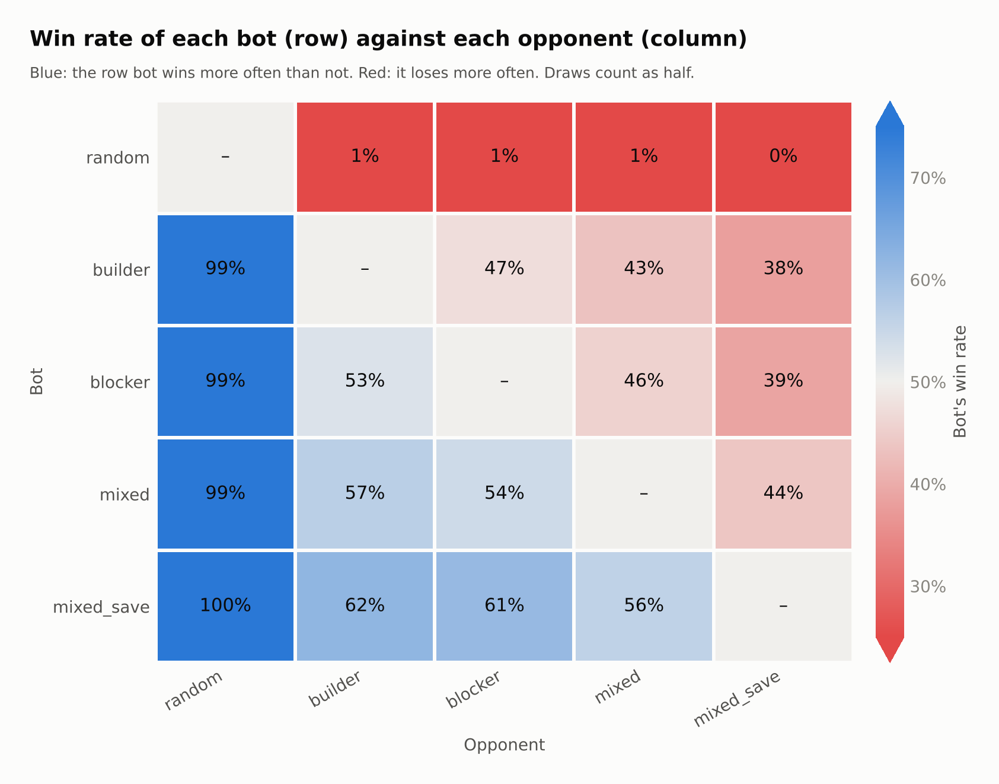
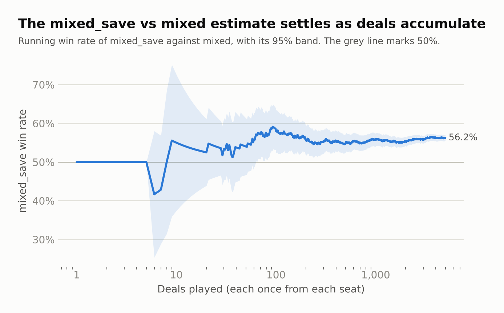
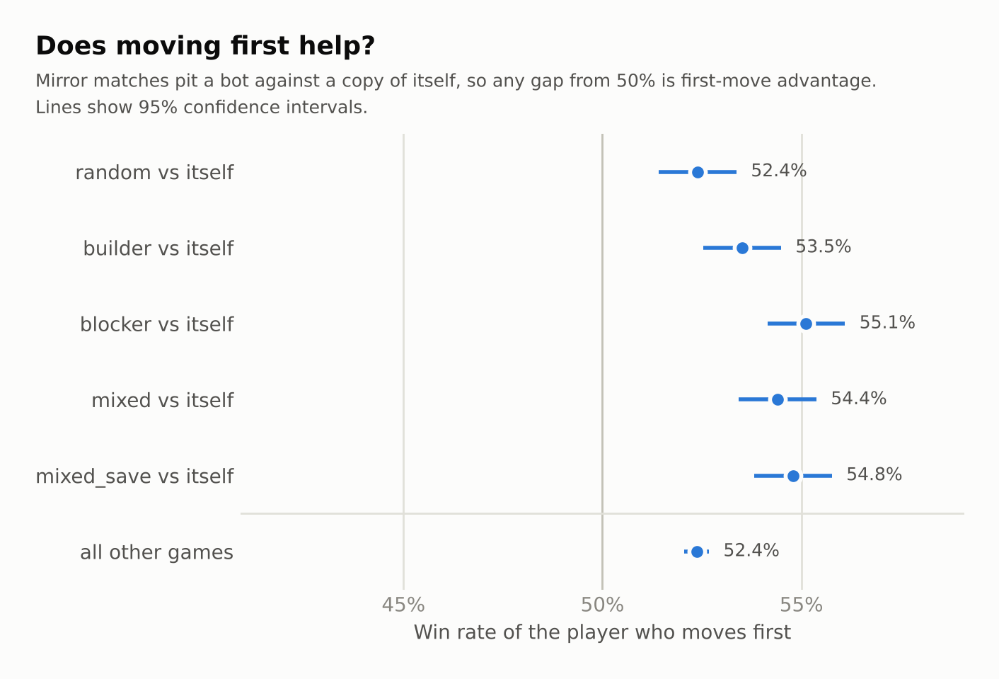
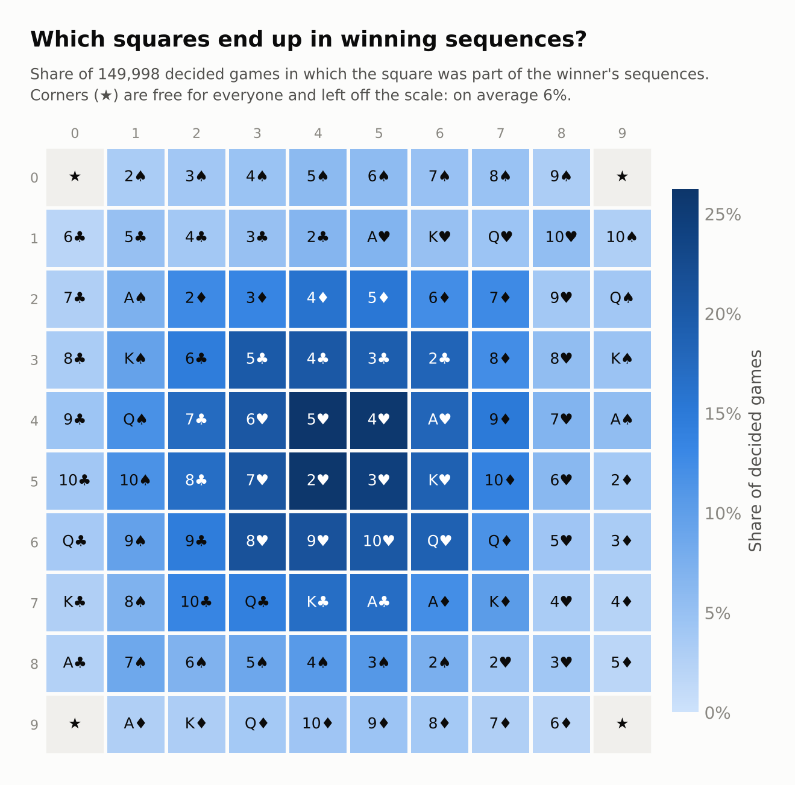
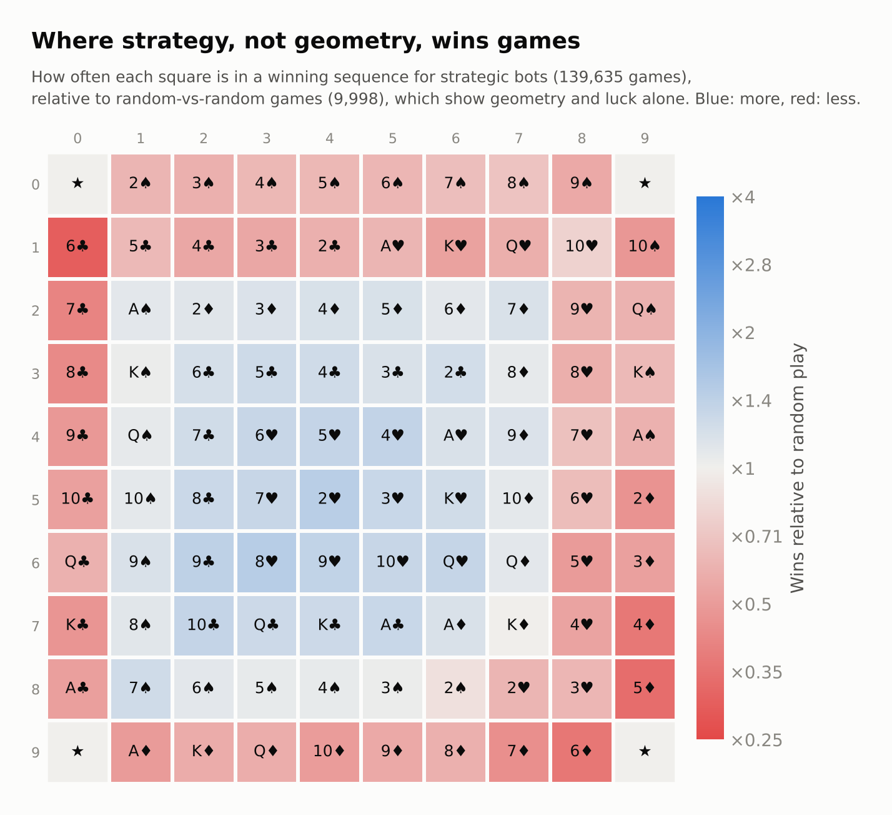

# Tournament summary

150,000 games between 5 bots (100,000 between different bots, 50,000 mirror matches). Draws: 2. Median game length: 49 turns (plies).

## Win-rate matrix

Row bot's win rate against the column bot, with the 95% margin. Margins come from paired deals (each deal is played once from each seat).

| bot \ opponent | random | builder | blocker | mixed | mixed_save | avg vs field |
|---|---|---|---|---|---|---|
| **random** | – | 1.3% ±0.2 | 1.0% ±0.2 | 0.9% ±0.2 | 0.4% ±0.1 | 0.9% |
| **builder** | 98.7% ±0.2 | – | 47.3% ±0.8 | 43.2% ±0.8 | 38.0% ±0.8 | 56.8% |
| **blocker** | 99.0% ±0.2 | 52.7% ±0.8 | – | 45.6% ±0.8 | 38.7% ±0.8 | 59.0% |
| **mixed** | 99.1% ±0.2 | 56.8% ±0.8 | 54.4% ±0.8 | – | 43.8% ±0.8 | 63.5% |
| **mixed_save** | 99.6% ±0.1 | 62.0% ±0.8 | 61.3% ±0.8 | 56.2% ±0.8 | – | 69.8% |

Games per pairing: 10,000.

## Equilibrium of the meta-game

If each player secretly picks a bot, this mix of bots can't be exploited: no single bot wins more than 50% against it. The bootstrap redraws every win rate within its margin 500 times and re-solves, to show how stable the answer is.

| bot | equilibrium weight | bootstrap 95% range | in the mix (share of resamples) |
|---|---|---|---|
| random | 0.0% | 0.0% – 0.0% | 0% |
| builder | 0.0% | 0.0% – 0.0% | 0% |
| blocker | 0.0% | 0.0% – 0.0% | 0% |
| mixed | 0.0% | 0.0% – 0.0% | 0% |
| mixed_save | 100.0% | 100.0% – 100.0% | 100% |

Game value: -0.0000 (a symmetric zero-sum game is worth 0).
Cross-check with nashpy's linear program: same mix, worst-case payoff +0.0000.

## Best responses

| against | best response | its win rate |
|---|---|---|
| random | mixed_save | 99.6% |
| builder | mixed_save | 62.0% |
| blocker | mixed_save | 61.3% |
| mixed | mixed_save | 56.2% |
| mixed_save | mixed_save | 50.0% |

10 of 10 pairings differ from 50% after a Holm correction for multiple comparisons.

Beats every other bot (Holm-corrected): mixed_save.
Rock-paper-scissors cycles (all three wins Holm-corrected): none.

## Skill ladder or cycles?

A rating per bot explains 99.3% of the variation in the win-rate matrix; the remaining 0.7% is cyclic (rock-paper-scissors). Rating = the bot's average edge over 50% across all bots, itself included.

| bot | rating |
|---|---|
| mixed_save | +15.8 points |
| mixed | +10.8 points |
| blocker | +7.2 points |
| builder | +5.4 points |
| random | -39.3 points |

## Replicator dynamics

A population starts evenly split between the bots; each bot's share grows in proportion to how much better than average it does. Shares at t = 300:

| bot | start | end |
|---|---|---|
| random | 20.0% | 0.0% |
| builder | 20.0% | 0.0% |
| blocker | 20.0% | 0.0% |
| mixed | 20.0% | 0.0% |
| mixed_save | 20.0% | 100.0% |

## Each strategy against mixed_save

mixed_save won the pilot, and each new idea is built on it, so this is what each idea adds (or costs). Significant = differs from 50% after the Holm correction.

| bot | win rate vs mixed_save | 95% margin | significant |
|---|---|---|---|
| mixed | 43.8% | ±0.8 | yes |
| blocker | 38.7% | ±0.8 | yes |
| builder | 38.0% | ±0.8 | yes |
| random | 0.4% | ±0.1 | yes |

## Jack timing

Each variant differs from mixed only in when it plays Jacks. Win rate against mixed:

| variant | win rate vs mixed | 95% margin |
|---|---|---|
| mixed_save | 56.2% | ±0.8 |

## First-move advantage

Win rate of the player who moves first. 50% means no advantage.

| games | first player wins | 95% range | games played |
|---|---|---|---|
| random vs itself | 52.4% | 51.4% – 53.4% | 10,000 |
| builder vs itself | 53.5% | 52.5% – 54.5% | 10,000 |
| blocker vs itself | 55.1% | 54.1% – 56.1% | 10,000 |
| mixed vs itself | 54.4% | 53.4% – 55.4% | 10,000 |
| mixed_save vs itself | 54.8% | 53.8% – 55.8% | 10,000 |
| all other games | 52.4% | 52.1% – 52.7% | 100,000 |

## Jack use

Average per game played.

| bot | two-eyed Jacks | one-eyed Jacks | dead cards traded |
|---|---|---|---|
| random | 1.15 | 1.10 | 0.77 |
| builder | 1.13 | 0.99 | 0.13 |
| blocker | 1.30 | 1.23 | 0.36 |
| mixed | 1.22 | 1.15 | 0.20 |
| mixed_save | 1.22 | 1.02 | 0.25 |

## Squares that win games

Share of 149,998 decided games in which the square was part of the winner's sequences. The four corners (free spaces) average 5.8%. Central squares lie on more of the 192 lines (up to 20, against 3 for a corner), so part of this is geometry; the next section separates the two.

| rank | square | row, col | lines through it | share |
|---|---|---|---|---|
| 1 | 5♥ | 4, 4 | 20 | 26.2% |
| 2 | 2♥ | 5, 4 | 20 | 26.1% |
| 3 | 4♥ | 4, 5 | 20 | 25.8% |
| 4 | 3♥ | 5, 5 | 20 | 24.6% |
| 5 | 8♥ | 6, 3 | 15 | 21.4% |
| 6 | 9♥ | 6, 4 | 17 | 21.2% |
| 7 | 7♥ | 5, 3 | 17 | 20.8% |
| 8 | 6♥ | 4, 3 | 17 | 20.5% |
| 9 | 10♥ | 6, 5 | 17 | 20.3% |
| 10 | 4♣ | 3, 4 | 17 | 20.3% |

## Squares beyond geometry

Random-vs-random games (9,998) show what geometry and luck alone produce. Lift = a square's share among strategic bots' wins (139,635 games) divided by its share under random play; above 1, strategy uses the square more than geometry predicts.

|  | square | row, col | lift |
|---|---|---|---|
| most | 8♥ | 6, 3 | ×1.49 |
| most | 2♥ | 5, 4 | ×1.47 |
| most | 9♣ | 6, 2 | ×1.42 |
| most | 9♥ | 6, 4 | ×1.40 |
| most | 4♥ | 4, 5 | ×1.37 |
| least | 7♣ | 2, 0 | ×0.41 |
| least | 4♦ | 7, 9 | ×0.37 |
| least | 6♦ | 9, 8 | ×0.37 |
| least | 5♦ | 8, 9 | ×0.34 |
| least | 6♣ | 1, 0 | ×0.30 |

## Charts

