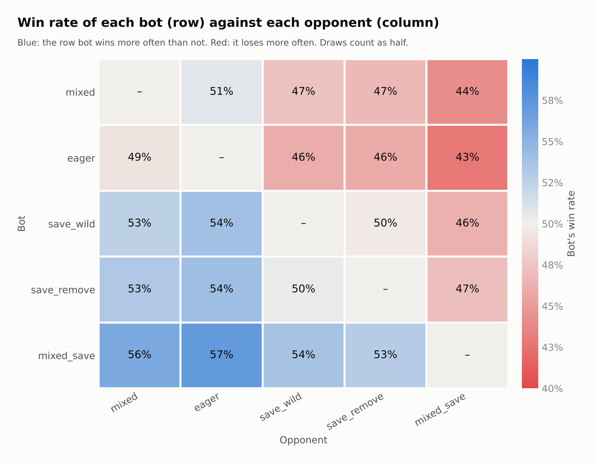
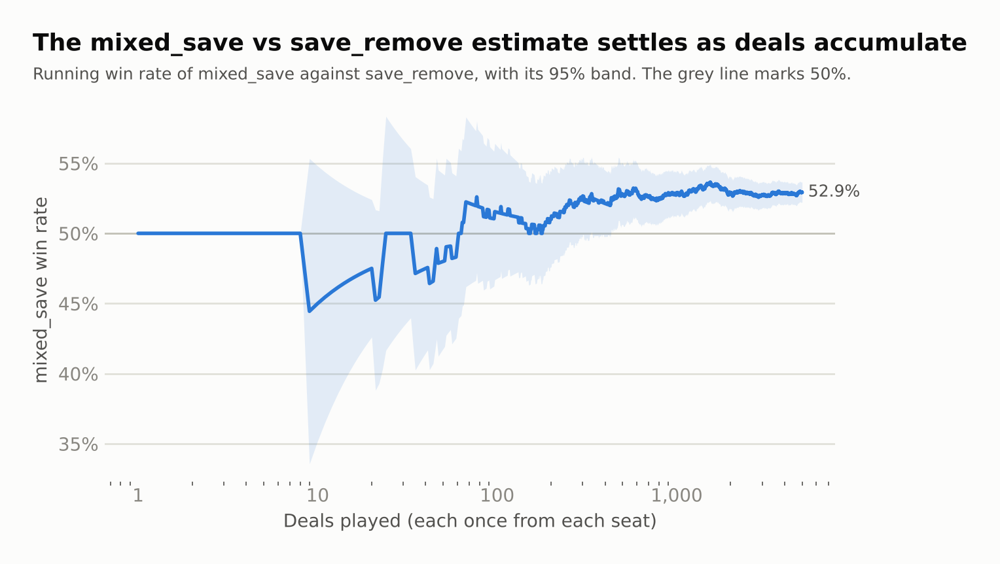
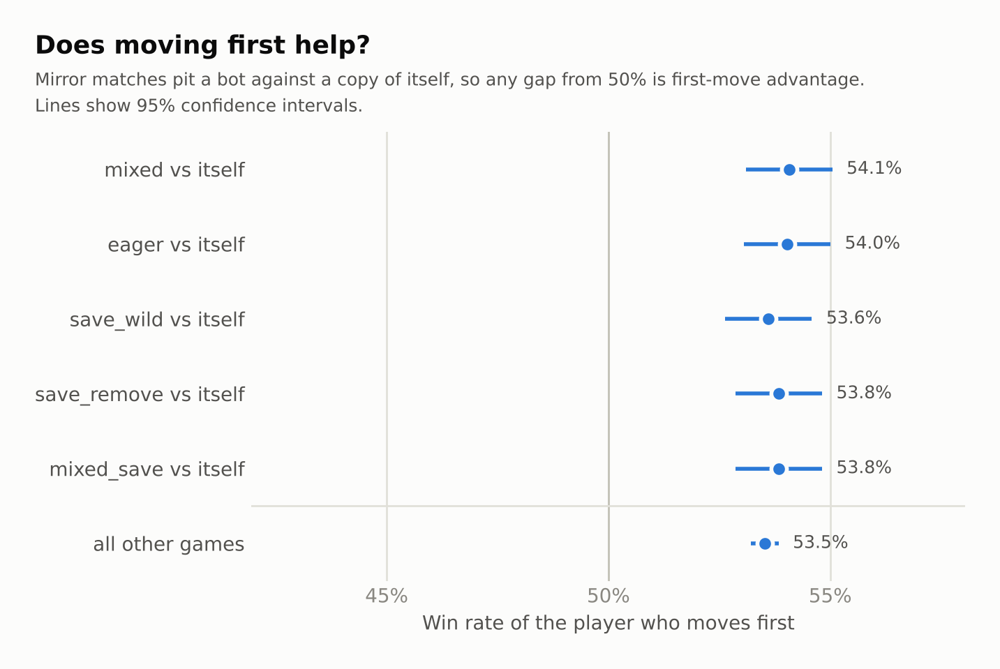
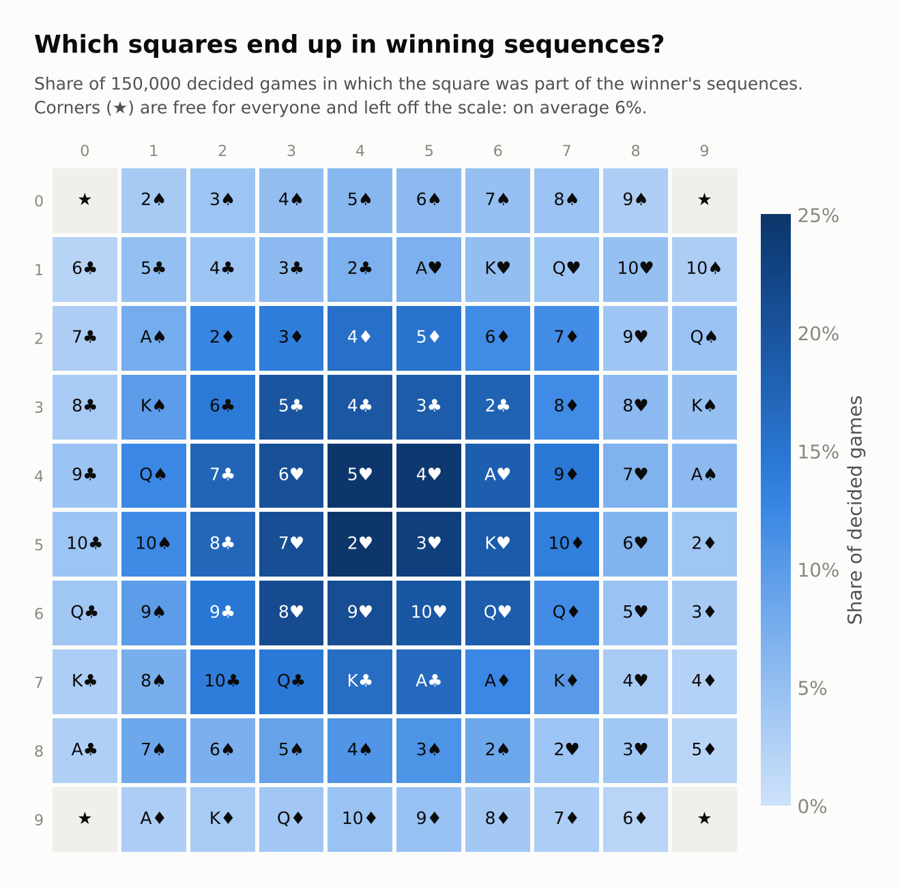

# Tournament summary

150,000 games between 5 bots (100,000 between different bots, 50,000 mirror matches). Draws: 0. Median game length: 50 turns (plies).

Settings: line values per bot (default), 2 sequences to win, first seed 300000, 5000 deals per pairing. Command: `python tournament.py --roster jacks --deals 5000 --seed 300000 --out results/jacks/games.csv.gz`

## Win-rate matrix

Row bot's win rate against the column bot, with the 95% margin. Margins come from paired deals (each deal is played once from each seat).

| bot \ opponent | mixed | eager | save_wild | save_remove | mixed_save | avg vs field |
|---|---|---|---|---|---|---|
| **mixed** | – | 50.8% ±0.5 | 47.3% ±0.7 | 46.7% ±0.7 | 44.2% ±0.8 | 47.3% |
| **eager** | 49.2% ±0.5 | – | 46.1% ±0.7 | 45.9% ±0.7 | 42.9% ±0.8 | 46.0% |
| **save_wild** | 52.6% ±0.7 | 53.9% ±0.7 | – | 49.6% ±0.8 | 46.2% ±0.7 | 50.6% |
| **save_remove** | 53.3% ±0.7 | 54.1% ±0.7 | 50.4% ±0.8 | – | 47.1% ±0.7 | 51.2% |
| **mixed_save** | 55.8% ±0.8 | 57.1% ±0.8 | 53.8% ±0.7 | 52.9% ±0.7 | – | 54.9% |

Games per pairing: 10,000.

## Equilibrium of the meta-game

If each player secretly picks a bot, this mix of bots can't be exploited: no single bot wins more than 50% against it. The bootstrap redraws every win rate within its margin 500 times and re-solves, to show how stable the answer is. The last column is each bot's win rate against the equilibrium mix (Nash averaging, Balduzzi et al. 2018): unlike the average against the field, it can't be inflated by adding weak bots.

| bot | equilibrium weight | bootstrap 95% range | in the mix (share of resamples) | win rate vs the mix |
|---|---|---|---|---|
| mixed | 0.0% | 0.0% – 0.0% | 0% | 44.2% |
| eager | 0.0% | 0.0% – 0.0% | 0% | 42.9% |
| save_wild | 0.0% | 0.0% – 0.0% | 0% | 46.2% |
| save_remove | 0.0% | 0.0% – 0.0% | 0% | 47.1% |
| mixed_save | 100.0% | 100.0% – 100.0% | 100% | 50.0% |

Game value: -0.0000 (a symmetric zero-sum game is worth 0).
Cross-check with nashpy's linear program: same mix, worst-case payoff +0.0000.

## Best responses

| against | best response | its win rate |
|---|---|---|
| mixed | mixed_save | 55.8% |
| eager | mixed_save | 57.1% |
| save_wild | mixed_save | 53.8% |
| save_remove | mixed_save | 52.9% |
| mixed_save | mixed_save | 50.0% |

9 of 10 pairings differ from 50% after a Holm correction for multiple comparisons.

Beats every other bot (Holm-corrected): mixed_save.
Rock-paper-scissors cycles (all three wins Holm-corrected): none.

## Skill ladder or cycles?

A rating per bot explains 99.8% of the variation in the win-rate matrix; the remaining 0.2% is cyclic (rock-paper-scissors). Rating = the bot's average edge over 50% across all bots, itself included.

| bot | rating |
|---|---|
| mixed_save | +3.9 points |
| save_remove | +1.0 points |
| save_wild | +0.5 points |
| mixed | -2.2 points |
| eager | -3.2 points |

## Replicator dynamics

A population starts evenly split between the bots; each bot's share grows in proportion to how much better than average it does. Shares at t = 300:

| bot | start | end |
|---|---|---|
| mixed | 20.0% | 0.0% |
| eager | 20.0% | 0.0% |
| save_wild | 20.0% | 0.0% |
| save_remove | 20.0% | 0.0% |
| mixed_save | 20.0% | 100.0% |

## Each strategy against mixed_save

mixed_save won the pilot, and each new idea is built on it, so this is what each idea adds (or costs). Significant = differs from 50% after the Holm correction.

| bot | win rate vs mixed_save | 95% margin | significant |
|---|---|---|---|
| save_remove | 47.1% | ±0.7 | yes |
| save_wild | 46.2% | ±0.7 | yes |
| mixed | 44.2% | ±0.8 | yes |
| eager | 42.9% | ±0.8 | yes |

## Jack timing

Each variant differs from mixed only in when it plays Jacks. Win rate against mixed:

| variant | win rate vs mixed | 95% margin |
|---|---|---|
| eager | 49.2% | ±0.5 |
| save_wild | 52.6% | ±0.7 |
| save_remove | 53.3% | ±0.7 |
| mixed_save | 55.8% | ±0.8 |

## First-move advantage

Win rate of the player who moves first. 50% means no advantage.

| games | first player wins | 95% range | games played |
|---|---|---|---|
| mixed vs itself | 54.1% | 53.1% – 55.0% | 10,000 |
| eager vs itself | 54.0% | 53.1% – 55.0% | 10,000 |
| save_wild vs itself | 53.6% | 52.6% – 54.6% | 10,000 |
| save_remove vs itself | 53.8% | 52.9% – 54.8% | 10,000 |
| mixed_save vs itself | 53.8% | 52.9% – 54.8% | 10,000 |
| all other games | 53.5% | 53.2% – 53.8% | 100,000 |

## Game length

Median length in plies (one ply = one player's turn).

| bot | against other bots | mirror matches |
|---|---|---|
| mixed | 49 | 49 |
| eager | 49 | 49 |
| save_wild | 49 | 49 |
| save_remove | 50 | 51 |
| mixed_save | 50 | 52 |

## Jack use

Average per game played.

What the Jacks achieved: the share of two-eyed Jacks that completed a sequence or blocked an opponent's four, and of one-eyed Jacks that broke an opponent's four.

| bot | two-eyed Jacks | finished a sequence | blocked a four | one-eyed Jacks | broke a four | dead cards traded |
|---|---|---|---|---|---|---|
| mixed | 1.22 | 31.6% | 13.6% | 1.16 | 37.9% | 0.18 |
| eager | 1.22 | 31.0% | 13.7% | 1.17 | 37.0% | 0.19 |
| save_wild | 1.22 | 46.7% | 53.2% | 1.17 | 34.3% | 0.18 |
| save_remove | 1.25 | 32.0% | 13.1% | 1.16 | 99.7% | 0.24 |
| mixed_save | 1.25 | 47.5% | 52.5% | 1.14 | 99.7% | 0.24 |

## Squares that win games

Share of 150,000 decided games in which the square was part of the winner's sequences. The four corners (free spaces) average 5.7%. Central squares lie on more of the 192 lines (up to 20, against 3 for a corner), so part of this is geometry; the next section separates the two.

| rank | square | row, col | lines through it | share |
|---|---|---|---|---|
| 1 | 2♥ | 5, 4 | 20 | 25.0% |
| 2 | 5♥ | 4, 4 | 20 | 24.8% |
| 3 | 4♥ | 4, 5 | 20 | 24.4% |
| 4 | 3♥ | 5, 5 | 20 | 23.4% |
| 5 | 8♥ | 6, 3 | 15 | 21.5% |
| 6 | 9♥ | 6, 4 | 17 | 21.1% |
| 7 | 7♥ | 5, 3 | 17 | 21.0% |
| 8 | 6♥ | 4, 3 | 17 | 20.7% |
| 9 | 5♣ | 3, 3 | 15 | 19.8% |
| 10 | 10♥ | 6, 5 | 17 | 19.6% |

## Squares beyond geometry

Needs random-vs-random games (include `random` in the tournament) to separate strategy from geometry.

## Charts

