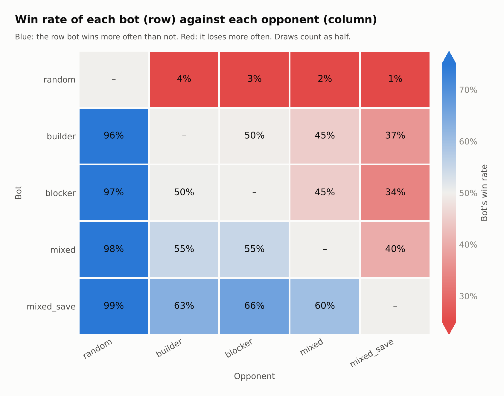
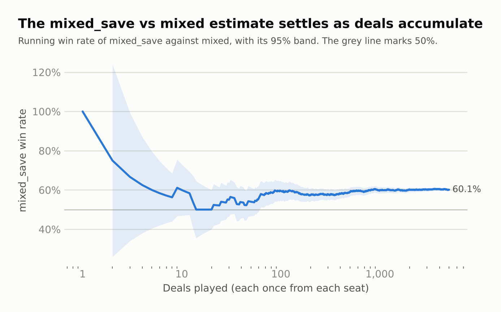
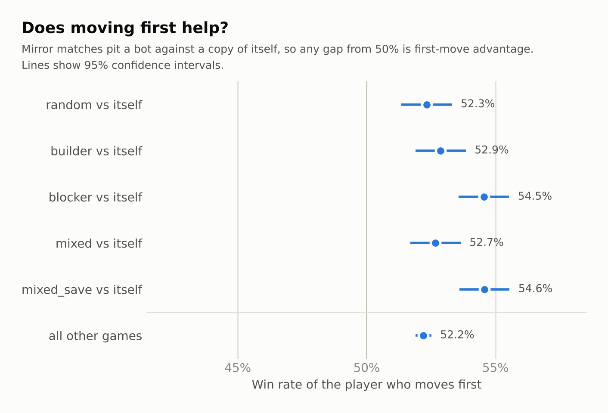
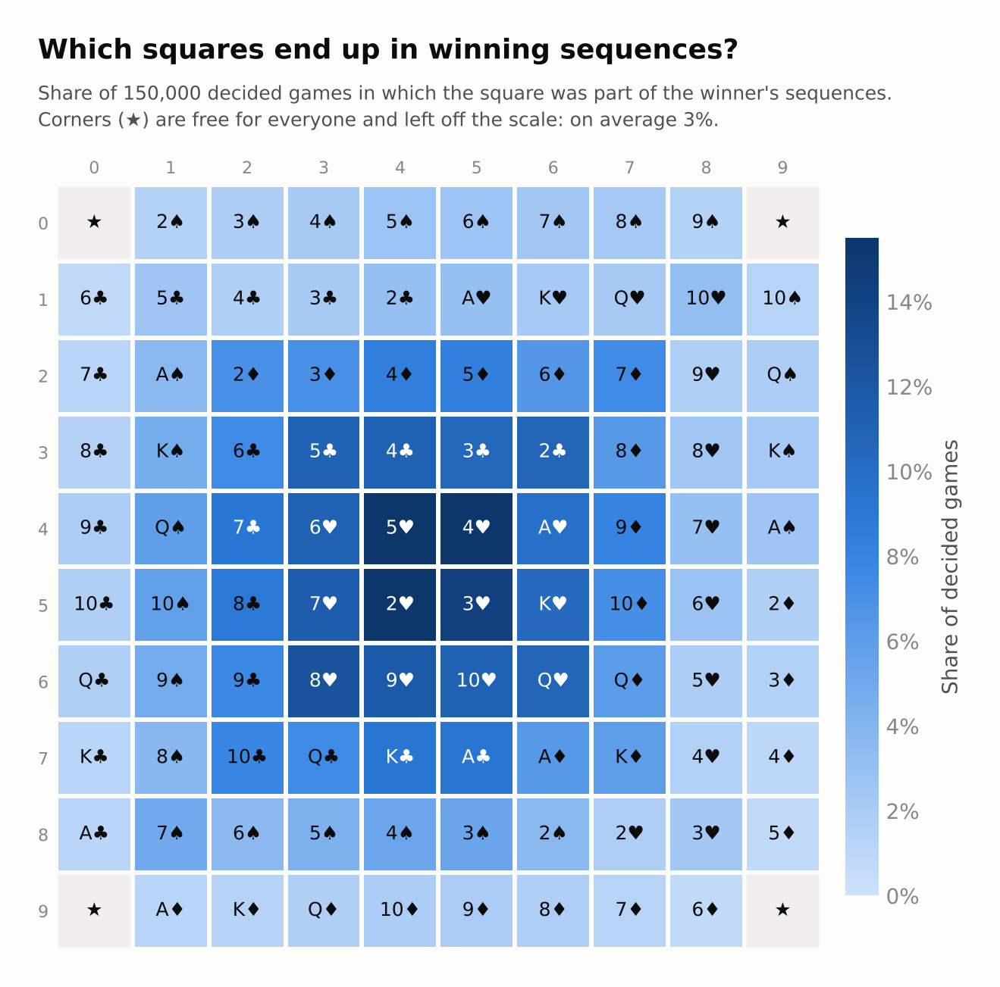
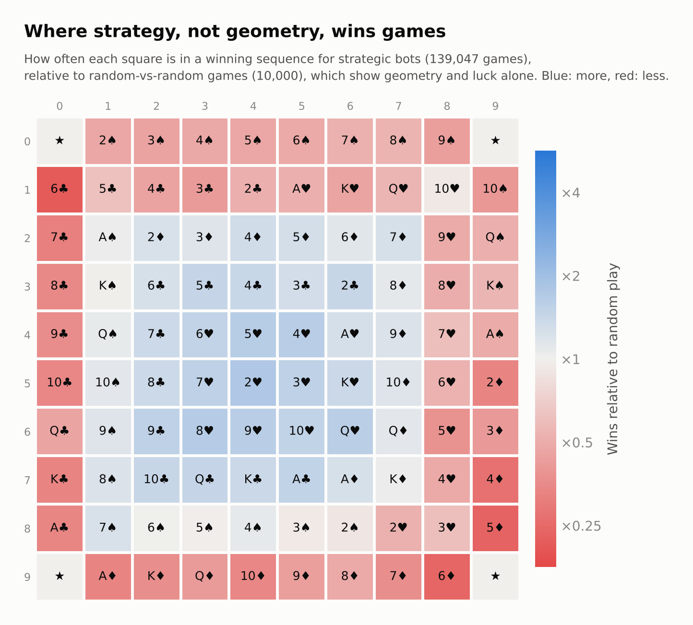

# Tournament summary

150,000 games between 5 bots (100,000 between different bots, 50,000 mirror matches). Draws: 0. Median game length: 31 turns (plies).

Settings: line values per bot (default), 1 sequences to win, first seed 2026, 5000 deals per pairing. Command: `python tournament.py --roster pilot --sequences-to-win 1 --deals 5000 --out results/one_sequence/games.csv.gz`

## Win-rate matrix

Row bot's win rate against the column bot, with the 95% margin. Margins come from paired deals (each deal is played once from each seat).

| bot \ opponent | random | builder | blocker | mixed | mixed_save | avg vs field |
|---|---|---|---|---|---|---|
| **random** | – | 3.7% ±0.4 | 2.6% ±0.3 | 2.4% ±0.3 | 0.9% ±0.2 | 2.4% |
| **builder** | 96.3% ±0.4 | – | 49.7% ±0.8 | 44.8% ±0.7 | 36.5% ±0.7 | 56.8% |
| **blocker** | 97.4% ±0.3 | 50.3% ±0.8 | – | 44.8% ±0.7 | 33.8% ±0.8 | 56.5% |
| **mixed** | 97.7% ±0.3 | 55.2% ±0.7 | 55.2% ±0.7 | – | 39.9% ±0.7 | 62.0% |
| **mixed_save** | 99.2% ±0.2 | 63.5% ±0.7 | 66.2% ±0.8 | 60.1% ±0.7 | – | 72.2% |

Games per pairing: 10,000.

## Equilibrium of the meta-game

If each player secretly picks a bot, this mix of bots can't be exploited: no single bot wins more than 50% against it. The bootstrap redraws every win rate within its margin 500 times and re-solves, to show how stable the answer is. The last column is each bot's win rate against the equilibrium mix (Nash averaging, Balduzzi et al. 2018): unlike the average against the field, it can't be inflated by adding weak bots.

| bot | equilibrium weight | bootstrap 95% range | in the mix (share of resamples) | win rate vs the mix |
|---|---|---|---|---|
| random | 0.0% | 0.0% – 0.0% | 0% | 0.9% |
| builder | 0.0% | 0.0% – 0.0% | 0% | 36.5% |
| blocker | 0.0% | 0.0% – 0.0% | 0% | 33.8% |
| mixed | 0.0% | 0.0% – 0.0% | 0% | 39.9% |
| mixed_save | 100.0% | 100.0% – 100.0% | 100% | 50.0% |

Game value: -0.0000 (a symmetric zero-sum game is worth 0).
Cross-check with nashpy's linear program: same mix, worst-case payoff +0.0000.

## Best responses

| against | best response | its win rate |
|---|---|---|
| random | mixed_save | 99.2% |
| builder | mixed_save | 63.5% |
| blocker | mixed_save | 66.2% |
| mixed | mixed_save | 60.1% |
| mixed_save | mixed_save | 50.0% |

9 of 10 pairings differ from 50% after a Holm correction for multiple comparisons.

Beats every other bot (Holm-corrected): mixed_save.
Rock-paper-scissors cycles (all three wins Holm-corrected): none.

## Skill ladder or cycles?

A rating per bot explains 99.1% of the variation in the win-rate matrix; the remaining 0.9% is cyclic (rock-paper-scissors). Rating = the bot's average edge over 50% across all bots, itself included.

| bot | rating |
|---|---|
| mixed_save | +17.8 points |
| mixed | +9.6 points |
| builder | +5.5 points |
| blocker | +5.2 points |
| random | -38.1 points |

## Replicator dynamics

A population starts evenly split between the bots; each bot's share grows in proportion to how much better than average it does. Shares at t = 300:

| bot | start | end |
|---|---|---|
| random | 20.0% | 0.0% |
| builder | 20.0% | 0.0% |
| blocker | 20.0% | 0.0% |
| mixed | 20.0% | 0.0% |
| mixed_save | 20.0% | 100.0% |

## Each strategy against mixed_save

mixed_save won the pilot, and each new idea is built on it, so this is what each idea adds (or costs). Significant = differs from 50% after the Holm correction.

| bot | win rate vs mixed_save | 95% margin | significant |
|---|---|---|---|
| mixed | 39.9% | ±0.7 | yes |
| builder | 36.5% | ±0.7 | yes |
| blocker | 33.8% | ±0.8 | yes |
| random | 0.9% | ±0.2 | yes |

## Jack timing

Each variant differs from mixed only in when it plays Jacks. Win rate against mixed:

| variant | win rate vs mixed | 95% margin |
|---|---|---|
| mixed_save | 60.1% | ±0.7 |

## First-move advantage

Win rate of the player who moves first. 50% means no advantage.

| games | first player wins | 95% range | games played |
|---|---|---|---|
| random vs itself | 52.3% | 51.4% – 53.3% | 10,000 |
| builder vs itself | 52.9% | 51.9% – 53.8% | 10,000 |
| blocker vs itself | 54.5% | 53.6% – 55.5% | 10,000 |
| mixed vs itself | 52.7% | 51.7% – 53.6% | 10,000 |
| mixed_save vs itself | 54.6% | 53.6% – 55.5% | 10,000 |
| all other games | 52.2% | 51.9% – 52.5% | 100,000 |

## Game length

Median length in plies (one ply = one player's turn).

| bot | against other bots | mirror matches |
|---|---|---|
| random | 32 | 63 |
| builder | 28 | 25 |
| blocker | 32 | 34 |
| mixed | 30 | 30 |
| mixed_save | 29 | 33 |

## Jack use

Average per game played.

What the Jacks achieved: the share of two-eyed Jacks that completed a sequence or blocked an opponent's four, and of one-eyed Jacks that broke an opponent's four.

| bot | two-eyed Jacks | finished a sequence | blocked a four | one-eyed Jacks | broke a four | dead cards traded |
|---|---|---|---|---|---|---|
| random | 0.82 | 1.0% | 1.8% | 0.78 | 19.3% | 0.22 |
| builder | 0.81 | 27.8% | 0.4% | 0.57 | 18.2% | 0.03 |
| blocker | 0.91 | 23.7% | 10.7% | 0.85 | 21.1% | 0.06 |
| mixed | 0.86 | 27.2% | 9.0% | 0.78 | 23.3% | 0.04 |
| mixed_save | 0.79 | 52.0% | 48.0% | 0.57 | 100.0% | 0.04 |

## Squares that win games

Share of 150,000 decided games in which the square was part of the winner's sequences. The four corners (free spaces) average 3.2%. Central squares lie on more of the 192 lines (up to 20, against 3 for a corner), so part of this is geometry; the next section separates the two.

| rank | square | row, col | lines through it | share |
|---|---|---|---|---|
| 1 | 2♥ | 5, 4 | 20 | 15.5% |
| 2 | 5♥ | 4, 4 | 20 | 15.5% |
| 3 | 4♥ | 4, 5 | 20 | 15.5% |
| 4 | 3♥ | 5, 5 | 20 | 14.4% |
| 5 | 8♥ | 6, 3 | 15 | 12.5% |
| 6 | 9♥ | 6, 4 | 17 | 11.8% |
| 7 | 7♥ | 5, 3 | 17 | 11.5% |
| 8 | 6♥ | 4, 3 | 17 | 11.2% |
| 9 | 4♣ | 3, 4 | 17 | 11.1% |
| 10 | 10♥ | 6, 5 | 17 | 11.1% |

## Squares beyond geometry

Random-vs-random games (10,000) show what geometry and luck alone produce. Lift = a square's share among strategic bots' wins (139,047 games) divided by its share under random play; above 1, strategy uses the square more than geometry predicts.

|  | square | row, col | lift |
|---|---|---|---|
| most | 2♥ | 5, 4 | ×1.75 |
| most | 8♥ | 6, 3 | ×1.66 |
| most | 5♥ | 4, 4 | ×1.63 |
| most | 4♥ | 4, 5 | ×1.62 |
| most | 9♥ | 6, 4 | ×1.61 |
| least | 7♣ | 2, 0 | ×0.31 |
| least | 4♦ | 7, 9 | ×0.27 |
| least | 6♦ | 9, 8 | ×0.24 |
| least | 5♦ | 8, 9 | ×0.23 |
| least | 6♣ | 1, 0 | ×0.22 |

## Charts

