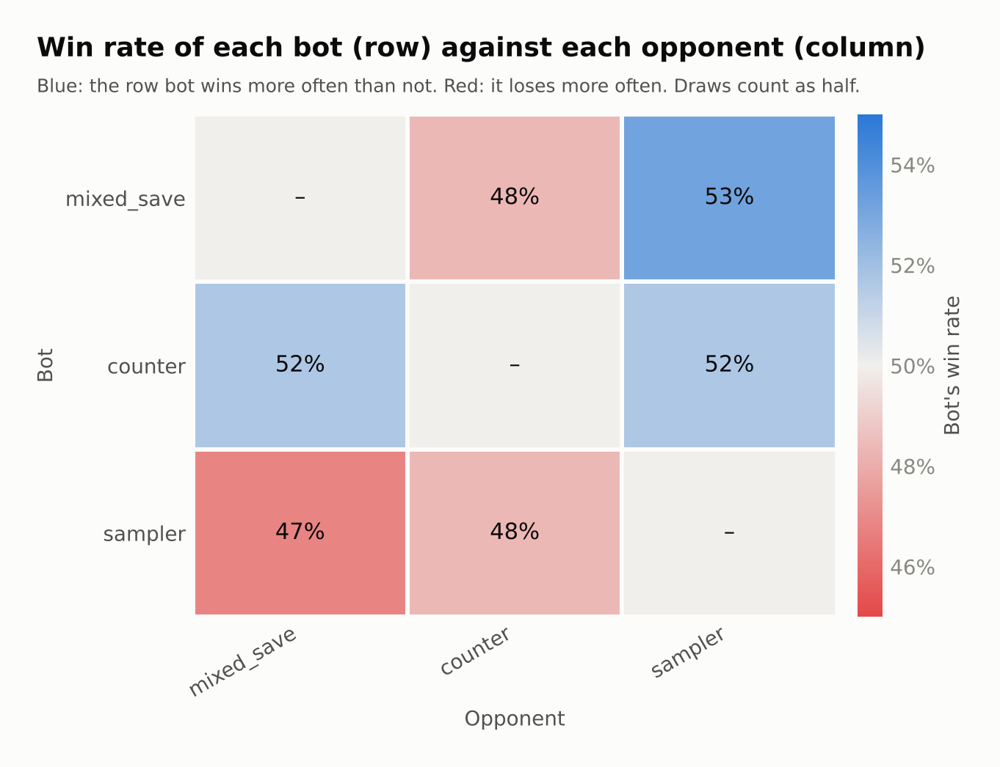
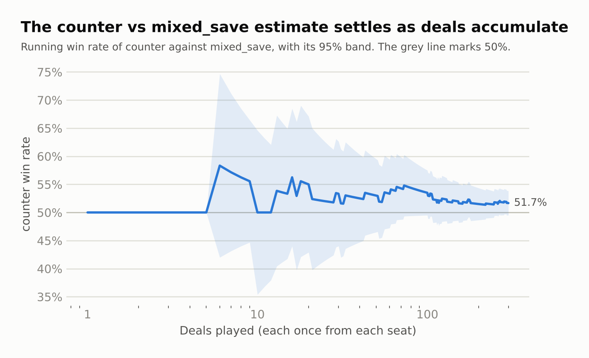
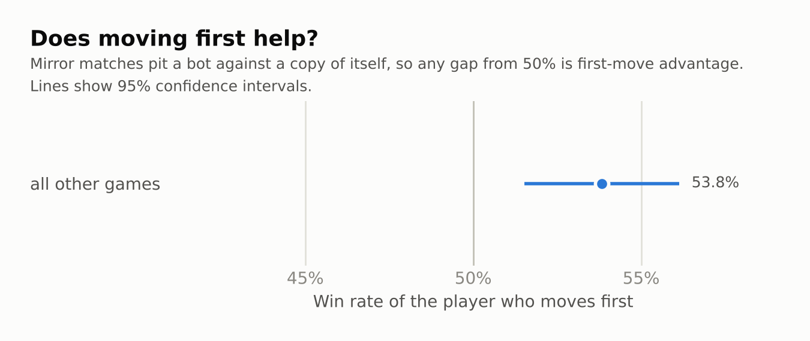
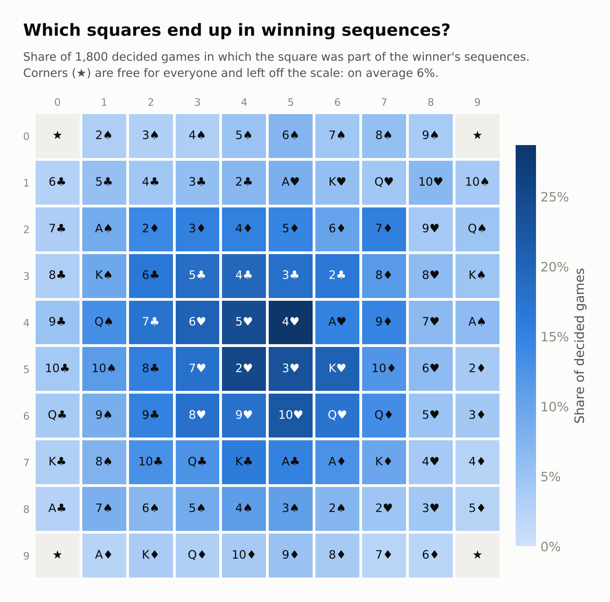

# Tournament summary

1,800 games between 3 bots (1,800 between different bots, 0 mirror matches). Draws: 0. Median game length: 51 turns (plies).

Settings: line values per bot (default), 2 sequences to win, first seed 600000, 300 deals per pairing. Command: `python tournament.py --bots mixed_save counter sampler --deals 300 --seed 600000 --no-mirror --out results/sampler/games.csv.gz`

## Win-rate matrix

Row bot's win rate against the column bot, with the 95% margin. Margins come from paired deals (each deal is played once from each seat).

| bot \ opponent | mixed_save | counter | sampler | avg vs field |
|---|---|---|---|---|
| **mixed_save** | – | 48.3% ±2.2 | 53.2% ±3.4 | 50.7% |
| **counter** | 51.7% ±2.2 | – | 51.7% ±3.3 | 51.7% |
| **sampler** | 46.8% ±3.4 | 48.3% ±3.3 | – | 47.6% |

Games per pairing: 600.

## Equilibrium of the meta-game

If each player secretly picks a bot, this mix of bots can't be exploited: no single bot wins more than 50% against it. The bootstrap redraws every win rate within its margin 500 times and re-solves, to show how stable the answer is. The last column is each bot's win rate against the equilibrium mix (Nash averaging, Balduzzi et al. 2018): unlike the average against the field, it can't be inflated by adding weak bots.

| bot | equilibrium weight | bootstrap 95% range | in the mix (share of resamples) | win rate vs the mix |
|---|---|---|---|---|
| mixed_save | 0.0% | 0.0% – 100.0% | 19% | 48.3% |
| counter | 100.0% | 0.0% – 100.0% | 95% | 50.0% |
| sampler | 0.0% | 0.0% – 52.3% | 17% | 48.3% |

Game value: -0.0000 (a symmetric zero-sum game is worth 0).
Cross-check with nashpy's linear program: same mix, worst-case payoff +0.0000.

## Best responses

| against | best response | its win rate |
|---|---|---|
| mixed_save | counter | 51.7% |
| counter | counter | 50.0% |
| sampler | mixed_save | 53.2% |

0 of 3 pairings differ from 50% after a Holm correction for multiple comparisons.

Beats every other bot (Holm-corrected): none.
Rock-paper-scissors cycles (all three wins Holm-corrected): none.

## Skill ladder or cycles?

A rating per bot explains 78.6% of the variation in the win-rate matrix; the remaining 21.4% is cyclic (rock-paper-scissors). Rating = the bot's average edge over 50% across all bots, itself included.

| bot | rating |
|---|---|
| counter | +1.1 points |
| mixed_save | +0.5 points |
| sampler | -1.6 points |

## Replicator dynamics

A population starts evenly split between the bots; each bot's share grows in proportion to how much better than average it does. Shares at t = 300:

| bot | start | end |
|---|---|---|
| mixed_save | 33.3% | 1.2% |
| counter | 33.3% | 98.7% |
| sampler | 33.3% | 0.2% |

## Each strategy against mixed_save

mixed_save won the pilot, and each new idea is built on it, so this is what each idea adds (or costs). Significant = differs from 50% after the Holm correction.

| bot | win rate vs mixed_save | 95% margin | significant |
|---|---|---|---|
| counter | 51.7% | ±2.2 | no |
| sampler | 46.8% | ±3.4 | no |

## First-move advantage

Win rate of the player who moves first. 50% means no advantage.

| games | first player wins | 95% range | games played |
|---|---|---|---|
| all other games | 53.8% | 51.5% – 56.1% | 1,800 |

## Game length

Median length in plies (one ply = one player's turn).

| bot | against other bots | mirror matches |
|---|---|---|
| mixed_save | 52 | n/a |
| counter | 51 | n/a |
| sampler | 51 | n/a |

## Jack use

Average per game played.

What the Jacks achieved: the share of two-eyed Jacks that completed a sequence or blocked an opponent's four, and of one-eyed Jacks that broke an opponent's four.

| bot | two-eyed Jacks | finished a sequence | blocked a four | one-eyed Jacks | broke a four | dead cards traded |
|---|---|---|---|---|---|---|
| mixed_save | 1.23 | 48.9% | 51.1% | 1.13 | 99.8% | 0.23 |
| counter | 1.22 | 50.4% | 49.6% | 1.09 | 100.0% | 0.24 |
| sampler | 1.25 | 41.0% | 58.9% | 1.15 | 99.3% | 0.27 |

## Squares that win games

Share of 1,800 decided games in which the square was part of the winner's sequences. The four corners (free spaces) average 6.1%. Central squares lie on more of the 192 lines (up to 20, against 3 for a corner), so part of this is geometry; the next section separates the two.

| rank | square | row, col | lines through it | share |
|---|---|---|---|---|
| 1 | 4♥ | 4, 5 | 20 | 28.7% |
| 2 | 2♥ | 5, 4 | 20 | 25.1% |
| 3 | 5♥ | 4, 4 | 20 | 24.5% |
| 4 | 3♥ | 5, 5 | 20 | 23.3% |
| 5 | 10♥ | 6, 5 | 17 | 22.3% |
| 6 | 6♥ | 4, 3 | 17 | 20.7% |
| 7 | K♥ | 5, 6 | 17 | 20.6% |
| 8 | 4♣ | 3, 4 | 17 | 19.4% |
| 9 | 5♣ | 3, 3 | 15 | 18.6% |
| 10 | 3♣ | 3, 5 | 17 | 18.1% |

## Squares beyond geometry

Needs random-vs-random games (include `random` in the tournament) to separate strategy from geometry.

## Charts

