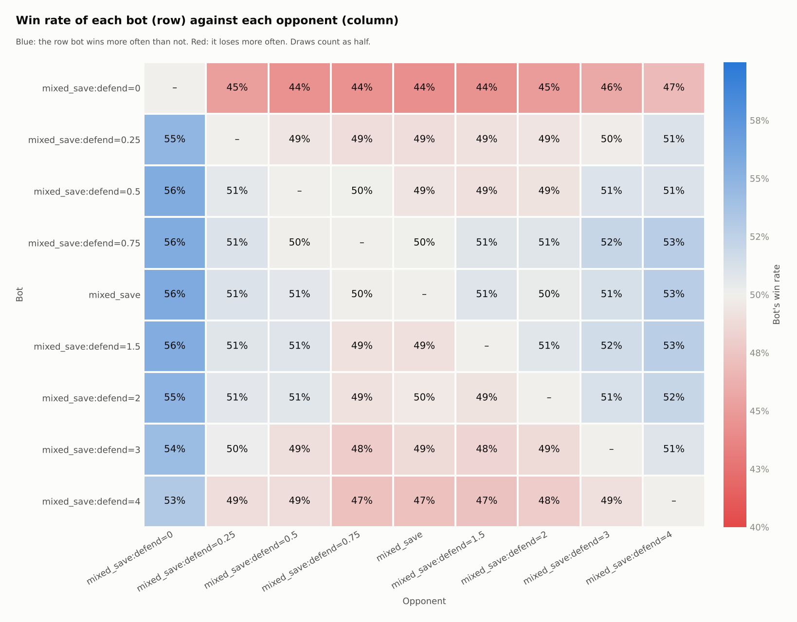
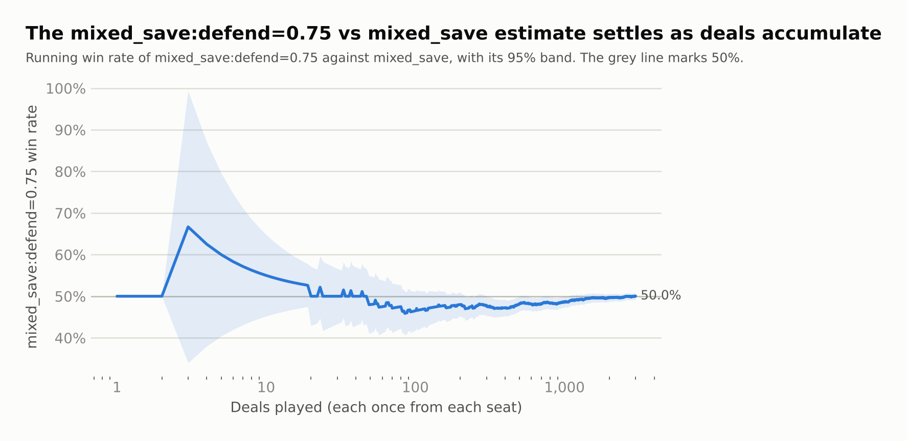
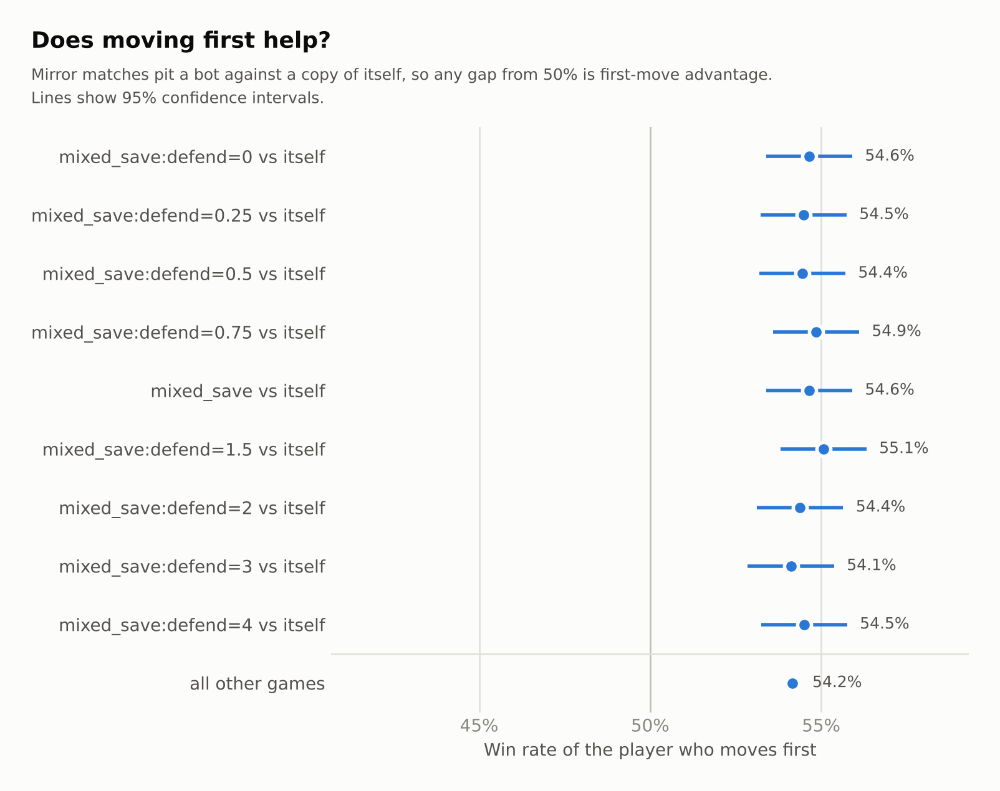
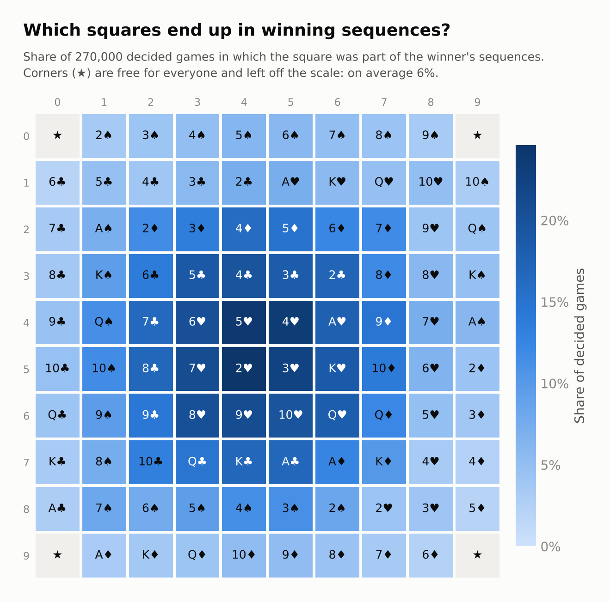

# Tournament summary

270,000 games between 9 bots (216,000 between different bots, 54,000 mirror matches). Draws: 0. Median game length: 50 turns (plies).

Settings: line values per bot (default), 2 sequences to win, first seed 400000, 3000 deals per pairing. Command: `python tournament.py --bots mixed_save:defend=0 mixed_save:defend=0.25 mixed_save:defend=0.5 mixed_save:defend=0.75 mixed_save mixed_save:defend=1.5 mixed_save:defend=2 mixed_save:defend=3 mixed_save:defend=4 --deals 3000 --seed 400000 --out results/sweep_defend/games.csv.gz`

## Win-rate matrix

Row bot's win rate against the column bot, with the 95% margin. Margins come from paired deals (each deal is played once from each seat).

| bot \ opponent | mixed_save:defend=0 | mixed_save:defend=0.25 | mixed_save:defend=0.5 | mixed_save:defend=0.75 | mixed_save | mixed_save:defend=1.5 | mixed_save:defend=2 | mixed_save:defend=3 | mixed_save:defend=4 | avg vs field |
|---|---|---|---|---|---|---|---|---|---|---|
| **mixed_save:defend=0** | – | 45.2% ±0.9 | 44.4% ±1.0 | 44.4% ±1.0 | 44.2% ±1.0 | 44.5% ±1.0 | 45.0% ±1.0 | 45.8% ±1.0 | 46.8% ±1.0 | 45.0% |
| **mixed_save:defend=0.25** | 54.8% ±0.9 | – | 49.4% ±0.8 | 49.0% ±0.9 | 48.9% ±0.9 | 49.2% ±1.0 | 49.3% ±1.0 | 49.8% ±1.0 | 51.1% ±1.0 | 50.2% |
| **mixed_save:defend=0.5** | 55.6% ±1.0 | 50.6% ±0.8 | – | 50.1% ±0.8 | 49.4% ±0.9 | 49.1% ±1.0 | 49.3% ±1.0 | 51.0% ±1.0 | 51.0% ±1.0 | 50.8% |
| **mixed_save:defend=0.75** | 55.6% ±1.0 | 51.0% ±0.9 | 49.9% ±0.8 | – | 50.0% ±0.8 | 50.8% ±0.9 | 50.8% ±0.9 | 52.0% ±1.0 | 52.8% ±1.0 | 51.6% |
| **mixed_save** | 55.8% ±1.0 | 51.1% ±0.9 | 50.6% ±0.9 | 50.0% ±0.8 | – | 50.9% ±0.8 | 50.3% ±0.9 | 51.3% ±1.0 | 52.8% ±1.0 | 51.6% |
| **mixed_save:defend=1.5** | 55.5% ±1.0 | 50.8% ±1.0 | 50.9% ±1.0 | 49.2% ±0.9 | 49.1% ±0.8 | – | 50.7% ±0.8 | 51.6% ±0.9 | 52.7% ±1.0 | 51.3% |
| **mixed_save:defend=2** | 55.0% ±1.0 | 50.7% ±1.0 | 50.7% ±1.0 | 49.2% ±0.9 | 49.7% ±0.9 | 49.3% ±0.8 | – | 51.2% ±0.9 | 52.0% ±0.9 | 51.0% |
| **mixed_save:defend=3** | 54.2% ±1.0 | 50.2% ±1.0 | 49.0% ±1.0 | 48.0% ±1.0 | 48.7% ±1.0 | 48.4% ±0.9 | 48.8% ±0.9 | – | 50.9% ±0.9 | 49.8% |
| **mixed_save:defend=4** | 53.2% ±1.0 | 48.9% ±1.0 | 49.0% ±1.0 | 47.2% ±1.0 | 47.2% ±1.0 | 47.3% ±1.0 | 48.0% ±0.9 | 49.1% ±0.9 | – | 48.7% |

Games per pairing: 6,000.

## Equilibrium of the meta-game

If each player secretly picks a bot, this mix of bots can't be exploited: no single bot wins more than 50% against it. The bootstrap redraws every win rate within its margin 500 times and re-solves, to show how stable the answer is. The last column is each bot's win rate against the equilibrium mix (Nash averaging, Balduzzi et al. 2018): unlike the average against the field, it can't be inflated by adding weak bots.

| bot | equilibrium weight | bootstrap 95% range | in the mix (share of resamples) | win rate vs the mix |
|---|---|---|---|---|
| mixed_save:defend=0 | 0.0% | 0.0% – 0.0% | 0% | 44.4% |
| mixed_save:defend=0.25 | 0.0% | 0.0% – 0.0% | 0% | 49.0% |
| mixed_save:defend=0.5 | 4.5% | 0.0% – 44.0% | 35% | 50.0% |
| mixed_save:defend=0.75 | 86.4% | 0.0% – 100.0% | 63% | 50.0% |
| mixed_save | 9.1% | 0.0% – 100.0% | 72% | 50.0% |
| mixed_save:defend=1.5 | 0.0% | 0.0% – 16.2% | 11% | 49.2% |
| mixed_save:defend=2 | 0.0% | 0.0% – 31.5% | 18% | 49.3% |
| mixed_save:defend=3 | 0.0% | 0.0% – 0.0% | 0% | 48.1% |
| mixed_save:defend=4 | 0.0% | 0.0% – 0.0% | 0% | 47.3% |

Game value: -0.0000 (a symmetric zero-sum game is worth 0).
Cross-check with nashpy's linear program: same mix, worst-case payoff -0.0000.

## Best responses

| against | best response | its win rate |
|---|---|---|
| mixed_save:defend=0 | mixed_save | 55.8% |
| mixed_save:defend=0.25 | mixed_save | 51.1% |
| mixed_save:defend=0.5 | mixed_save:defend=1.5 | 50.9% |
| mixed_save:defend=0.75 | mixed_save:defend=0.5 | 50.1% |
| mixed_save | mixed_save:defend=0.75 | 50.0% |
| mixed_save:defend=1.5 | mixed_save | 50.9% |
| mixed_save:defend=2 | mixed_save:defend=0.75 | 50.8% |
| mixed_save:defend=3 | mixed_save:defend=0.75 | 52.0% |
| mixed_save:defend=4 | mixed_save | 52.8% |

14 of 36 pairings differ from 50% after a Holm correction for multiple comparisons.

Beats every other bot (Holm-corrected): none.
Rock-paper-scissors cycles (all three wins Holm-corrected): none.

## Skill ladder or cycles?

A rating per bot explains 98.3% of the variation in the win-rate matrix; the remaining 1.7% is cyclic (rock-paper-scissors). Rating = the bot's average edge over 50% across all bots, itself included.

| bot | rating |
|---|---|
| mixed_save:defend=0.75 | +1.5 points |
| mixed_save | +1.4 points |
| mixed_save:defend=1.5 | +1.2 points |
| mixed_save:defend=2 | +0.9 points |
| mixed_save:defend=0.5 | +0.7 points |
| mixed_save:defend=0.25 | +0.2 points |
| mixed_save:defend=3 | -0.2 points |
| mixed_save:defend=4 | -1.1 points |
| mixed_save:defend=0 | -4.4 points |

## Replicator dynamics

A population starts evenly split between the bots; each bot's share grows in proportion to how much better than average it does. Shares at t = 300:

| bot | start | end |
|---|---|---|
| mixed_save:defend=0 | 11.1% | 0.0% |
| mixed_save:defend=0.25 | 11.1% | 1.1% |
| mixed_save:defend=0.5 | 11.1% | 5.8% |
| mixed_save:defend=0.75 | 11.1% | 40.9% |
| mixed_save | 11.1% | 37.7% |
| mixed_save:defend=1.5 | 11.1% | 8.1% |
| mixed_save:defend=2 | 11.1% | 6.2% |
| mixed_save:defend=3 | 11.1% | 0.2% |
| mixed_save:defend=4 | 11.1% | 0.0% |

## Each strategy against mixed_save

mixed_save won the pilot, and each new idea is built on it, so this is what each idea adds (or costs). Significant = differs from 50% after the Holm correction.

| bot | win rate vs mixed_save | 95% margin | significant |
|---|---|---|---|
| mixed_save:defend=0.75 | 50.0% | ±0.8 | no |
| mixed_save:defend=2 | 49.7% | ±0.9 | no |
| mixed_save:defend=0.5 | 49.4% | ±0.9 | no |
| mixed_save:defend=1.5 | 49.1% | ±0.8 | no |
| mixed_save:defend=0.25 | 48.9% | ±0.9 | no |
| mixed_save:defend=3 | 48.7% | ±1.0 | no |
| mixed_save:defend=4 | 47.2% | ±1.0 | yes |
| mixed_save:defend=0 | 44.2% | ±1.0 | yes |

## First-move advantage

Win rate of the player who moves first. 50% means no advantage.

| games | first player wins | 95% range | games played |
|---|---|---|---|
| mixed_save:defend=0 vs itself | 54.6% | 53.4% – 55.9% | 6,000 |
| mixed_save:defend=0.25 vs itself | 54.5% | 53.2% – 55.7% | 6,000 |
| mixed_save:defend=0.5 vs itself | 54.4% | 53.2% – 55.7% | 6,000 |
| mixed_save:defend=0.75 vs itself | 54.9% | 53.6% – 56.1% | 6,000 |
| mixed_save vs itself | 54.6% | 53.4% – 55.9% | 6,000 |
| mixed_save:defend=1.5 vs itself | 55.1% | 53.8% – 56.3% | 6,000 |
| mixed_save:defend=2 vs itself | 54.4% | 53.1% – 55.6% | 6,000 |
| mixed_save:defend=3 vs itself | 54.1% | 52.9% – 55.4% | 6,000 |
| mixed_save:defend=4 vs itself | 54.5% | 53.2% – 55.8% | 6,000 |
| all other games | 54.2% | 54.0% – 54.4% | 216,000 |

## Game length

Median length in plies (one ply = one player's turn).

| bot | against other bots | mirror matches |
|---|---|---|
| mixed_save:defend=0 | 45 | 39 |
| mixed_save:defend=0.25 | 49 | 48 |
| mixed_save:defend=0.5 | 49 | 49 |
| mixed_save:defend=0.75 | 50 | 50 |
| mixed_save | 51 | 52 |
| mixed_save:defend=1.5 | 51 | 53 |
| mixed_save:defend=2 | 52 | 54 |
| mixed_save:defend=3 | 53 | 56 |
| mixed_save:defend=4 | 53 | 58 |

## Jack use

Average per game played.

What the Jacks achieved: the share of two-eyed Jacks that completed a sequence or blocked an opponent's four, and of one-eyed Jacks that broke an opponent's four.

| bot | two-eyed Jacks | finished a sequence | blocked a four | one-eyed Jacks | broke a four | dead cards traded |
|---|---|---|---|---|---|---|
| mixed_save:defend=0 | 1.07 | 66.9% | 33.1% | 0.77 | 100.0% | 0.11 |
| mixed_save:defend=0.25 | 1.20 | 50.3% | 49.7% | 1.07 | 99.7% | 0.21 |
| mixed_save:defend=0.5 | 1.22 | 49.1% | 50.8% | 1.09 | 99.5% | 0.27 |
| mixed_save:defend=0.75 | 1.24 | 48.2% | 51.8% | 1.10 | 99.6% | 0.27 |
| mixed_save | 1.25 | 46.4% | 53.5% | 1.13 | 99.4% | 0.32 |
| mixed_save:defend=1.5 | 1.27 | 44.9% | 54.9% | 1.14 | 99.1% | 0.39 |
| mixed_save:defend=2 | 1.29 | 43.7% | 56.2% | 1.16 | 98.9% | 0.45 |
| mixed_save:defend=3 | 1.31 | 42.3% | 57.5% | 1.18 | 98.5% | 0.55 |
| mixed_save:defend=4 | 1.33 | 41.0% | 58.8% | 1.20 | 98.3% | 0.61 |

## Squares that win games

Share of 270,000 decided games in which the square was part of the winner's sequences. The four corners (free spaces) average 5.8%. Central squares lie on more of the 192 lines (up to 20, against 3 for a corner), so part of this is geometry; the next section separates the two.

| rank | square | row, col | lines through it | share |
|---|---|---|---|---|
| 1 | 2♥ | 5, 4 | 20 | 24.6% |
| 2 | 5♥ | 4, 4 | 20 | 24.2% |
| 3 | 4♥ | 4, 5 | 20 | 23.5% |
| 4 | 3♥ | 5, 5 | 20 | 22.4% |
| 5 | 7♥ | 5, 3 | 17 | 21.0% |
| 6 | 9♥ | 6, 4 | 17 | 21.0% |
| 7 | 6♥ | 4, 3 | 17 | 20.5% |
| 8 | 8♥ | 6, 3 | 15 | 20.3% |
| 9 | 10♥ | 6, 5 | 17 | 19.8% |
| 10 | 4♣ | 3, 4 | 17 | 19.8% |

## Squares beyond geometry

Needs random-vs-random games (include `random` in the tournament) to separate strategy from geometry.

## Charts

