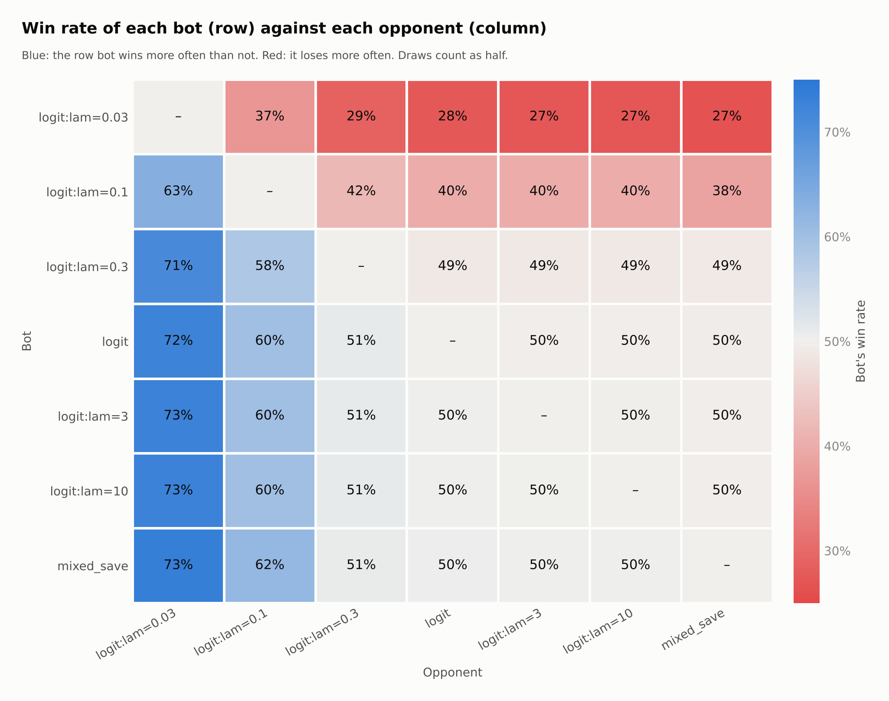
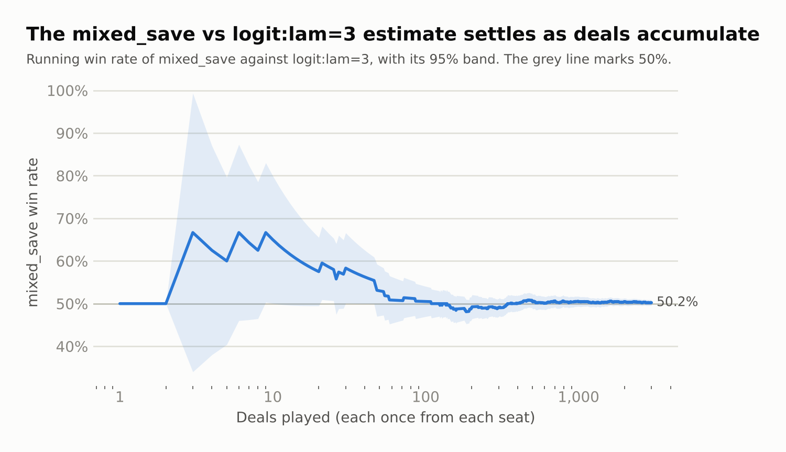
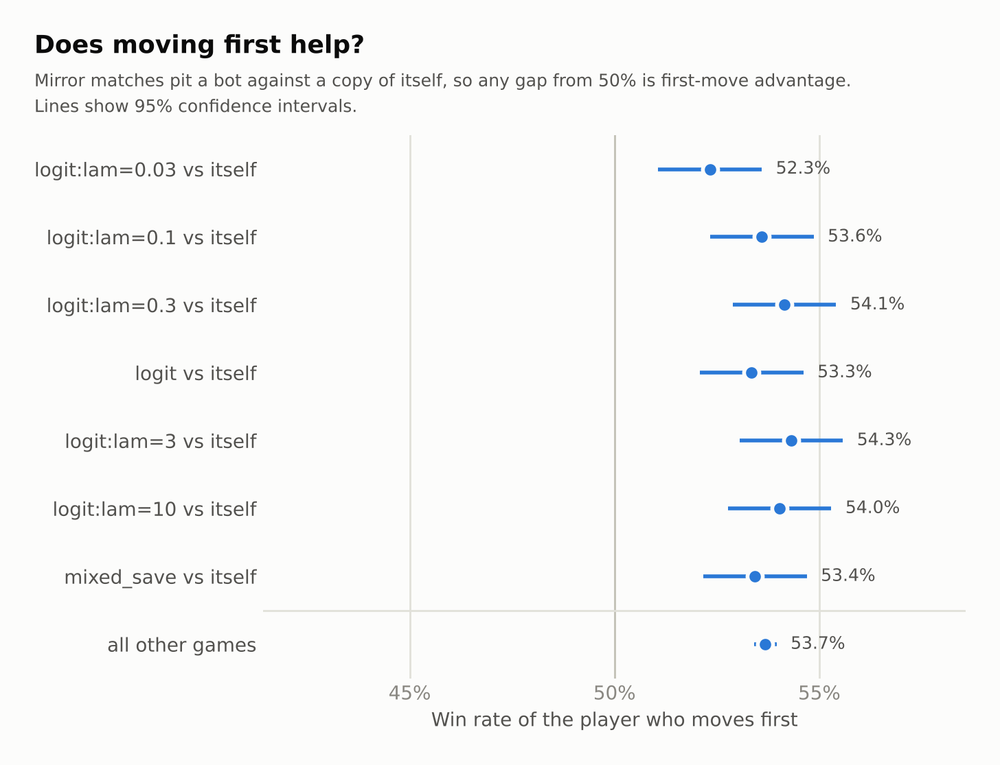
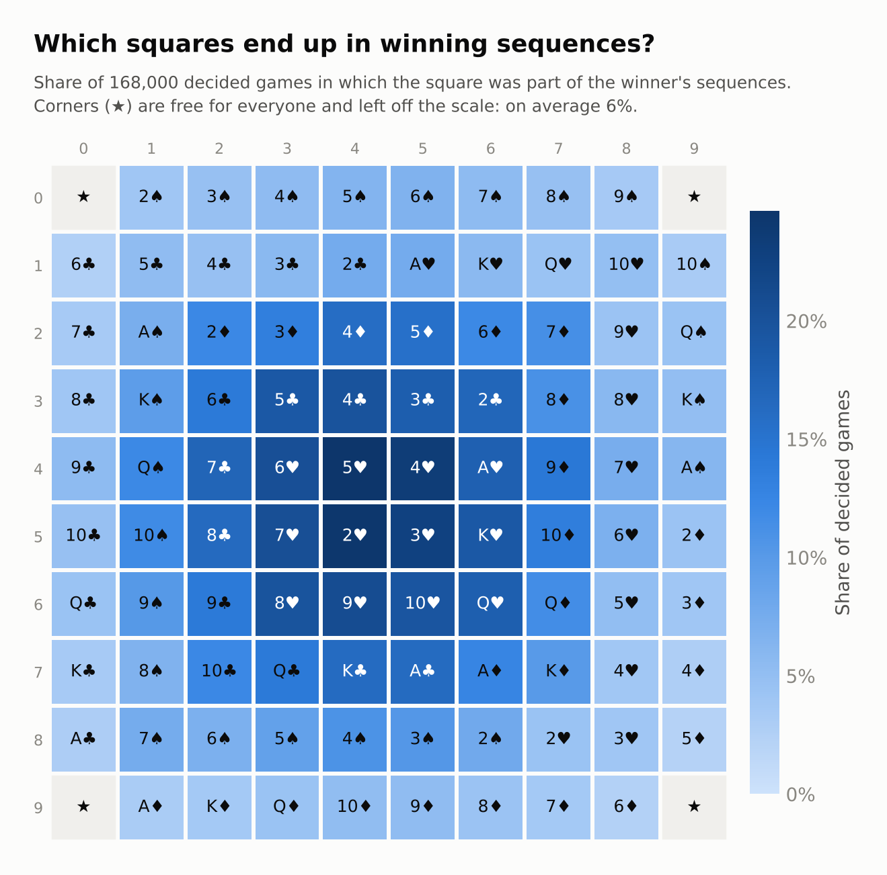

# Tournament summary

168,000 games between 7 bots (126,000 between different bots, 42,000 mirror matches). Draws: 0. Median game length: 53 turns (plies).

Settings: line values per bot (default), 2 sequences to win, first seed 500000, 3000 deals per pairing. Command: `python tournament.py --bots logit:lam=0.03 logit:lam=0.1 logit:lam=0.3 logit logit:lam=3 logit:lam=10 mixed_save --deals 3000 --seed 500000 --out results/sweep_lambda/games.csv.gz`

## Win-rate matrix

Row bot's win rate against the column bot, with the 95% margin. Margins come from paired deals (each deal is played once from each seat).

| bot \ opponent | logit:lam=0.03 | logit:lam=0.1 | logit:lam=0.3 | logit | logit:lam=3 | logit:lam=10 | mixed_save | avg vs field |
|---|---|---|---|---|---|---|---|---|
| **logit:lam=0.03** | – | 36.6% ±1.0 | 28.8% ±1.0 | 27.5% ±1.0 | 27.3% ±1.0 | 27.3% ±1.0 | 26.5% ±1.0 | 29.0% |
| **logit:lam=0.1** | 63.4% ±1.0 | – | 41.8% ±1.0 | 39.9% ±1.1 | 40.0% ±1.1 | 40.0% ±1.1 | 38.5% ±1.1 | 43.9% |
| **logit:lam=0.3** | 71.2% ±1.0 | 58.2% ±1.0 | – | 48.9% ±1.0 | 49.0% ±1.0 | 48.9% ±1.0 | 49.1% ±1.0 | 54.2% |
| **logit** | 72.5% ±1.0 | 60.1% ±1.1 | 51.1% ±1.0 | – | 49.8% ±0.7 | 49.7% ±0.7 | 49.5% ±0.8 | 55.5% |
| **logit:lam=3** | 72.8% ±1.0 | 60.0% ±1.1 | 51.0% ±1.0 | 50.2% ±0.7 | – | 50.0% ±0.3 | 49.8% ±0.7 | 55.6% |
| **logit:lam=10** | 72.7% ±1.0 | 60.0% ±1.1 | 51.1% ±1.0 | 50.3% ±0.7 | 50.0% ±0.3 | – | 49.6% ±0.6 | 55.6% |
| **mixed_save** | 73.5% ±1.0 | 61.5% ±1.1 | 50.9% ±1.0 | 50.4% ±0.8 | 50.2% ±0.7 | 50.4% ±0.6 | – | 56.2% |

Games per pairing: 6,000.

## Equilibrium of the meta-game

If each player secretly picks a bot, this mix of bots can't be exploited: no single bot wins more than 50% against it. The bootstrap redraws every win rate within its margin 500 times and re-solves, to show how stable the answer is. The last column is each bot's win rate against the equilibrium mix (Nash averaging, Balduzzi et al. 2018): unlike the average against the field, it can't be inflated by adding weak bots.

| bot | equilibrium weight | bootstrap 95% range | in the mix (share of resamples) | win rate vs the mix |
|---|---|---|---|---|
| logit:lam=0.03 | 0.0% | 0.0% – 0.0% | 0% | 26.5% |
| logit:lam=0.1 | 0.0% | 0.0% – 0.0% | 0% | 38.5% |
| logit:lam=0.3 | 0.0% | 0.0% – 0.0% | 2% | 49.1% |
| logit | 0.0% | 0.0% – 48.8% | 15% | 49.5% |
| logit:lam=3 | 0.0% | 0.0% – 100.0% | 32% | 49.8% |
| logit:lam=10 | 0.0% | 0.0% – 100.0% | 28% | 49.6% |
| mixed_save | 100.0% | 0.0% – 100.0% | 83% | 50.0% |

Game value: -0.0000 (a symmetric zero-sum game is worth 0).
Cross-check with nashpy's linear program: same mix, worst-case payoff +0.0000.

## Best responses

| against | best response | its win rate |
|---|---|---|
| logit:lam=0.03 | mixed_save | 73.5% |
| logit:lam=0.1 | mixed_save | 61.5% |
| logit:lam=0.3 | logit | 51.1% |
| logit | mixed_save | 50.4% |
| logit:lam=3 | mixed_save | 50.2% |
| logit:lam=10 | mixed_save | 50.4% |
| mixed_save | mixed_save | 50.0% |

11 of 21 pairings differ from 50% after a Holm correction for multiple comparisons.

Beats every other bot (Holm-corrected): none.
Rock-paper-scissors cycles (all three wins Holm-corrected): none.

## Skill ladder or cycles?

A rating per bot explains 99.9% of the variation in the win-rate matrix; the remaining 0.1% is cyclic (rock-paper-scissors). Rating = the bot's average edge over 50% across all bots, itself included.

| bot | rating |
|---|---|
| mixed_save | +5.3 points |
| logit:lam=3 | +4.8 points |
| logit:lam=10 | +4.8 points |
| logit | +4.7 points |
| logit:lam=0.3 | +3.6 points |
| logit:lam=0.1 | -5.2 points |
| logit:lam=0.03 | -18.0 points |

## Replicator dynamics

A population starts evenly split between the bots; each bot's share grows in proportion to how much better than average it does. Shares at t = 300:

| bot | start | end |
|---|---|---|
| logit:lam=0.03 | 14.3% | 0.0% |
| logit:lam=0.1 | 14.3% | 0.0% |
| logit:lam=0.3 | 14.3% | 1.2% |
| logit | 14.3% | 11.4% |
| logit:lam=3 | 14.3% | 21.7% |
| logit:lam=10 | 14.3% | 20.1% |
| mixed_save | 14.3% | 45.7% |

## Each strategy against mixed_save

mixed_save won the pilot, and each new idea is built on it, so this is what each idea adds (or costs). Significant = differs from 50% after the Holm correction.

| bot | win rate vs mixed_save | 95% margin | significant |
|---|---|---|---|
| logit:lam=3 | 49.8% | ±0.7 | no |
| logit:lam=10 | 49.6% | ±0.6 | no |
| logit | 49.5% | ±0.8 | no |
| logit:lam=0.3 | 49.1% | ±1.0 | no |
| logit:lam=0.1 | 38.5% | ±1.1 | yes |
| logit:lam=0.03 | 26.5% | ±1.0 | yes |

## First-move advantage

Win rate of the player who moves first. 50% means no advantage.

| games | first player wins | 95% range | games played |
|---|---|---|---|
| logit:lam=0.03 vs itself | 52.3% | 51.1% – 53.6% | 6,000 |
| logit:lam=0.1 vs itself | 53.6% | 52.3% – 54.9% | 6,000 |
| logit:lam=0.3 vs itself | 54.1% | 52.9% – 55.4% | 6,000 |
| logit vs itself | 53.3% | 52.1% – 54.6% | 6,000 |
| logit:lam=3 vs itself | 54.3% | 53.1% – 55.6% | 6,000 |
| logit:lam=10 vs itself | 54.0% | 52.8% – 55.3% | 6,000 |
| mixed_save vs itself | 53.4% | 52.2% – 54.7% | 6,000 |
| all other games | 53.7% | 53.4% – 54.0% | 126,000 |

## Game length

Median length in plies (one ply = one player's turn).

| bot | against other bots | mirror matches |
|---|---|---|
| logit:lam=0.03 | 53 | 57 |
| logit:lam=0.1 | 53 | 54 |
| logit:lam=0.3 | 52 | 52 |
| logit | 52 | 52 |
| logit:lam=3 | 52 | 52 |
| logit:lam=10 | 52 | 52 |
| mixed_save | 52 | 52 |

## Jack use

Average per game played.

What the Jacks achieved: the share of two-eyed Jacks that completed a sequence or blocked an opponent's four, and of one-eyed Jacks that broke an opponent's four.

| bot | two-eyed Jacks | finished a sequence | blocked a four | one-eyed Jacks | broke a four | dead cards traded |
|---|---|---|---|---|---|---|
| logit:lam=0.03 | 1.30 | 32.9% | 67.0% | 1.23 | 99.6% | 0.35 |
| logit:lam=0.1 | 1.28 | 40.8% | 59.2% | 1.20 | 99.5% | 0.33 |
| logit:lam=0.3 | 1.27 | 46.7% | 53.2% | 1.16 | 99.6% | 0.30 |
| logit | 1.27 | 48.2% | 51.7% | 1.15 | 99.4% | 0.32 |
| logit:lam=3 | 1.27 | 48.4% | 51.5% | 1.16 | 99.5% | 0.31 |
| logit:lam=10 | 1.27 | 48.4% | 51.6% | 1.15 | 99.5% | 0.32 |
| mixed_save | 1.26 | 48.6% | 51.3% | 1.15 | 99.5% | 0.30 |

## Squares that win games

Share of 168,000 decided games in which the square was part of the winner's sequences. The four corners (free spaces) average 5.9%. Central squares lie on more of the 192 lines (up to 20, against 3 for a corner), so part of this is geometry; the next section separates the two.

| rank | square | row, col | lines through it | share |
|---|---|---|---|---|
| 1 | 5♥ | 4, 4 | 20 | 24.6% |
| 2 | 2♥ | 5, 4 | 20 | 24.4% |
| 3 | 4♥ | 4, 5 | 20 | 23.4% |
| 4 | 3♥ | 5, 5 | 20 | 22.6% |
| 5 | 9♥ | 6, 4 | 17 | 20.9% |
| 6 | 7♥ | 5, 3 | 17 | 20.5% |
| 7 | 6♥ | 4, 3 | 17 | 20.5% |
| 8 | 4♣ | 3, 4 | 17 | 19.9% |
| 9 | 8♥ | 6, 3 | 15 | 19.8% |
| 10 | 10♥ | 6, 5 | 17 | 19.5% |

## Squares beyond geometry

Needs random-vs-random games (include `random` in the tournament) to separate strategy from geometry.

## Charts

