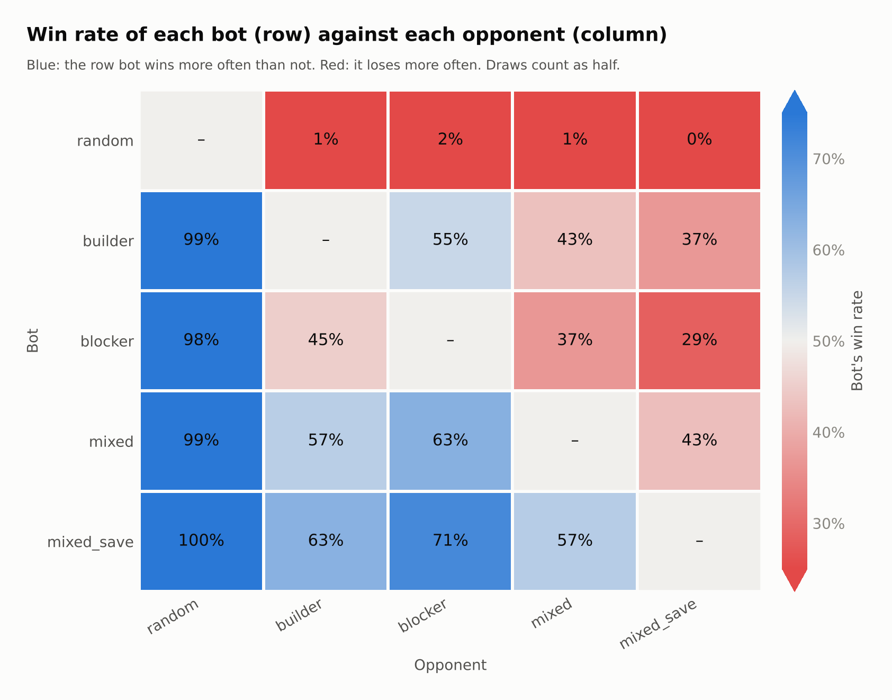
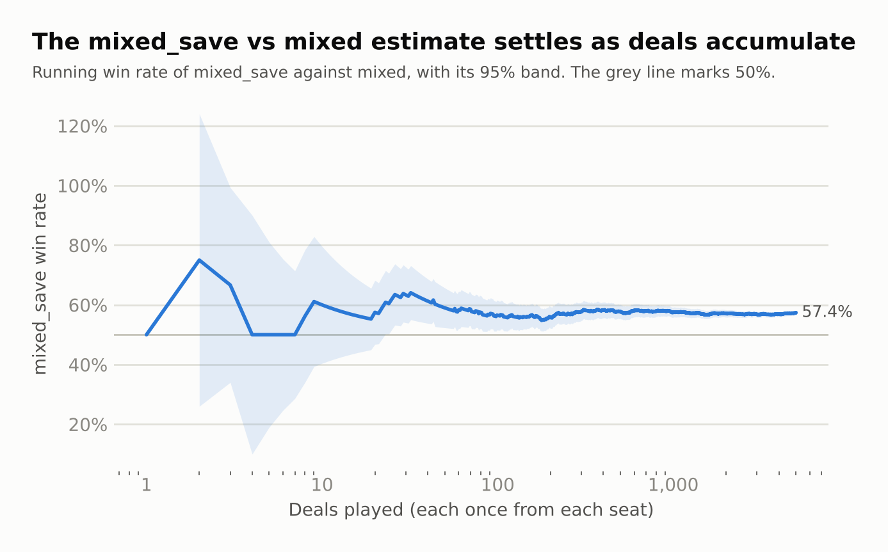
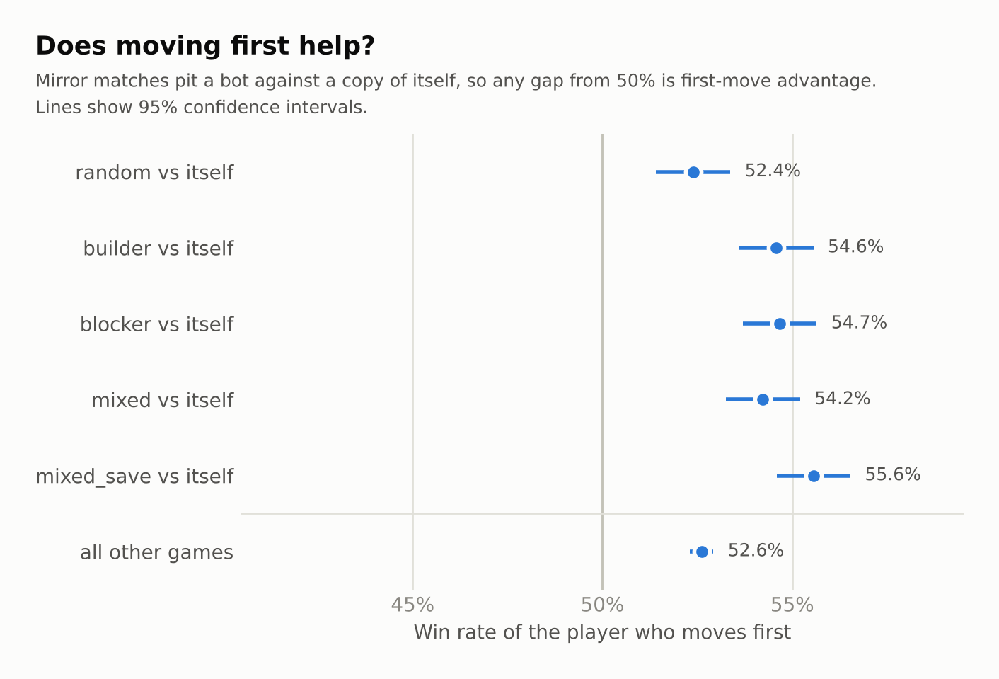
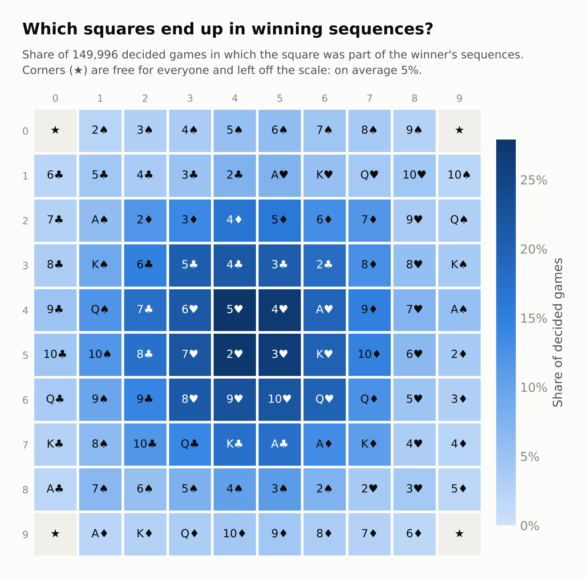
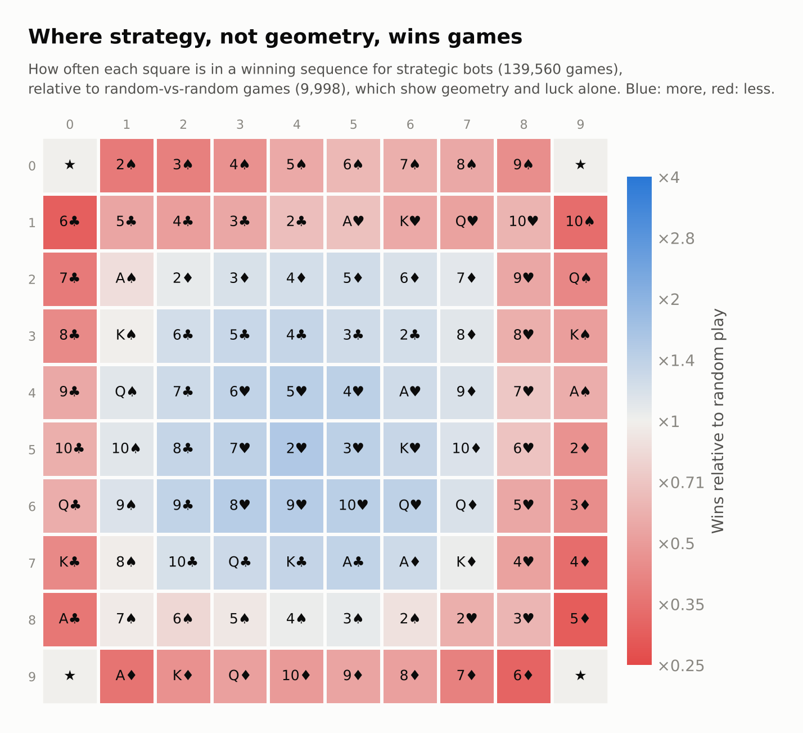

# Tournament summary

150,000 games between 5 bots (100,000 between different bots, 50,000 mirror matches). Draws: 4. Median game length: 53 turns (plies).

Settings: line values flat, 2 sequences to win, first seed 2026, 5000 deals per pairing. Command: `python tournament.py --roster pilot --values flat --deals 5000 --out results/values_flat/games.csv.gz`

## Win-rate matrix

Row bot's win rate against the column bot, with the 95% margin. Margins come from paired deals (each deal is played once from each seat).

| bot \ opponent | random | builder | blocker | mixed | mixed_save | avg vs field |
|---|---|---|---|---|---|---|
| **random** | – | 1.3% ±0.2 | 1.8% ±0.3 | 0.9% ±0.2 | 0.4% ±0.1 | 1.1% |
| **builder** | 98.7% ±0.2 | – | 54.9% ±0.9 | 43.0% ±0.8 | 37.0% ±0.8 | 58.4% |
| **blocker** | 98.2% ±0.3 | 45.1% ±0.9 | – | 36.7% ±0.8 | 28.5% ±0.8 | 52.1% |
| **mixed** | 99.1% ±0.2 | 57.0% ±0.8 | 63.3% ±0.8 | – | 42.6% ±0.8 | 65.5% |
| **mixed_save** | 99.6% ±0.1 | 63.0% ±0.8 | 71.5% ±0.8 | 57.4% ±0.8 | – | 72.9% |

Games per pairing: 10,000.

## Equilibrium of the meta-game

If each player secretly picks a bot, this mix of bots can't be exploited: no single bot wins more than 50% against it. The bootstrap redraws every win rate within its margin 500 times and re-solves, to show how stable the answer is. The last column is each bot's win rate against the equilibrium mix (Nash averaging, Balduzzi et al. 2018): unlike the average against the field, it can't be inflated by adding weak bots.

| bot | equilibrium weight | bootstrap 95% range | in the mix (share of resamples) | win rate vs the mix |
|---|---|---|---|---|
| random | 0.0% | 0.0% – 0.0% | 0% | 0.4% |
| builder | 0.0% | 0.0% – 0.0% | 0% | 37.0% |
| blocker | 0.0% | 0.0% – 0.0% | 0% | 28.5% |
| mixed | 0.0% | 0.0% – 0.0% | 0% | 42.6% |
| mixed_save | 100.0% | 100.0% – 100.0% | 100% | 50.0% |

Game value: -0.0000 (a symmetric zero-sum game is worth 0).
Cross-check with nashpy's linear program: same mix, worst-case payoff +0.0000.

## Best responses

| against | best response | its win rate |
|---|---|---|
| random | mixed_save | 99.6% |
| builder | mixed_save | 63.0% |
| blocker | mixed_save | 71.5% |
| mixed | mixed_save | 57.4% |
| mixed_save | mixed_save | 50.0% |

10 of 10 pairings differ from 50% after a Holm correction for multiple comparisons.

Beats every other bot (Holm-corrected): mixed_save.
Rock-paper-scissors cycles (all three wins Holm-corrected): none.

## Skill ladder or cycles?

A rating per bot explains 98.4% of the variation in the win-rate matrix; the remaining 1.6% is cyclic (rock-paper-scissors). Rating = the bot's average edge over 50% across all bots, itself included.

| bot | rating |
|---|---|
| mixed_save | +18.3 points |
| mixed | +12.4 points |
| builder | +6.7 points |
| blocker | +1.7 points |
| random | -39.1 points |

## Replicator dynamics

A population starts evenly split between the bots; each bot's share grows in proportion to how much better than average it does. Shares at t = 300:

| bot | start | end |
|---|---|---|
| random | 20.0% | 0.0% |
| builder | 20.0% | 0.0% |
| blocker | 20.0% | 0.0% |
| mixed | 20.0% | 0.0% |
| mixed_save | 20.0% | 100.0% |

## Each strategy against mixed_save

mixed_save won the pilot, and each new idea is built on it, so this is what each idea adds (or costs). Significant = differs from 50% after the Holm correction.

| bot | win rate vs mixed_save | 95% margin | significant |
|---|---|---|---|
| mixed | 42.6% | ±0.8 | yes |
| builder | 37.0% | ±0.8 | yes |
| blocker | 28.5% | ±0.8 | yes |
| random | 0.4% | ±0.1 | yes |

## Jack timing

Each variant differs from mixed only in when it plays Jacks. Win rate against mixed:

| variant | win rate vs mixed | 95% margin |
|---|---|---|
| mixed_save | 57.4% | ±0.8 |

## First-move advantage

Win rate of the player who moves first. 50% means no advantage.

| games | first player wins | 95% range | games played |
|---|---|---|---|
| random vs itself | 52.4% | 51.4% – 53.4% | 10,000 |
| builder vs itself | 54.6% | 53.6% – 55.6% | 10,000 |
| blocker vs itself | 54.7% | 53.7% – 55.6% | 10,000 |
| mixed vs itself | 54.2% | 53.3% – 55.2% | 10,000 |
| mixed_save vs itself | 55.6% | 54.6% – 56.5% | 10,000 |
| all other games | 52.6% | 52.3% – 52.9% | 100,000 |

## Game length

Median length in plies (one ply = one player's turn).

| bot | against other bots | mirror matches |
|---|---|---|
| random | 51 | 80 |
| builder | 48 | 43 |
| blocker | 57 | 67 |
| mixed | 51 | 52 |
| mixed_save | 50 | 55 |

## Jack use

Average per game played.

What the Jacks achieved: the share of two-eyed Jacks that completed a sequence or blocked an opponent's four, and of one-eyed Jacks that broke an opponent's four.

| bot | two-eyed Jacks | finished a sequence | blocked a four | one-eyed Jacks | broke a four | dead cards traded |
|---|---|---|---|---|---|---|
| random | 1.19 | 2.0% | 3.3% | 1.14 | 20.0% | 0.82 |
| builder | 1.17 | 37.8% | 0.7% | 1.10 | 19.2% | 0.15 |
| blocker | 1.46 | 22.9% | 16.1% | 1.42 | 26.5% | 1.04 |
| mixed | 1.29 | 32.9% | 10.7% | 1.23 | 23.3% | 0.30 |
| mixed_save | 1.28 | 56.8% | 43.1% | 1.04 | 98.9% | 0.43 |

## Squares that win games

Share of 149,996 decided games in which the square was part of the winner's sequences. The four corners (free spaces) average 4.7%. Central squares lie on more of the 192 lines (up to 20, against 3 for a corner), so part of this is geometry; the next section separates the two.

| rank | square | row, col | lines through it | share |
|---|---|---|---|---|
| 1 | 5♥ | 4, 4 | 20 | 27.9% |
| 2 | 2♥ | 5, 4 | 20 | 27.5% |
| 3 | 4♥ | 4, 5 | 20 | 27.2% |
| 4 | 3♥ | 5, 5 | 20 | 26.6% |
| 5 | 9♥ | 6, 4 | 17 | 22.7% |
| 6 | 7♥ | 5, 3 | 17 | 22.2% |
| 7 | 10♥ | 6, 5 | 17 | 22.1% |
| 8 | 4♣ | 3, 4 | 17 | 21.5% |
| 9 | 6♥ | 4, 3 | 17 | 21.4% |
| 10 | 8♥ | 6, 3 | 15 | 21.3% |

## Squares beyond geometry

Random-vs-random games (9,998) show what geometry and luck alone produce. Lift = a square's share among strategic bots' wins (139,560 games) divided by its share under random play; above 1, strategy uses the square more than geometry predicts.

|  | square | row, col | lift |
|---|---|---|---|
| most | 2♥ | 5, 4 | ×1.56 |
| most | 9♥ | 6, 4 | ×1.50 |
| most | 8♥ | 6, 3 | ×1.48 |
| most | 10♥ | 6, 5 | ×1.46 |
| most | 5♥ | 4, 4 | ×1.45 |
| least | 10♠ | 1, 9 | ×0.34 |
| least | 4♦ | 7, 9 | ×0.34 |
| least | 6♦ | 9, 8 | ×0.31 |
| least | 6♣ | 1, 0 | ×0.30 |
| least | 5♦ | 8, 9 | ×0.30 |

## Charts

